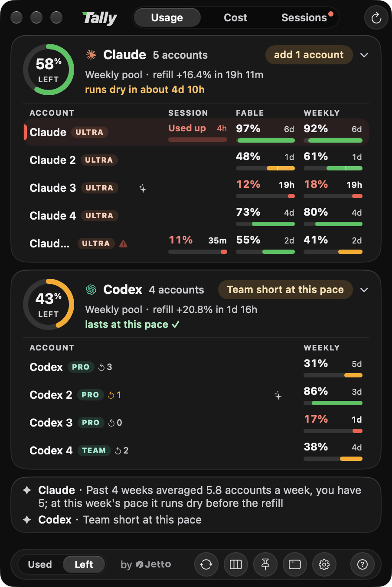
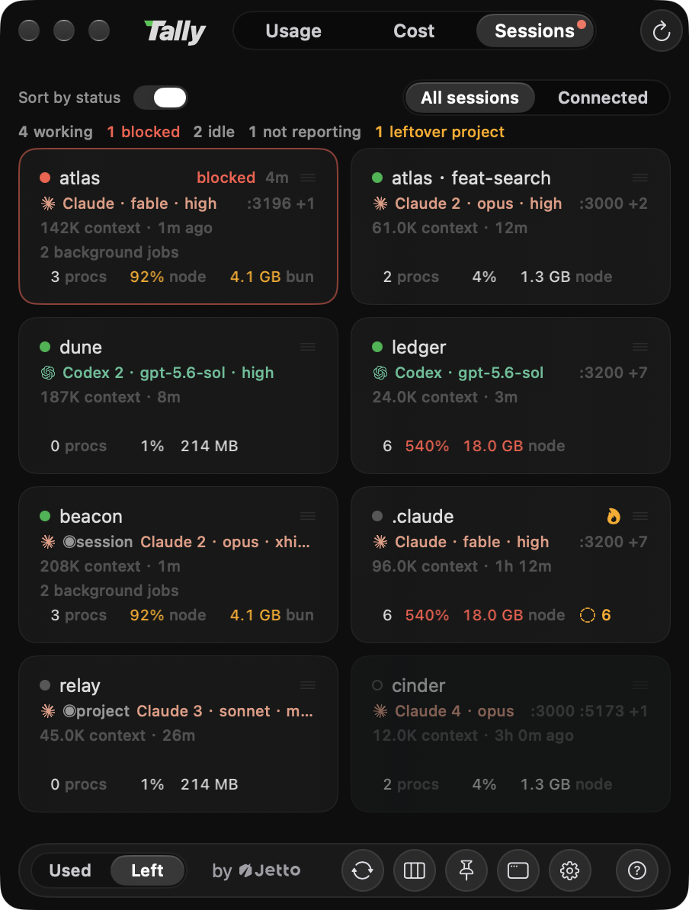
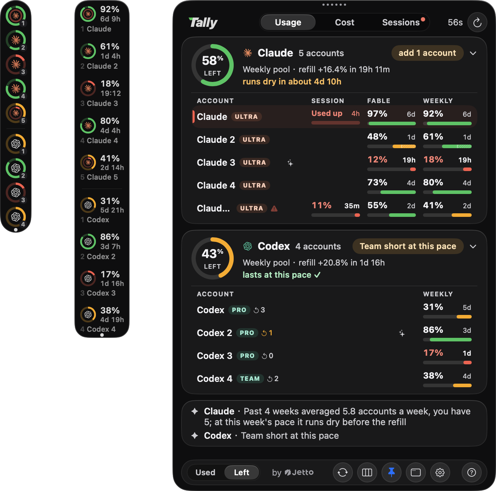
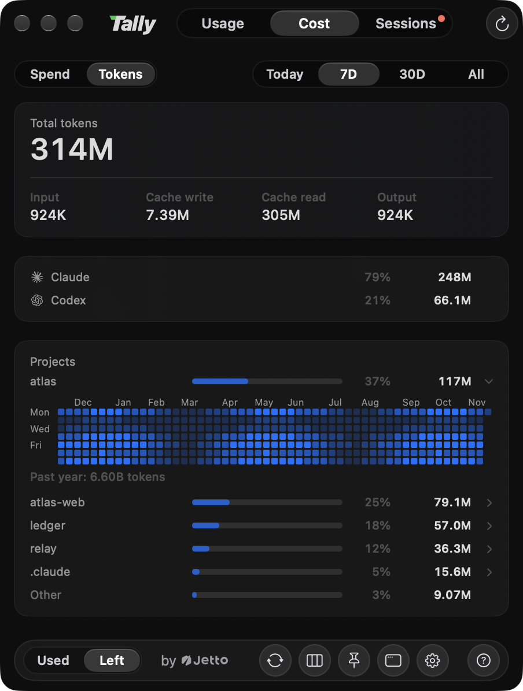
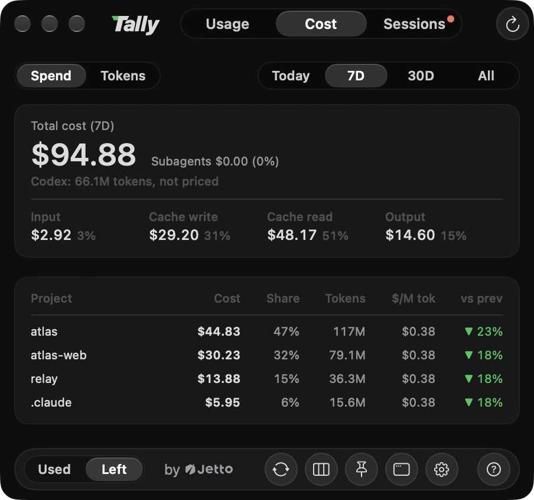
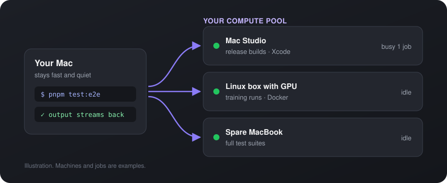

<p align="right"><a href="README.md">English</a> · <a href="README.zh-TW.md">繁體中文</a> · <a href="README.zh-CN.md">简体中文</a> · <b>日本語</b> · <a href="README.ko.md">한국어</a></p>

<p align="center">
  <a href="https://github.com/jettoai/tally/releases/latest"></a>
</p>
<h1 align="center">Tally</h1>

<h3 align="center">支払っている Claude と Codex のサブスクリプションを、すべてひと目で。</h3>

<p align="center">無料のオープンソース macOS メニューバーアプリです。すべてのアカウントの 5 時間・週間・フラッグシップモデルの使用上限を横並びで表示し、新しいセッションをいちばん余裕のあるアカウントで開始します。<br>読み取り専用で、自分で契約した有料サブスクリプションのみが対象です。</p>

<p align="center">
  <a href="https://github.com/jettoai/tally/releases/latest/download/Tally.dmg"></a>
  <br><sub><a href="#インストール">そのほかのインストール方法</a> · <a href="https://github.com/jettoai/tally/releases">リリースノート</a></sub>
</p>

<p align="center">
  <a href="https://github.com/jettoai/tally/releases/latest"></a>
  
  
</p>

<p align="center">
  
</p>

## すべてのアカウントをひと目で

Claude と Codex のログインはそれぞれ 1 行になり、5 時間・毎週・最上位モデルの窓を表示します。さらにアカウントプールが同じプロバイダのアカウントを 1 つの予算にまとめ、今のペースでいつ尽きるかを予測します（「約 4d 10h で尽きる」）。メニューバーは何も開かずに同じプールを表示します：プロバイダごと（またはプランごと）に 1 つのリングで、毎週の残りの割合まで塗られます。設定でオンにすると、5 時間枠を示す細い内側のリングが加わります。

<p align="center">
  
</p>

## 新しいセッションは、いちばん余裕のあるアカウントから

`tally claude`（または `tally codex`）は、残りクォータとリセット時刻を見比べてアカウントを選びます。アカウントが上限に達すると、Tally は次のアカウントで*同じ会話*を再開します。`/clear` のたびに、無料で乗り換える機会があります。あなたや AI エージェントが外から `tally session clear` でセッションをクリアすることもでき、新しい空のウィンドウはいちばん余裕のあるアカウントで開きます。

```sh
tally claude          # 今いちばん良いアカウントで起動
tally codex           # Codex も同様
```

## すべてのセッションを 1 枚のボードで

Tally が起動した会話はそれぞれカードになります：アカウント、モデル、コンテキストサイズ、そして作業中か、アイドルか、**あなたの返事を待ってブロック中**か。どれかが許可を求めているとメニューバーの赤い点で分かり、各カードはそのセッションがマシンにどれだけ負担をかけているか（CPU、メモリ、掴んでいるポート）を示します。これらの数値は macOS カーネルから直接読み取っており、`ps` や `top` のプロセスを別に起動することはありません。

<p align="center">
  
</p>

## インストール

次の文章を AI エージェントに貼り付けてください。Tally をインストールし、結果まで見せてくれます。

```text
Download https://github.com/jettoai/tally/releases/latest/download/Tally.dmg,
copy Tally.app from it into /Applications and launch it. If macOS blocks the
app, stop and tell me to open it once from Finder. Then create /usr/local/bin if
it is missing and link the bundled CLI onto my PATH with
`ln -s /Applications/Tally.app/Contents/Helpers/tally /usr/local/bin/tally`,
trying it without a password first. If that needs my password, do not force it:
give me this one line to paste instead:
`sudo mkdir -p /usr/local/bin && sudo ln -s /Applications/Tally.app/Contents/Helpers/tally /usr/local/bin/tally`
After I paste it, wait about 10 seconds, run `tally` and show me the result. If
it shows no accounts, tell me to sign in to Claude or Codex first.
```

または自分でインストールする場合：

```sh
curl -fsSLO https://github.com/jettoai/tally/releases/latest/download/Tally.dmg && open Tally.dmg
```

または [DMG を直接ダウンロード](https://github.com/jettoai/tally/releases/latest/download/Tally.dmg)し、**Tally.app** をアプリケーションフォルダへドラッグして起動してください。公証済みで、アプリ内で自動的にアップデートされます。続いて **設定 → 連携 → すべてインストール** を押せば、`tally` CLI、status line シグナル、Claude Code スキルがワンクリックで追加されます。[そのほかのインストール方法](#インストール方法)。

## パネルをピン留め

ダッシュボードを常に最前面のすりガラスパネルとしてピン留めし、ドラッグして好きな場所へ置けます。形は3種類から選べます。リングだけの形、ラベル付きの細いストリップ、フル表示のフローティングパネルです。ストリップではポインターを重ねると閉じるボタンが現れ、右クリックでピン留めの解除、形、向きを選べます。アカウントのカードはパネルの背景の上にガラスとして描かれます。

<p align="center">
  
</p>

## トークンの行き先を見る

プロジェクトごとのトークンと定価ベースの支出を、各 CLI 自身のローカルトランスクリプトから読み取ります。データが Mac の外へ出ることはなく、`tally cost --json` は同じ数字をスクリプトに渡します。

<p align="center">
  
</p>

<details>
<summary>支出ページ</summary>

支出ページ（タブを開いたときに最初に出るページ）は、そのトークンを金額に換算します：プロジェクトごとの Claude の使用量を Anthropic の定価で計算し、合計を入力、キャッシュ書込、キャッシュ読込、出力に分けて示します。Codex のトークンも集計しますが、Tally が信頼できる価格表がないため金額には換算しません。`tally cost --json` を使えば、同じ数字をスクリプトから受け取れます。

<p align="center">
  
</p>

</details>

## 読み取り専用、あなた自身の有料サブスクリプションで

- 使用量は公式の `claude` と `codex` CLI（`claude -p "/usage"` と `codex app-server`）を通じて読み取るので、渡すべきセッションキーやブラウザの Cookie はありません。
- Tally はアクセスのプロキシ、共有、転売を一切行わず、トークンをログに残すことも送信することもありません。
- Electron を使わない単一のネイティブ Swift アプリで、会話ログを読み取るコアは Rust で書かれています。

<details>
<summary>仕組み（そして決してしないこと）：すべての読み取りと、名前を挙げた少数の書き込み</summary>

- **公式 CLI 経由で使用量を取得。** 使用量は各プロバイダの**公式 CLI**
  （`claude -p "/usage"` と `codex app-server`）を通じて読み取ります。公式クライアントが
  プロバイダとの認証と認証情報の管理を担い、アカウント検出ではログインの属性を確認します。
  読み取り専用の例外として、Claude のログイン期限を取得するために、Tally は Keychain 内の
  ローカル認証情報ドキュメントを一時的に読み取ります。Keychain 項目が存在しない場合は
  `.credentials.json` から `refreshTokenExpiresAt` を取得します。このリーダーが外部に返すのは
  日付のみで、トークンのログ出力、永続保存、送信、ログインの更新、認証情報の変更は行いません。
- **読み取り専用、ただし明示された例外が 1 つ。** `claude auth login` は OAuth のやり取りを
  終えるとそこで止まるため、Tally が作成してサインインまで済ませた config home も、
  最初のセッションでは初回起動ウィザード（テーマ選択と、たった今サインインしたばかりの
  アカウントへのサインイン要求）に出会うことになります。そこで Tally 自身が行った
  サインインの後（アカウントの追加、またはカードからの更新）、Claude Code 自身が
  「ウィザードは完了した」と記録するフィールド `hasCompletedOnboarding` を、その home の
  状態ファイルにマージします。Tally が新規作成する home には、既存アカウントですでに
  答えたフォルダ信頼の回答もあらかじめ入れておきます。あくまでマージであって置き換えでは
  なく、解析できないファイルは書き換えずに拒否し、ウィザードを終えた home はバイト単位で
  そのまま残します。資格情報には決して触れず、他の home をスキャンして修復することも
  決してありません。
- **用途が一つだけの、任意の root ヘルパー。** `fseventsd` のようなプロセスが CPU を使い切り続けると、
  Tally は `~/.tally/logs/process-forensics/` に証拠ファイルを残します。root 所有のプロセスの
  `sample` と `fs_usage` を取るには root 権限が必要なので、設定画面（または `tally forensics setup`）から
  ヘルパーを一度だけインストールできます。実行するのはシステム自身のパスワードウインドウで、
  Tally はパスワードを見ません。書き込む root 所有のファイルは
  `/Library/PrivilegedHelperTools/ai.jetto.tally.forensics` と `/etc/sudoers.d/tally-forensics` の 2 つだけです。
  ヘルパーが受け取るのはプロセス番号 1 つで、実行するのはその 2 つの読み取り専用ツールだけです。
  設定するまでは無効で、`tally forensics remove`（または設定画面の「削除」ボタン）で 2 つとも消えます。
- **ポーリングは常にひとつ。** CLI を実行するのはメニューバーアプリだけです（デフォルト
  1 分間隔、2／5／15 分に緩和可能）。`tally` ランチャーはローカルのスナップショット
  （`~/.tally/snapshot.json`：パーセンテージとパスのみ、トークンは決して含まない）を
  読むだけなので、ターミナルを 10 個開いても追加の読み取りはゼロです。
- **自分のアカウントだけ。** マルチアカウントとは、*あなた自身*が支払い、*あなたの*マシン上に
  あるサブスクリプションのことです。Tally はアクセスのプロキシも、共有も、転売も
  しません。アカウント切り替えは、あなたがすでに所有している config ディレクトリで公式 CLI を
  起動するだけです。
- **ローカル中心、エラーレポートは任意で既定オフ。** 使用量の読み取り、下記の匿名の利用状況、
  そして設定で「クラッシュとエラーのレポートを送信」をオンにした場合に Sentry へ送る
  エラーレポート以外、何もマシンの外へ出ません。レポートに含まれるのはスタックトレース、
  アプリと macOS のバージョン、Mac の機種、言語とタイムゾーン、接続から Sentry が推定する
  おおよその地域で、IP アドレス、アカウント、使用量の数値、ファイルの内容は決して含まれません。同じ場所でいつでもオフにできます。
- **匿名の利用状況、既定でオン。** Tally の起動時と、実行中はおよそ 1 日 1 回、ランダムなデバイス ID、
  アプリのバージョン、ビルドの種類（Tally または Tally Pro）を jetto.ai に送り、インストール数と
  利用者数の集計に使います。アカウント、使用量の数値、プロジェクト名、ファイルの内容は送りません。
  通常の Web リクエストと同じく、サーバーには IP アドレスと標準の User-Agent ヘッダーが届きます。
  設定 > 情報 の「匿名の利用状況を送信」をオフにすると、それ以降は何も送信されません。
- **連携のための小さな API。** ダッシュボードやスクリプトは `tally` CLI を通じて Tally と
  やり取りします。接続するソケットやサーバーはありません。
  - `tally status --json` は読み取り側です。各アカウントの残りのウィンドウとリセット時刻に
    加えて `sessions` を返します。これは監督対象のセッション 1 つにつき 1 件で、`pid`、
    `project`、`state`、`model`、`effort`、`taskList`（書き込み先のタスクリスト）を含みます。
    レポートには `"version": 1` が付き、追加のみです。後のバージョンでフィールドが増えることは
    ありますが、既存のフィールドが消えたり意味が変わったりすることはありません。
  - `tally session send <text> --session <pid>` はそのセッションに 1 行を入力して Return を
    押します。`tally message claude|codex <text> --session <pid>` は、キーを押さずに
    セッション自身のトランスポートへメッセージを渡します。

</details>

## 機能

すべての機能を 1 行ずつ並べた地図です。詳しい解説は [docs/features.ja.md](docs/features.ja.md) にあります。

| 場所 | 得られるもの |
|---|---|
| [ダッシュボード](docs/features.ja.md#ダッシュボード) | アカウントプールと予測、使用量アドバイザー、メニューバー表示、ピン留めできるガラスパネル、カードとリストの密度、プロジェクト別のトークン使用量、リセット時刻、ログイン状態、Codex のリセットバンキング |
| [セッションボード](docs/features.ja.md#セッションボード) | 会話ごとに 1 枚のカード、ブロック状態、赤い点、セッションごとの CPU とメモリ |
| [起動コントロールプレーン](docs/features.ja.md#起動コントロールプレーン) | スマート選択、上限ハンドオフ、`/clear` での引っ越し、早めのスタート、`tally type`、worktree、リロード、そして `tally` CLI（`tally status --json` を含む）、status line、Claude Code スキル、シェルシム、Harness ツール |
| [見た目と作り](docs/features.ja.md#見た目と作り) | 6 つのアプリ言語、ネイティブ Swift、サードパーティ依存は 1 つだけ |

## 近日公開：Tally Pro コンピュートプール

この Mac がテストスイートを回している間も、あなたの他の Mac や Linux マシンは遊んでいます。Tally Pro は重い処理（フルテストスイート、リリースビルド、学習ジョブ）をあなた自身の他のマシンへ自動で送り、出力をストリーミングで返します。いま入力している Mac は軽快なままです。

<p align="center">
  
</p>

<p align="center"><sub>リリースを知りたい方は、このリポジトリを Watch してください。</sub></p>

## FAQ

<details>
<summary>macOS のメニューバーで、複数の Claude Max アカウントの使用上限を見るには？</summary>

各アカウントを、それぞれ別の設定ディレクトリで Claude Code にサインインさせます（例：
`CLAUDE_CONFIG_DIR=~/.claude2 claude` を実行してログイン）。Tally は `~/.claude*` のログインと
Codex のインストールをすべて見つけ、各アカウントの 5 時間・週間・フラッグシップモデルのウィンドウを
1 行ずつ表示し、プロバイダごとのアカウントを 1 つの予算にまとめてメニューバーに出します。

</details>

<details>
<summary>Tally はプロキシ、またはアカウント共有ツールですか？</summary>

いいえ。Tally は Claude Code と Anthropic の間に入らず、アクセスのプロキシ、共有、転売も行いません。
各アカウントの使用量は公式 CLI 経由で読み取り、`tally claude` は最も余裕のあるアカウントの設定
ディレクトリで公式 CLI を起動します。どのアカウントも、あなた自身の Mac 上の、あなた自身の
有料サブスクリプションです。

</details>

<details>
<summary>Tally は ccusage や他の使用量トラッカーと何が違うの？</summary>

[ccusage](https://github.com/ryoppippi/ccusage) のようなツールはターミナル CLI で、ローカル
ログからトークン支出を推定します。Tally はネイティブのメニューバーアプリで、ベンダーが実際に
適用するクォータウィンドウ（5 時間、週間、フラッグシップモデル）をすべての Claude / Codex
アカウントについて同時に表示し、その数字に基づいて動くランチャーも備えています。トークンビューは「どれだけ使ったのか、何に使ったのか」
という問いにも、プロジェクト単位で、ローカルのトランスクリプトから直接答えます。金額の推測は
しません。そしてセッションボードは、ccusage や他の使用量メーターよりも一段深く踏み込みます。動いているセッションが
1 枚ずつカードになり、どれがあなたを待って止まっているのか、それぞれがマシンにどれだけ負担を
かけているのかが、メモリを抱えているプロセスまで分かります。読み取り専用で、自分で契約した
有料サブスクリプションのみが対象です。

</details>

<details>
<summary>Tally は CodexBar、Claude Usage Tracker、Usage4Claude と何が違いますか？</summary>

2026 年 10 月時点で、これらはいずれもネイティブのメニューバーメーターで、複数アカウントに対応した
ものもあります。Tally が加えているのは次の点です。使用量は公式の `claude` と `codex` CLI だけを通して
読み取るので、セッションキーやブラウザの Cookie を渡す必要がありません。プロバイダごとのアカウントを
1 つの予算にまとめ、今のペースでいつ尽きるかを予測します。そして `tally claude` は、残りクォータと
リセット時刻から新しいセッションのアカウントを選び、あるアカウントが上限に達したら次のアカウントで
同じ会話を再開します。CodexBar は対応プロバイダが多く（Cursor、Copilot、Gemini など）、1 つの
アカウントを多くの AI ツールで使う方には、そちらが合うかもしれません。

</details>

<details>
<summary>Tally は Keychain にどのようにアクセスしますか？</summary>

使用量は公式 CLI 経由で取得し、アカウント検出では属性のみを確認します。Claude のログイン期限
リーダーは認証情報ドキュメントも読み取りますが、事前確認で Keychain のロックを検出した場合や、
リーダーが信頼されていると確認できない場合はアクセスを省略し、期限は不明のままにします。
確認から読み取りまでの間に Keychain の状態が変わることがあるため、許可ダイアログが表示される
可能性はあります。ログインは引き続き公式 CLI が行い、Tally のログイン処理は認証情報を直接変更しません。

</details>

<details>
<summary>すべてのアカウントが上限に達したら？</summary>

劇的なことは起きません。ダッシュボードはそのまま表示し、`tally claude` は警告して素の
CLI を起動し、自動ハンドオフはループせずその場に留まります。

</details>

<details>
<summary>自動ハンドオフで会話は失われない？</summary>

失われません。次のアカウントで同じセッションの記録を再開します（追記のみ。元の記録が
変更されることはありません）。中断されたツール呼び出しは、切り替え後に一度だけ再実行される
ことがあります。

</details>

<details>
<summary>status line 統合はカスタム status line を壊しませんか？</summary>

壊しません。あなた自身のコマンドは同じ session JSON を受け取ったまま、これまでどおり
実行され続けます。Tally はそこにシグナルを追記するだけで、すでにアカウント名を表示
している場合はその部分を省略します。削除時にはバイト単位で元の登録に復元され、万一
tally バイナリが消えていても、あなたのコマンドを直接実行する形にフォールバックします。

</details>

## 動作要件

- macOS 14+
- [Claude Code](https://claude.com/claude-code) および／または Codex CLI（`~/.codex`）。この Mac
  にどちらもまだ入っていなければ、Tally を初めて開いたときのウィンドウがどちらかをインストールし、
  ログインまで案内します。
- 2 つ目の Claude アカウント：**設定 → アカウント → アカウントを追加**。（上級者向け：実体は config
  ディレクトリを 1 つ増やすだけなので、`CLAUDE_CONFIG_DIR=~/.claude2 claude` を実行してログインする方法でも追加できます。）

## インストール方法

[Releases](https://github.com/jettoai/tally/releases/latest) から最新の公証済み DMG を
ダウンロードし、**Tally.app** をアプリケーションフォルダへドラッグして起動してください。
以降のアップデートはアプリ内で自動的に届きます。

`tally` CLI を使うには、アプリに同梱されたバイナリを PATH にリンクします。新しい Mac では `/usr/local/bin` が存在しない場合があるため、管理者パスワードが必要です：

```sh
sudo mkdir -p /usr/local/bin && sudo ln -s /Applications/Tally.app/Contents/Helpers/tally /usr/local/bin/tally
```

<details>
<summary>ソースからビルドする場合</summary>

```sh
brew install xcodegen   # 初回のみ
git clone https://github.com/jettoai/tally && cd tally
xcodegen generate
xcodebuild build -project Tally.xcodeproj -scheme Tally -configuration Release -destination 'platform=macOS'
xcodebuild build -project Tally.xcodeproj -scheme TallyCLI -configuration Release -destination 'platform=macOS'
```

`Tally.app` を DerivedData からアプリケーションフォルダへ移動し、`tally` バイナリを
PATH に置きます：

```sh
ln -s <build-products>/tally /usr/local/bin/tally
```

</details>

シンボリックリンクを使わない方法もあります。**設定 → Integrations**
では各項目をワンクリックでインストールでき、削除もきれいに行えます。まとめて扱う
「すべてインストール」スイッチも上にあります：CLI ツール、shell シム（裸の `claude` /
`codex` もポリシーに従うようにする）、status line シグナル、セッションボードの通知フック、
サブエージェント数のフック、クォータ警告のフック、そして `/tally` コマンド付きの
Claude Code スキル。フックの行はどれも同じ約束を守ります：そのイベントに
すでに登録していたものはそのまま動き続け、削除で外れるのは Tally 自身のエントリだけです。
既存アカウントを共有の一式に載せる行もここにありますが、「すべてインストール」からは
意図的に外してあります。これは config home の間で会話を移動させる操作であり、「全部オンに
する」という意味の一押しが、それも意味するとは限らないからです。

シムと `tally claude` の違い：設定のシムを入れ、Claude の「起動アカウント」を「オフ」以外にしておけば、`claude` をそのまま打っても起動前にアカウントが選ばれます。`tally claude`（下の `c` と `cc`）は、シムにはできないことをさらに二つこなします：アカウントが使用量の上限に達すると、会話が自動で別のアカウントに引き継がれます。まだどのアカウントにも余裕がなければ、その場で待って 15 秒ごとに再試行します。また `--continue` は、このディレクトリで Tally が最後に見ていた会話、つまり直近に `tally claude` で動かした会話を ID で開き直します。その記録がない場合や、その会話がもう残っていない場合に限り、開き方を問わずディレクトリ内でいちばん新しい会話に切り替えます。

お好みで shell エイリアスも：

```sh
alias c='tally claude'
alias cc='tally claude --continue'
```

## ローカライズ

Tally は English、繁體中文、简体中文、日本語、한국어、Türkçe の 6 言語を同梱し、設定から再起動なしで即時に切り替えられます。すべての文字列はひとつの Xcode String Catalog
（[`Tally/Resources/Localizable.xcstrings`](Tally/Resources/Localizable.xcstrings)）にあります。言語を追加するには、カタログの列を埋め、そのコードを `AppLocale.supported` と `project.yml` に登録し、設定の言語ピッカーにその言語のネイティブ名を追加します。基準は「翻訳ではなく
OS のネイティブ文言のように読めること」。既存言語の修正も新しい言語と同じく歓迎します。

## コントリビュート

Issue と Pull Request を歓迎します。ビルド環境は上の「ソースからビルドする場合」を
参照してください。プロジェクトを健全に保つ約束事が二つあります：

- `project.yml` が唯一の情報源です。`Tally.xcodeproj` は XcodeGen が生成するもので、
  手で編集しません。
- ユーザーに見える文字列は必ず `L("…")` ヘルパー経由で String Catalog に入れ、
  6 言語すべてを埋めます。

PR はひとつの意図に絞り、「なぜ」を説明に書いてください。

## 謝辞

Tally は、この分野を切り拓いた優れたプロジェクトの道の上にあります：

- [ccusage](https://github.com/ryoppippi/ccusage)：Claude Code のローカルログを使用量の
  洞察に変えた先駆けであり、開発者がどれほど自分の数字を見たいかを示しました。
- [OpenUsage](https://github.com/robinebers/openusage) と
  [AIUsage](https://github.com/sylearn/AIUsage)：メニューバーで一目で分かる使用量メーター
  という形を確立しました。Tally は、その一目を複数アカウントに同時に向けたくて生まれました。
- [Sparkle](https://sparkle-project.org)：アプリ内アップデートを支えています。

## ライセンス

[MIT](LICENSE) © [jetto](https://jetto.ai)

<p align="center"><sub>無料のオープンソース · <a href="https://jetto.ai">Jetto</a> 製 · Claude と Codex のレート制限を監視する macOS メニューバーの AI 使用量モニター</sub></p>
