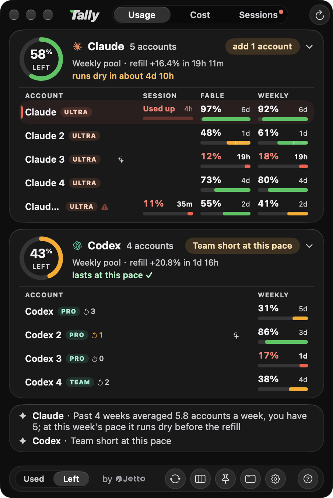
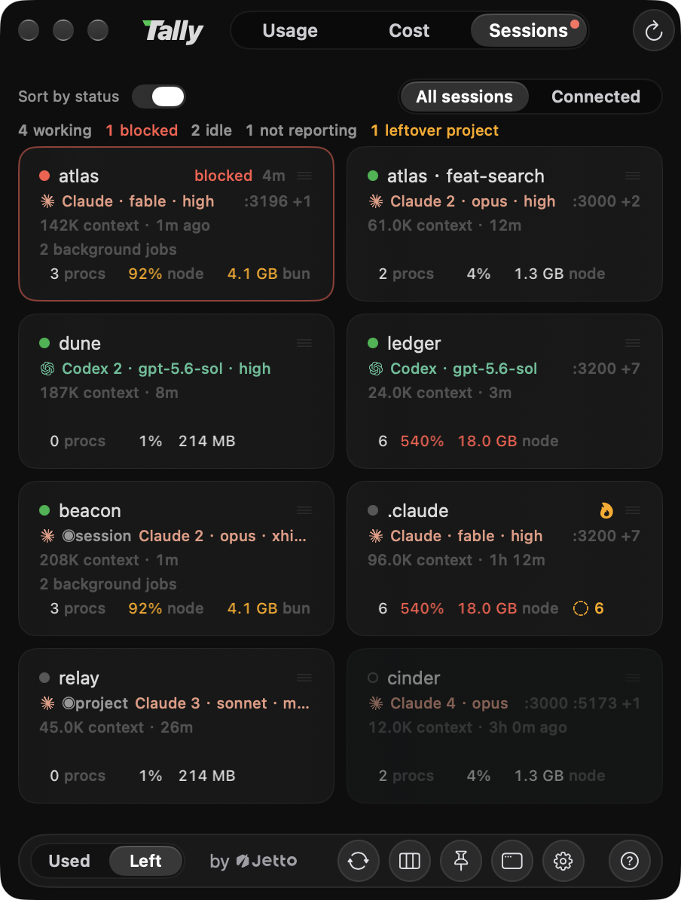
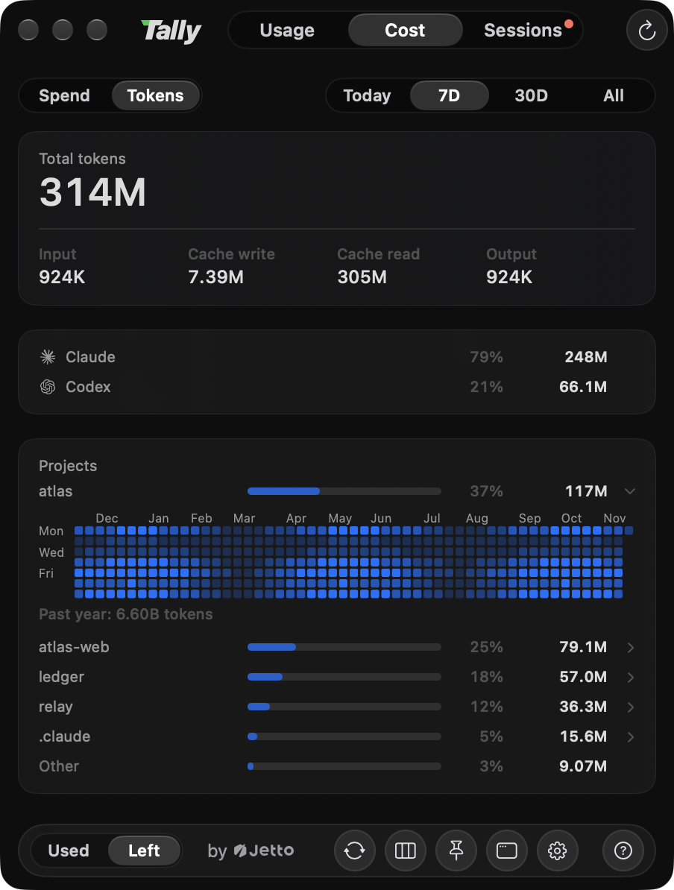
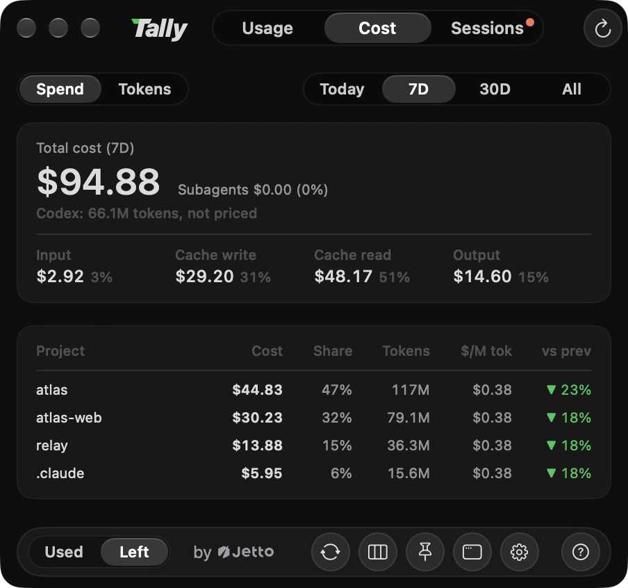
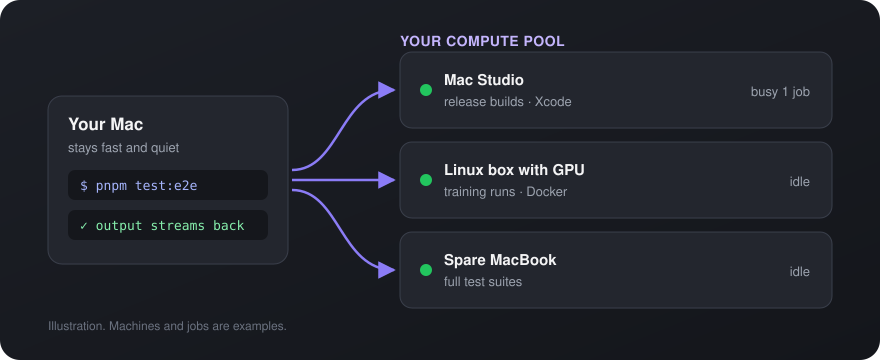

<p align="right"><a href="README.md">English</a> · <a href="README.zh-TW.md">繁體中文</a> · <a href="README.zh-CN.md">简体中文</a> · <a href="README.ja.md">日本語</a> · <b>한국어</b></p>

<p align="center">
  <a href="https://github.com/jettoai/tally/releases/latest"></a>
</p>
<h1 align="center">Tally</h1>

<h3 align="center">결제 중인 모든 Claude와 Codex 구독을, 한눈에.</h3>

<p align="center">무료 오픈 소스 macOS 메뉴 막대 앱입니다. 모든 계정의 5시간, 주간, 플래그십 모델 사용 한도를 나란히 보여 주고, 새 세션을 여유가 가장 많은 계정에서 시작합니다.<br>읽기 전용이며, 본인이 결제한 구독만 대상으로 합니다.</p>

<p align="center">
  <a href="https://github.com/jettoai/tally/releases/latest/download/Tally.dmg"></a>
  <br><sub><a href="#설치">다른 설치 방법</a> · <a href="https://github.com/jettoai/tally/releases">릴리스 노트</a></sub>
</p>

<p align="center">
  <a href="https://github.com/jettoai/tally/releases/latest"></a>
  
  
</p>

<p align="center">
  
</p>

## 모든 계정을 한눈에

Claude와 Codex의 로그인마다 5시간, 주간, 최상위 모델 창을 담은 행이 하나씩 생기고, 계정 풀이 같은 프로바이더의 계정을 하나의 예산으로 모아 현재 속도로 언제 소진될지 예측합니다(「약 4d 10h 후 소진」). 메뉴 막대는 아무것도 열지 않아도 같은 풀을 보여 줍니다: 프로바이더(또는 플랜)마다 한 구간씩, 위에는 세션, 아래에는 주간을 쌓습니다.

<p align="center">
  
</p>

## 새 세션은 여유가 가장 많은 계정에서

`tally claude`(또는 `tally codex`)는 남은 쿼터와 리셋 시각을 견주어 계정을 고릅니다. 계정이 한도에 걸리면 Tally는 다음 계정에서 *같은 대화*를 이어 가고, `/clear`할 때마다 계정을 옮길 기회가 공짜로 생깁니다. 사용자나 AI 에이전트가 바깥에서 `tally session clear`로 세션을 비울 수도 있으며, 새 빈 창은 여유가 가장 많은 계정에서 열립니다.

```sh
tally claude          # 지금 가장 좋은 계정에서 시작
tally codex           # Codex도 마찬가지
```

## 모든 세션을 한 보드에서

Tally가 띄운 대화는 저마다 카드가 됩니다: 계정, 모델, 컨텍스트 크기, 그리고 작업 중인지, 대기 중인지, **당신을 기다리며 막혀 있는지**. 어느 세션이 권한을 요청하고 있으면 메뉴 막대의 빨간 점이 알려 주고, 각 카드는 그 세션이 기기를 얼마나 쓰고 있는지(CPU, 메모리, 점유 중인 포트) 보여 줍니다. 이 수치는 macOS 커널에서 직접 읽으며, 이를 위해 `ps`나 `top` 프로세스를 따로 띄우지 않습니다.

<p align="center">
  
</p>

https://github.com/user-attachments/assets/75a92cf0-4724-4ffd-bd2b-8db5e10ba8dd

<p align="center"><sub>30초 만에 둘러보는 Tally.</sub></p>

## 설치

아래 내용을 AI 에이전트에게 붙여 넣으세요. Tally를 설치하고 결과까지 보여 줍니다.

```text
Download https://github.com/jettoai/tally/releases/latest/download/Tally.dmg,
copy Tally.app from it into /Applications and launch it. If macOS blocks the
app, stop and tell me to open it once from Finder. Then create /usr/local/bin if
it is missing and link the bundled CLI onto my PATH with
`ln -s /Applications/Tally.app/Contents/Helpers/tally /usr/local/bin/tally`,
trying it without a password first. If that needs my password, do not force it:
give me this one line to paste instead:
`sudo mkdir -p /usr/local/bin && sudo ln -s /Applications/Tally.app/Contents/Helpers/tally /usr/local/bin/tally`
After I paste it, wait about 10 seconds, run `tally` and show me the result. If
it shows no accounts, tell me to sign in to Claude or Codex first.
```

또는 직접 설치:

```sh
curl -fsSLO https://github.com/jettoai/tally/releases/latest/download/Tally.dmg && open Tally.dmg
```

또는 [DMG를 직접 다운로드](https://github.com/jettoai/tally/releases/latest/download/Tally.dmg)해 **Tally.app**을 응용 프로그램 폴더로 드래그한 뒤 실행하세요. 공증된 앱이며 앱 안에서 스스로 업데이트됩니다. 그다음 **설정 → 통합 → 모두 설치**를 누르면 `tally` CLI, status line 시그널, Claude Code skill이 한 번에 추가됩니다. [다른 설치 방법](#설치-옵션).

## 패널 고정

대시보드를 항상 맨 위에 떠 있는 반투명 글래스 패널로 고정하고, 헤더를 끌어 원하는 곳에 놓을 수 있습니다. 계정 카드는 패널 배경 위에 유리처럼 그려집니다.

## 토큰이 어디로 갔는지 확인

프로젝트별 토큰과 정가 기준 지출을 각 CLI가 로컬에 남긴 트랜스크립트에서 읽습니다. 데이터는 Mac 밖으로 나가지 않으며, `tally cost --json`은 같은 수치를 스크립트에 넘겨 줍니다.

<p align="center">
  
</p>

<details>
<summary>지출 페이지</summary>

지출 페이지(탭을 열면 먼저 나오는 페이지)는 그 토큰을 금액으로 바꿔 보여 줍니다: 프로젝트별 Claude 사용량을 Anthropic 정가로 계산하고, 합계를 입력, 캐시 쓰기, 캐시 읽기, 출력으로 나눕니다. Codex 토큰도 집계하지만, Tally가 믿을 만한 가격표가 없어 금액으로는 바꾸지 않습니다. `tally cost --json`을 쓰면 같은 수치를 스크립트로 받을 수 있습니다.

<p align="center">
  
</p>

</details>

## 읽기 전용, 본인이 결제한 구독으로

- 사용량은 공식 `claude`, `codex` CLI(`claude -p "/usage"`와 `codex app-server`)를 통해 읽으므로, 넘겨줄 세션 키나 브라우저 쿠키가 없습니다.
- Tally는 접근 권한을 프록시하거나 공유하거나 재판매하지 않고, 토큰을 기록하거나 전송하지 않습니다.
- Electron 없이 하나의 네이티브 Swift 앱으로 동작하며, 대화 기록을 읽는 핵심은 Rust로 작성되어 있습니다.

<details>
<summary>동작 방식 (그리고 절대 하지 않는 것): 모든 읽기와 이름을 밝힌 소수의 쓰기</summary>

- **공식 CLI로 사용량 조회.** 사용량은 각 프로바이더의 **공식 CLI**(`claude -p "/usage"`와
  `codex app-server`)를 통해 읽으며, 공식 클라이언트가 프로바이더 인증과 자격 증명 관리를
  담당합니다. 계정 탐지는 로그인 속성을 확인합니다. 읽기 전용 예외로, Tally는 Claude 로그인
  기한을 확인하기 위해 Keychain의 로컬 자격 증명 문서를 일시적으로 읽습니다. Keychain 항목이
  없으면 `.credentials.json`에서 `refreshTokenExpiresAt`을 가져옵니다. 이 리더가 반환하는 값은
  날짜뿐입니다. 토큰을 로그에 남기거나 영구 저장하거나 전송하지 않으며, 로그인을 갱신하거나
  자격 증명을 수정하지도 않습니다.
- **읽기 전용, 명시된 예외 하나만 있음.** `claude auth login`은 OAuth 왕복을 끝내면
  거기서 멈추기 때문에, Tally가 만들고 로그인까지 해 준 config home도 첫 세션에서는
  여전히 최초 실행 마법사(테마 선택, 그리고 방금 로그인한 계정에 다시 로그인하라는 요청)를
  만나게 됩니다. 그래서 Tally 자신이 수행한 로그인 이후(계정 추가, 또는 카드에서의 갱신),
  Claude Code 자신이 「마법사가 끝났다」고 기록하는 필드인 `hasCompletedOnboarding`을
  그 home의 상태 파일에 병합합니다. Tally가 새로 만드는 home에는 기존 계정에서 이미
  답한 폴더 신뢰 응답도 미리 채워 둡니다. 어디까지나 병합이지 대체가 아니며, 해석할 수
  없는 파일은 다시 쓰지 않고 거부하며, 마법사를 거친 home은 바이트 단위로 그대로
  남겨 둡니다. 자격 증명은 절대 건드리지 않고, 다른 home을 스캔해 고치는 일도 절대
  없습니다.
- **목적이 하나뿐인 선택형 root 도우미.** `fseventsd` 같은 프로세스가 CPU를 계속 끝까지 쓰면 Tally는
  `~/.tally/logs/process-forensics/`에 증거 파일을 남깁니다. root 소유 프로세스의 `sample`과 `fs_usage`를
  얻으려면 root 권한이 필요하므로, 설정 화면(또는 `tally forensics setup`)에서 도우미를 한 번만 설치할 수
  있습니다. 시스템 자체의 암호 창이 실행하며 Tally는 암호를 보지 못하고, root 소유 파일은
  `/Library/PrivilegedHelperTools/ai.jetto.tally.forensics`와 `/etc/sudoers.d/tally-forensics` 두 개만 씁니다.
  도우미는 프로세스 번호 하나만 받고 그 두 읽기 전용 도구만 실행합니다. 직접 설정하기 전에는 꺼져 있으며,
  `tally forensics remove`(또는 설정 화면의 「제거」 버튼)로 두 파일을 모두 지웁니다.
- **폴링은 언제나 하나.** CLI를 실행하는 것은 메뉴 막대 앱뿐입니다(기본 1분 간격, 2/5/15분으로
  완화 가능). `tally` 런처는 로컬 스냅숏(`~/.tally/snapshot.json`: 퍼센트와 경로만, 토큰은
  절대 없음)만 읽으므로 터미널을 열 개 열어도 추가 읽기는 없습니다.
- **오직 당신의 계정만.** 멀티 계정이란 *당신이* 결제하고 *당신의* 기기에 있는 구독을
  말합니다. Tally는 접근 권한을 프록시하거나 공유하거나 재판매하지 않습니다. 계정 전환은 이미
  소유한 config 디렉터리로 공식 CLI를 실행하는 것뿐입니다.
- **로컬 중심, 오류 보고는 선택 사항이며 기본값은 꺼짐.** 사용량 읽기, 아래의 익명 사용 통계,
  그리고 설정에서 「충돌 및 오류 보고서 보내기」를 켠 경우 Sentry로 보내는 오류 보고 외에는
  아무것도 기기 밖으로 나가지 않습니다. 보고에는 스택 트레이스, 앱 및 macOS 버전, Mac 모델,
  언어와 시간대, 그리고 Sentry가 연결에서 추정한 대략적인 지역이 담기며, IP 주소, 계정,
  사용량 수치, 파일 내용은 절대 담기지 않습니다. 같은 곳에서 언제든 끌 수 있습니다.
- **익명 사용 통계, 기본값은 켜짐.** Tally를 시작할 때와 실행 중 약 하루에 한 번, 무작위 기기 ID,
  앱 버전, 빌드 종류(Tally 또는 Tally Pro)를 jetto.ai로 보내 설치 수와 사용자 수를 집계합니다.
  계정, 사용량 수치, 프로젝트 이름, 파일 내용은 보내지 않습니다. 일반적인 웹 요청과 마찬가지로
  서버에는 IP 주소와 표준 User-Agent 헤더가 전달됩니다. 설정 > 정보에서 「익명 사용 통계 보내기」를
  끄면 그 이후로는 아무것도 보내지 않습니다.
- **연동을 위한 작은 API.** 대시보드와 스크립트는 `tally` CLI를 통해 Tally와 통신합니다.
  연결할 소켓이나 서버는 없습니다.
  - `tally status --json`은 읽기 쪽입니다. 모든 계정의 남은 창과 리셋 시각에 더해
    `sessions`를 반환하며, 감독 중인 세션마다 한 항목씩 `pid`, `project`, `state`, `model`,
    `effort`, `taskList`(세션이 기록하는 작업 목록)를 담습니다. 보고서에는 `"version": 1`이
    붙으며 추가만 허용됩니다. 이후 버전에서 필드가 늘어날 수는 있어도, 기존 필드가 사라지거나
    의미가 바뀌는 일은 없습니다.
  - `tally session send <text> --session <pid>`는 해당 세션에 한 줄을 입력하고 Return을
    누릅니다. `tally message claude|codex <text> --session <pid>`는 키를 누르지 않고
    세션 자체의 전송 경로로 메시지를 전달합니다.

</details>

## 기능

모든 기능을 한 줄씩 정리한 지도입니다. 자세한 설명은 [docs/features.ko.md](docs/features.ko.md)에 있습니다.

| 위치 | 얻는 것 |
|---|---|
| [대시보드](docs/features.ko.md#대시보드) | 계정 풀과 예측, 사용량 어드바이저, 메뉴 막대 표시, 고정 가능한 글래스 패널, 카드와 목록 밀도, 프로젝트별 토큰 사용량, 리셋 시각, 로그인 상태, Codex 리셋 뱅킹 |
| [세션 보드](docs/features.ko.md#세션-보드) | 대화마다 카드 한 장, 막힘 상태, 빨간 점, 세션별 CPU와 메모리 |
| [실행 컨트롤 플레인](docs/features.ko.md#실행-컨트롤-플레인) | 스마트 선택, 한도 핸드오프, `/clear` 때 계정 이동, 이른 시작, `tally type`, worktree, 리로드, 그리고 `tally` CLI(`tally status --json` 포함), status line, Claude Code 스킬, 셸 shim, 하네스 도구 |
| [외관과 디테일](docs/features.ko.md#외관과-디테일) | 6개 앱 언어, 네이티브 Swift, 서드파티 의존성은 하나뿐 |

## 출시 예정: Tally Pro 컴퓨트 풀

이 Mac이 테스트 스위트를 돌리느라 바쁜 동안, 다른 Mac과 Linux 머신은 놀고 있습니다. Tally Pro는 무거운 작업(전체 테스트 스위트, 릴리스 빌드, 학습 작업)을 당신이 가진 다른 머신으로 자동으로 보내고 출력을 다시 스트리밍해 주므로, 지금 타이핑하는 Mac은 계속 빠르게 유지됩니다.

<p align="center">
  
</p>

<p align="center"><sub>출시 소식을 받으려면 이 저장소를 Watch하세요.</sub></p>

## FAQ

<details>
<summary>macOS 메뉴 막대에서 여러 Claude Max 계정의 사용 한도를 한꺼번에 보려면?</summary>

각 계정을 서로 다른 설정 디렉터리로 Claude Code에 로그인시킵니다(예:
`CLAUDE_CONFIG_DIR=~/.claude2 claude`를 실행한 뒤 로그인). Tally는 모든 `~/.claude*` 로그인과
모든 Codex 설치를 찾아 계정마다 한 줄에 5시간, 주간, 플래그십 모델 윈도우를 보여 주고,
프로바이더별 계정을 하나의 예산으로 합쳐 메뉴 막대에 표시합니다.

</details>

<details>
<summary>Tally는 프록시나 계정 공유 도구인가요?</summary>

아닙니다. Tally는 Claude Code와 Anthropic 사이에 끼어들지 않으며, 접근 권한을 프록시, 공유,
재판매하지도 않습니다. 공식 CLI를 통해 각 계정의 사용량을 읽고, `tally claude`는 여유가 가장
많은 계정의 설정 디렉터리로 공식 CLI를 실행합니다. 모든 계정은 본인의 Mac에서 쓰는, 본인이
결제한 구독입니다.

</details>

<details>
<summary>Tally는 ccusage나 다른 사용량 트래커와 무엇이 다른가요?</summary>

[ccusage](https://github.com/ryoppippi/ccusage) 같은 도구는 로컬 로그에서 토큰 지출을
추정하는 터미널 CLI입니다. Tally는 벤더가 실제로 적용하는 쿼터 윈도우(5시간, 주간,
플래그십 모델)를 모든 Claude / Codex 계정에 대해 동시에 보여주는 네이티브 메뉴 막대 앱이며,
그 숫자에 따라 동작하는 런처도 제공합니다. 토큰 뷰는
「얼마나 썼고 어디에 썼는가」라는 질문까지 프로젝트 단위로, 로컬 트랜스크립트에서 곧바로
다룹니다. 금액 추정은 하지 않습니다. 그리고 세션 보드는 ccusage나 다른 사용량 미터보다 한 단계 더
들어갑니다: 실행 중인 모든 세션이 카드가 되어, 어느 것이 당신을 기다리며 막혀 있는지,
각각이 기기를 얼마나 쓰고 있는지를 메모리를 붙잡고 있는 프로세스까지 보여 줍니다. 읽기
전용이며, 본인이 결제한 구독만 대상으로 합니다.

</details>

<details>
<summary>Tally는 CodexBar, Claude Usage Tracker, Usage4Claude와 무엇이 다른가요?</summary>

2026년 10월 기준으로 이들은 모두 네이티브 메뉴 막대 미터이며, 일부는 이제 여러 계정도 표시합니다.
Tally가 더하는 점은 다음과 같습니다. 사용량을 공식 `claude`, `codex` CLI로만 읽기 때문에 세션 키나
브라우저 쿠키를 제공할 필요가 없습니다. 프로바이더별 계정을 하나의 예산으로 합치고, 지금 속도로
언제 바닥나는지 예측합니다. 그리고 `tally claude`는 남은 쿼터와 리셋 시각으로 새 세션의 계정을
고르고, 어느 계정이 한도에 닿으면 다음 계정에서 같은 대화를 이어 갑니다. CodexBar는 더 많은
서비스(Cursor, Copilot, Gemini 등)를 지원하므로, 하나의 계정을 여러 AI 도구에서 쓴다면 그쪽이
더 맞을 수 있습니다.

</details>

<details>
<summary>Tally는 Keychain에 어떻게 접근하나요?</summary>

사용량은 공식 CLI를 통해 가져오며 계정 탐지는 속성만 확인합니다. Claude 로그인 기한 리더는
자격 증명 문서도 읽지만, 사전 검사에서 Keychain이 잠겨 있거나 리더가 신뢰되는지 확인할 수 없으면
접근을 건너뛰고 기한을 알 수 없는 상태로 둡니다. 검사와 읽기 사이에 Keychain 상태가 바뀔 수 있어
권한 대화 상자가 표시될 가능성은 있습니다. 로그인은 계속 공식 CLI가 담당하며,
Tally의 로그인 과정은 자격 증명을 직접 수정하지 않습니다.

</details>

<details>
<summary>모든 계정이 한도에 도달하면?</summary>

극적인 일은 없습니다. 대시보드는 그대로 보여 주고, `tally claude`는 경고 후 순정 CLI를
실행하며, 자동 핸드오프는 루프 없이 제자리에 머뭅니다.

</details>

<details>
<summary>자동 핸드오프로 대화를 잃지 않나요?</summary>

잃지 않습니다. 다음 계정에서 같은 세션 기록을 이어 갑니다(추가 기록만 하며 원본 기록은
절대 수정되지 않음). 중단된 도구 호출은 전환 후 한 번 다시 실행될 수 있습니다.

</details>

<details>
<summary>status line 통합이 커스텀 status line을 망가뜨리지 않나요?</summary>

아닙니다. 여러분의 명령어는 같은 session JSON을 받으며 이전과 똑같이 계속 실행됩니다.
Tally는 그 뒤에 시그널만 추가하며, 이미 계정 이름을 표시하고 있다면 그 부분은
생략합니다. 제거하면 바이트 단위로 원래 등록 상태로 복원되고, 혹시 tally 바이너리가
사라지더라도 여러분의 명령어를 직접 실행하는 방식으로 대체됩니다.

</details>

## 요구 사항

- macOS 14+
- [Claude Code](https://claude.com/claude-code) 그리고/또는 Codex CLI (`~/.codex`). 이 Mac에
  둘 다 아직 없다면, Tally를 처음 열 때 나타나는 창이 하나를 설치해 주고 로그인까지 안내합니다.
- 두 번째 Claude 계정: **설정 → 계정 → 계정 추가**. (고급: 실체는 config 디렉터리를 하나 더
  만드는 것이므로 `CLAUDE_CONFIG_DIR=~/.claude2 claude`를 실행해 로그인하는 방법도 됩니다.)

## 설치 옵션

[Releases](https://github.com/jettoai/tally/releases/latest)에서 최신 공증 DMG를
다운로드하고 **Tally.app**을 응용 프로그램 폴더로 드래그한 뒤 실행하세요. 이후
업데이트는 앱 안에서 자동으로 도착합니다.

`tally` CLI를 쓰려면 앱에 번들된 바이너리를 PATH에 링크하세요. 새 Mac에서는 `/usr/local/bin`이 없을 수 있어 관리자 비밀번호가 필요합니다:

```sh
sudo mkdir -p /usr/local/bin && sudo ln -s /Applications/Tally.app/Contents/Helpers/tally /usr/local/bin/tally
```

<details>
<summary>소스에서 빌드하기</summary>

```sh
brew install xcodegen   # 최초 1회
git clone https://github.com/jettoai/tally && cd tally
xcodegen generate
xcodebuild build -project Tally.xcodeproj -scheme Tally -configuration Release -destination 'platform=macOS'
xcodebuild build -project Tally.xcodeproj -scheme TallyCLI -configuration Release -destination 'platform=macOS'
```

`Tally.app`을 DerivedData에서 응용 프로그램 폴더로 옮기고 `tally` 바이너리를 PATH에
두세요:

```sh
ln -s <build-products>/tally /usr/local/bin/tally
```

</details>

심볼릭 링크를 건너뛸 수도 있습니다: **설정 → Integrations**에서는 각 항목을
클릭 한 번으로 설치하고 깔끔하게 제거할 수 있으며, 위에는 전체를 한꺼번에 다루는 「모두
설치」 스위치도 있습니다: CLI 도구, 셸 shim(맨몸의 `claude` / `codex`도 정책을 따르게 함),
status line 시그널, 세션 보드의 알림 훅, 서브에이전트 수 훅, 쿼터 경고 훅, 그리고 `/tally`
명령이 딸린 Claude Code 스킬. 훅 행은 모두 같은 약속을 지킵니다: 그 이벤트에 이미 등록해 둔 것은
그대로 계속 실행되고, 제거할 때 빠지는 것은 Tally 자신의 항목뿐입니다. 이미 가진 계정을
공유 설정에 올리는 행도 여기 있지만, 「모두 설치」에서는 일부러 빼 두었습니다: 그것은
config home 사이에서 대화를 옮기는 작업이고, 「전부 켜기」라는 뜻의 한 번의 누름이
그것까지 뜻하지는 않을 수 있기 때문입니다.

shim과 `tally claude`의 차이: 설정의 shim을 설치하고 Claude의 「실행 계정」이 「끄기」가 아니면
`claude`를 그냥 입력해도 시작 전에 계정을 먼저 골라 줍니다. `tally claude`(아래의 `c`와 `cc`)는
shim이 못 하는 두 가지를 더 합니다: 계정이 사용량 한도에 닿으면 대화가 자동으로 다른 계정으로
이어지고, 아직 여유 있는 계정이 없으면 그 자리에서 기다리며 15초마다 다시 시도합니다. 그리고
`--continue`는 이 디렉터리에서 Tally가 마지막으로 지켜본 대화, 즉 가장 최근에 `tally claude`로
실행한 대화를 ID로 다시 엽니다. 그런 기록이 없거나 그 대화가 이미 없을 때만, 어떻게 열었는지와
상관없이 디렉터리의 가장 최근 대화로 대신 이어 갑니다.

선택 사항인 셸 별칭:

```sh
alias c='tally claude'
alias cc='tally claude --continue'
```

## 현지화

Tally는 English, 繁體中文, 简体中文, 日本語, 한국어, Türkçe를 내장하며 설정에서 재시작 없이
즉시 전환됩니다. 모든 문자열은 하나의 Xcode String Catalog
([`Tally/Resources/Localizable.xcstrings`](Tally/Resources/Localizable.xcstrings))에 있습니다. 언어를 추가하려면 카탈로그의 열을 채우고, 그 코드를 `AppLocale.supported`와 `project.yml`에 등록하고, 설정의 언어 선택기에 그 언어의 고유 이름을 추가하세요. 기준은 「번역이 아니라 OS의
네이티브 문구처럼 읽힐 것」. 기존 언어의 교정도 새 언어만큼 환영합니다.

## 기여하기

이슈와 풀 리퀘스트를 환영합니다. 빌드 환경은 위의 「소스에서 빌드하기」를 참고하세요.
프로젝트를 건강하게 유지하는 두 가지 관례가 있습니다:

- `project.yml`이 유일한 진실의 원천입니다. `Tally.xcodeproj`는 XcodeGen이 생성하며
  손으로 편집하지 않습니다.
- 사용자에게 보이는 새 문자열은 반드시 `L("…")` 헬퍼를 거쳐 String Catalog에 넣고,
  6개 언어를 모두 채웁니다.

PR은 하나의 의도로 좁히고, 「왜」를 설명에 적어 주세요.

## 감사의 말

Tally는 이 분야를 먼저 개척한 훌륭한 프로젝트들의 길 위에 서 있습니다:

- [ccusage](https://github.com/ryoppippi/ccusage): Claude Code의 로컬 로그를 사용량
  인사이트로 바꾼 선구자로, 개발자들이 자신의 숫자를 얼마나 보고 싶어 하는지 보여주었습니다.
- [OpenUsage](https://github.com/robinebers/openusage)와
  [AIUsage](https://github.com/sylearn/AIUsage): 메뉴 막대에서 한눈에 보는 사용량 미터라는
  형식을 확립했습니다. Tally는 그 한눈을 여러 계정에 동시에 향하게 하고 싶어 태어났습니다.
- [Sparkle](https://sparkle-project.org): 앱 내 자동 업데이트를 담당합니다.

## 라이선스

[MIT](LICENSE) © [jetto](https://jetto.ai)

<p align="center"><sub>무료 오픈 소스 · by <a href="https://jetto.ai">Jetto</a> · Claude와 Codex의 사용 한도를 보여 주는 macOS 메뉴 막대 AI 사용량 모니터</sub></p>
