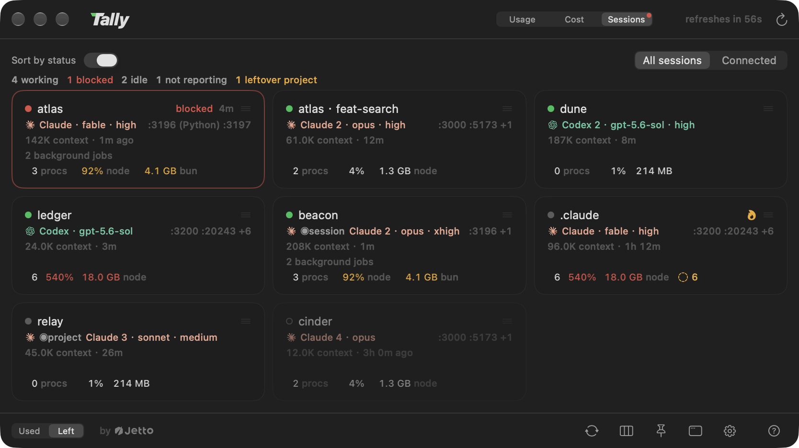
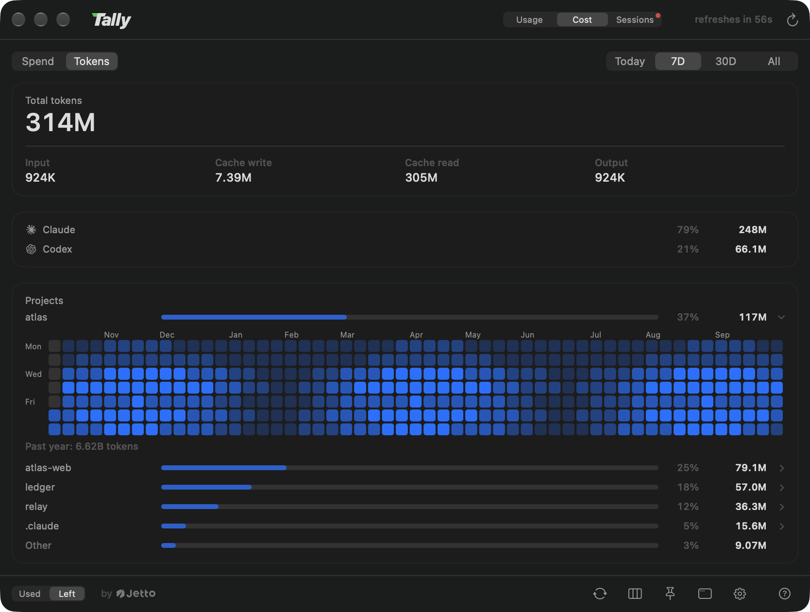
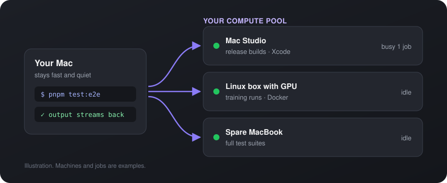

<p align="center">
  <a href="https://github.com/jettoai/tally/releases/latest"></a>
</p>
<h1 align="center">Tally</h1>

<p align="center"><b>For people running more than one AI subscription.</b></p>

<h3 align="center">Every Claude and Codex subscription you pay for, in one glance from your menu bar.<br>Every new session starts on the account with the most room left.</h3>

<p align="center">
  <a href="https://github.com/jettoai/tally/releases/latest/download/Tally.dmg"></a>
</p>

<p align="center">
  <a href="https://github.com/jettoai/tally/releases/latest"></a>
  
  
  
</p>

<p align="center"><b>English</b> · <a href="README.zh-TW.md">繁體中文</a> · <a href="README.zh-CN.md">简体中文</a> · <a href="README.ja.md">日本語</a> · <a href="README.ko.md">한국어</a></p>

<p align="center">
  
</p>

https://github.com/user-attachments/assets/75a92cf0-4724-4ffd-bd2b-8db5e10ba8dd

<p align="center"><sub>A 30-second tour of Tally.</sub></p>

<p align="center"><sub>Free and open source · by <a href="https://jetto.ai">Jetto</a> · a macOS menu bar AI usage monitor for Claude and Codex rate limits</sub></p>

## Why Tally

If you pay for two Claude Max seats and a Codex plan, the question all day is "which account still has room?" Single-account meters answer it for one account at a time. Tally answers it for all of them at once, then acts on the answer.

### 1. Every account, side by side

Each Claude and Codex login is its own card with its 5-hour, weekly and top-model windows, plus an account pool that pools them into one budget and forecasts when it runs dry at your pace ("runs dry in about 4d 10h"). The menu bar shows the same pools without opening anything: one segment per provider (or per plan), session on top and weekly below, with a small corner mark for how many accounts it sums or which plan it is. Switch it to one mark per account in Settings when you want them apart.

<p align="center">
  
</p>

### 2. Every session lands on the account with the most room

`tally claude` (or `tally codex`) starts each new session on the account whose quota goes furthest right now, weighing reset times and not just remaining percent. When an account hits its cap mid-conversation, Tally resumes the *same conversation* on the next-best account; every `/clear` is a free chance to move; and an account running low types one heads-up line into the sessions using it. You, or an AI agent, can also clear a session from outside with `tally session clear`: the empty window reopens on the account with the most room.

```sh
tally claude          # starts on the best account right now
```

### 3. Every running session on one board

Every conversation Tally launched becomes a card: account, model, context size, and whether it is working, idle, or **blocked waiting on you**. A red dot in the menu bar tells you when one is asking for permission, and each card shows what that session is costing the machine (CPU, memory, ports held). Those numbers are read straight from the macOS kernel; Tally does not start a `ps` or `top` process to get them.

<p align="center">
  
</p>

### 4. See where your tokens went

The Cost tab's Tokens page totals input, cache and output tokens for today, 7 days, 30 days or all time, split by provider and by project, with a year of daily activity per project. It reads the CLIs' own local transcripts and never leaves your Mac.

<p align="center">
  
</p>

### 5. Read-only, on your own paid subscriptions

Usage is read through the providers' own official CLIs (`claude -p "/usage"` and `codex app-server`). Tally never proxies, shares or resells access, never logs or sends a token, and runs as one native Swift app with no Electron, with the core that reads conversation transcripts written in Rust. [What it reads, and the few things it writes](#how-it-works-and-what-it-never-does).

## Install

```sh
curl -fsSLO https://github.com/jettoai/tally/releases/latest/download/Tally.dmg && open Tally.dmg
```

Or [download the DMG](https://github.com/jettoai/tally/releases/latest/download/Tally.dmg) directly, drag **Tally.app** into Applications, and launch it. It is notarized and updates itself in-app. Then **Settings → Integrations → Install all** adds the `tally` CLI, the status line signal and the Claude Code skill in one click. [More install options](#install-options).

## Coming soon: Tally Pro compute pool

Your other Macs and Linux boxes are sitting idle while this one grinds through a test suite. Tally Pro will send heavy work (full test suites, release builds, training jobs) to your own other machines automatically and stream the output back, so the Mac you are typing on stays fast.

<p align="center">
  
</p>

<p align="center"><sub>Watch this repo to hear when it ships.</sub></p>

## Features

### The dashboard

- **Multi-account first.** Every `~/.claude*` login and Codex install is its own card: N accounts
  side by side, not a single-account fallback chain. Drag cards to reorder; the order applies
  everywhere.
- **The account pool.** Each provider's accounts pooled into ONE meter: a continuous bar for the
  combined weekly budget, the total in accounts' worth ("2.9/5 left"), and the next staggered
  refill. A forecast estimates how long the pool lasts at your recently measured pace, counting
  the quota each reset brings back: "runs dry in about 4d 10h" when you are outspending the refill
  cycle, "won't run dry at this pace ✓" when you are not. Single-account meters have nothing to pool.
- **The usage advisor.** Do you need another account? One line per provider under the gauges: a
  filled pip per account you own, a hollow one when your measured pace asks for another, and the
  running weekly demand as the figure to read ("5.8 acct/wk"). A fleet on two plans reads per tier
  ("Pro 1.7 · Team 0.9"), because one account-week of a $200 seat and of a $20 seat are not the same
  quantity, and pooling them produces a number no subscription can be bought against. The hover
  carries the breakdown per tier, the active burn rate, the starved hours, and the next refills;
  `tally status --json` publishes the same split as `tierDemands`.
- **Menu bar strip.** One segment per provider by default, summing that provider's accounts into
  the same pool the account pool draws, badged with how many accounts it stands for; switch it to one
  mark per account when you want them apart. Either way the segment stacks session over weekly, and
  hover spells out the accounts, their numbers, and anyone missing from the pool.
- **Pinnable glass panel.** Pin the dashboard as an always-on-top frosted-glass panel; drag the
  header to place it anywhere. The account cards themselves render as glass over the panel's
  backdrop (solid whenever you turn the translucency off, or the system asks for reduced
  transparency).
- **Cards, or one row per account.** Past half a dozen accounts a card grid outgrows the display,
  so the panel carries a second density: every account on a single line, identity on the left, each
  window as a small bar plus its figure, the launch controls shrunk to icons. It hides words, never
  facts, so the window names, the resets and what each control does move into hover callouts (Tally
  draws its own, on the panel's own glass, rather than waiting on the system tooltip). Each density
  remembers its own column count behind the one picker, and the list's Auto keeps one column, its
  bars stretching to fill each row.
- **Your layout, one card at a time.** A view-options card in the footer sets the density and the
  column count with layout tiles (each tile drawing the layout it produces), switches the account
  pool and the advisor on or off, folds providers behind their gauges, and can seat the cards in a
  section per provider; drag cards to reorder within it. A folded provider keeps its heading, which
  is how it comes back. A fleet too tall for the screen scrolls instead of falling off it.
- **Token usage, by project.** A Tokens page inside the Cost tab on every surface: total
  tokens over today / 7 days / 30 days / all time with the input, cache and output breakdown, a
  per-provider split, and a per-project table that traces even agent and workflow sessions back
  to the project they served. Click a project row and it opens into a year of daily activity, a
  contribution-style heatmap graded on that project's own scale, with each day's total a hover
  away. Read from the CLIs' own local transcripts, aggregated behind an incremental cache (a
  refresh with nothing new costs well under a second), and it never leaves your machine. The tab's
  other page, Spend (the one it opens on), prices those tokens at Anthropic's list prices, per
  project, with the input / cache write / cache read / output split, and `tally cost --json` hands
  the same figures to scripts.
- **Reset times everywhere.** Every window shows its own reset; click any reset label to flip all of
  them between countdown ("resets in 2d 4h") and exact time ("resets at 07/18 20:00").
- **Login health at a glance.** Hover a card for the account's signed-in email. Signed-out
  accounts get a red chip and a notification; sessions that need `/login` get their own warning
  and a shortcut to open the affected session. When a Claude login deadline is available, Tally
  warns within three days of expiry and when it has passed. Clicking to renew runs the provider's
  official CLI sign-in in the background with browser consent (a visible Terminal is the fallback);
  Tally does not directly modify credentials during that sign-in flow.
- **Add an account without leaving the app.** Settings prepares the next account home, offers the
  shared-harness default (one setup serving every account) with a plain privacy note, and drives
  the same quiet sign-in; the new card appears when the browser hands back. An account you
  already have can join the same shared harness later (`tally share`, or its row in Settings):
  conversations, inbox and memory notes merge into the main account, nothing is deleted
  (whatever is in the way is renamed and left in place), and the row says plainly what sharing
  means: every account can then read every account's conversations.
- **Codex reset banking, visible and redeemable.** Banked rate-limit resets show right on the
  card ("3 resets available"), so you know your escape hatches before you hit a wall. Click to
  redeem one, behind a confirmation that names the account, spells out the cost, and warns you
  off when redeeming would mostly be wasted; the soonest-expiring credit goes first. And once an
  account's weekly quota is used up, Tally can redeem the soonest-expiring credit on its own and
  tell you it did (a switch in Settings, on by default).


### The session board

- **Every conversation on one board.** A third position on the header switch, next to Usage and
  Cost: one card per supervised session, saying what it is (account, model, effort, the
  worktree it runs in), what it is doing right now, and how big the conversation has grown
  ("142k context"). Four states, published by the session's own supervisor rather than guessed
  from the outside: working, blocked, idle, and an honest "not reporting" when nothing new
  enough is attached. Click a card and Tally brings that session's terminal to the front.
  Ghostty is the terminal Tally is built for and the one we recommend: the jump lands on the
  exact tab, found by the session's own tty. On any other terminal the click still raises the
  right app; exact-tab jumps for more terminals are on the roadmap.
- **Blocked means it is asking for you.** The one state that needs a human, when Claude Code has
  put up a permission request, a question, or a plan approval and nobody has answered, gets a
  red card edge, a waiting timer, and a hover that spells out exactly what it wants ("Claude
  needs your permission to use Bash"). A summary row counts working / blocked / idle / not
  reporting across the whole board, and only the blocked count wears a color, only while it is
  above zero.
- **A red dot even with the panel closed.** The menu bar strip grows a small red dot the moment
  any session is waiting on you, and drops it the moment none is; hover says how many.
- **What each session is costing the machine.** Each card keeps a quarter hour of the whole
  process tree under that session: CPU, memory and process count as sparklines with the current
  figure and the period peak, the biggest eater named ("(bun)", "(Google Chrome Helper)"), plus
  how many subagents it has out, which ports it is holding (the thing your next `pnpm dev` will
  collide with), and how fast it is writing to disk. Warnings key on mismatch, not size: a
  session at 300% of a core mid-build is a build, while the same burn twenty seconds after the
  turn ended is residue and gets an amber note; a session holding most of the machine's memory
  gets a red one, and memory needs two witnesses (the tree's own figure plus the kernel's
  pressure reading) before Tally says so. A reading must hold for seconds before a warning
  appears, so one GC pause never flashes red. Usage meters read quota, not what each running
  session is costing the machine.
- **A board you can learn.** Sort by status seats the cards the moment the board opens and
  freezes them there (a board that re-sorted itself twice a second is a board nobody can learn);
  drag one card and the order becomes yours. A filter narrows to connected sessions or shows
  everything, dimming what is not reporting but keeping it clickable, and the board remembers a
  column count of its own, separate from the dashboard's.


### The launch control plane

- **Smart pick.** New sessions start on the account whose binding quota window sustains the highest
  spend rate: remaining percent divided by time to reset, across the 5-hour, weekly, and top-model
  windows. Quota about to reset gets burned first (it would evaporate unused); quota that must last
  days is preserved; hysteresis keeps noise-level differences from bouncing you between accounts.
  The panel badge marks the current pick, with the reason in its tooltip.
- **Three modes per provider.** Smart (the algorithm decides at every launch), Manual (the circle
  on a card pins that account; clicking the check releases it back to Smart, live, even for the
  running session), or Off (a dashboard and nothing more).
- **Mid-session follow-through.** Hit a usage cap and tally resumes the *same conversation* on the
  next-best account (3-per-10-minutes fuse; opt out with `--no-handoff` or `TALLY_AUTO_HANDOFF=0`).
  If the server silently downgrades your model, a sibling account that can still serve your primary
  model takes the conversation over instead, and only when nobody can does your configured
  fallback pairing apply. Non-urgent switches wait for a quiet moment between turns.
- **Window boundaries are free moves.** The moment you type `/clear`, the conversation is empty:
  no turn to interrupt, no context to reload, nothing to lose. So Tally asks the account
  question again right there, once per unit of work rather than once per launch, and moves the
  fresh window to the account with the most room when the one it is on is nearly dry. The
  trigger is a fact, not a guess: Claude Code's own status line reports the new conversation id,
  so a `/clear` swallowed by a prompt moves nothing.
- **Early start.** A 5-hour window only starts counting when you send something, so the day's
  first reset lands five hours after you sit down, and every pause pushes the next one later.
  Whenever a Claude account's window is closed, Tally opens it with one short message through the
  official CLI, pinned to the cheapest model, so the clock runs while you sleep and resets land
  earlier in your day. At most one message per account every 5 hours, an account already working
  is left alone, and optional quiet hours keep it silent overnight. It never touches credentials,
  tells you once before the first message ever goes out, and the settings row keeps the day's
  honest tally: how many accounts started, were skipped on purpose, or could not start.
- **The account that is running out says so.** When an account's binding window drops under 15%,
  Tally types one line into the composer of every session on it, naming the bottleneck window,
  when it refills, how many sessions are sharing it, and which sibling account still has room:
  "Wrap up and switch accounts, or wait for the reset." When no account has headroom it says
  that instead, honestly. It re-arms at 30%, so an account hovering at the line speaks once, and
  a window about to reset counts as full, because calling you off quota that is about to refill
  would be working against you.
- **Tell a running session what to do.** `tally type claude "<text>" --project <name>` sends one
  line to the exact supervised terminal that address names, never to the frontmost window. The word
  after `type` says which kind of session is meant, so a checkout running one Claude and one Codex
  side by side is addressed by provider alone, and a session of the other kind is refused rather
  than typed into. `--project` takes a bare project name, the last component of a launch directory,
  as well as a path, and can be dropped when you are already in that directory. Two sessions of the
  same kind in one directory are refused with both PIDs listed rather than guessed between.
  `tally session send "<text>" --session <pid>` is the same send addressed by the
  supervisor or terminal child PID from `tally status --json`. Claude keeps its existing send and
  clear behavior. A Codex session advertises only `send` after Tally has a trusted native binding,
  a verified matching terminal, and a completed native turn. Codex accepts nonempty plain prompts
  only, never slash commands, shell mode, or a bare Return. It queues while working, blocked, unknown, waiting
  for permission, or while a person may be typing, then expires after 15 minutes. Quiet unexplained
  input is refused immediately: send a real prompt in that exact Codex session, wait for it to
  finish, then retry; clearing its composer alone cannot establish safety. Delivery is confirmed
  only by Codex's matching new user message. A terminal write without that confirmation is
  `unconfirmed-input` and is never retried automatically, including with custom Enter key mappings.
  To upgrade a monitoring-only Codex session, exit it and use `tally codex resume <UUID>`. When that
  resume names one exact UUID with no explicit prompt, Tally's status hooks are installed, and Tally
  launches it through its private TTY, Tally submits one visible native initialization prompt, with no manual
  bootstrap prompt required. It uses one model turn and subscription quota, never retries automatically,
  and does not promise zero tool execution:
  the prompt instruction is not enforcement. Caller prompts and every other resume shape are unchanged.
  Human input during startup remains draft-held. This path still needs a trusted native binding, exact
  terminal, completed native turn, and matching receipt before Codex advertises `send`; it never skips
  native trust. Requests are limited to 200 UTF-8 bytes; served or refused outcomes are logged in
  `~/.tally/logs/input.log`. `tally session clear` remains the distinct Claude control that may reopen a
  cleared session on a healthier account.
  `tally message claude "<text>" --project <name>` delivers a native message into that
  conversation instead, without touching the keyboard; it cannot answer a dialog, and neither
  command is a receipt.
- **Parallel lines of work.** `tally claude -w <name>` opens the session in a git worktree,
  creating `../<repo>-<name>` if needed, linking the project's Claude memory across, and running
  the repo's own setup script; bare `-w` lists the existing lines to pick from. `tally worktree
  tree / list / root / remove` oversees them, and `remove` retires a merged line cleanly: it
  ends the line's sessions, removes the worktree and the branch, and keeps the transcripts
  unless you say otherwise.
- **Pin one conversation, or one repo.** `tally account <name>` moves the session you run it in
  to another account at the end of the current turn, conversation intact, and keeps it there
  until `tally account --auto` releases it. `tally model <model> [effort]` runs this one
  conversation on that model for the rest of its life, surviving every relaunch (cap handoff,
  reload, app update), which is what Claude Code's own `/model` cannot promise once a supervisor
  relaunches from its own command line. `tally project set --model <m> [--account <n>]` declares
  what this repo, and every worktree of it, launches with; app defaults yield to it, flags you
  type beat it. From inside Claude Code, the bundled `/tally` command switches the account or
  the model without waking the model, and `/tally-account` / `/tally-model` without arguments
  raise a native picker panel drawn by the app itself: one list, one click, and the answer goes
  back to the CLI.
- **Change your setup once, every session reloads.** `tally reload` restarts every supervised
  session at its next quiet moment, so an edited hook, skill, or CLAUDE.md reaches every open
  terminal without you walking them one by one. The conversation survives (the restart rides
  the same resume path as a cap handoff), a session that is streaming or being typed into is
  left alone, and a restart that is happening anyway also carries a session off an account that
  is nearly dry. `tally reload --self`, run inside one session (by you or by its agent), restarts
  only that session, at the end of the current turn, on the same model and account.
- **Launch defaults, in Settings.** Default permission mode, start mode (continue vs new), model
  and reasoning effort as one pairing, and a separate fallback pairing (fallback model + its own
  effort + extra flags). Injected only when you didn't type the flag yourself: your own arguments
  always win.
- **Change the model once, every session follows.** Re-point the default model or effort and
  every running supervised session adopts it at its next quiet moment, resuming the same
  conversation; no walking terminals to type `/model` one by one. A model or effort you typed
  yourself is never touched, and `--no-follow` opts a session out.
- **Shell integration.** One click installs PATH shims so even bare `claude` / `codex` commands
  follow your launch policy; one click removes them just as cleanly.
- **Status line integration.** Your Claude Code status line gains a purple ✦ Tally signal (this
  session runs under Tally), the active account name, and the model and effort this session is
  running; opt in to the full quota line and it carries the whole story in the app's own
  palette: meter bars, percents and reset countdowns for the 5-hour window and this account's
  weekly budget, following the panel's used/left toggle. The pooled fleet view stays in the app
  and in `tally status`, where there is room for it. An existing custom status line keeps running untouched with Tally's line appended,
  is restored byte-for-byte on removal, and keeps working even if you delete Tally without
  uninstalling.
- **Claude Code skill.** One click drops a small skill into every Claude account's skills
  folder, teaching agent sessions to answer quota questions and pick accounts from
  `tally status --json` (and to check the binding window before heavy multi-agent work);
  removed just as cleanly. The same install adds the `/tally` command and registers the MCP
  server behind the native picker panels.
- **`tally` CLI.** Launch: `tally claude [args…]`, `tally claude --account <name>`,
  `tally claude -w <name>` (worktrees), `tally resume` (move this directory's latest
  conversation to another account), `tally add <provider>` (log in one more account: next free
  number picked and the config directory created for you; the main account's harness,
  CLAUDE.md/AGENTS.md, skills, hooks, agents, settings, and conversation history, is
  symlinked in by default so one setup serves every account, opt out with `--no-share`),
  `tally share` (put an account you already have on that same harness). Inspect: `tally status`
  (add `--json` for a versioned machine-readable report: every account's windows, reset times,
  which account a launch would land on right now, and what every supervised session is running,
  ready for your own scripts, hooks, and agent skills), `tally worktree tree|list|root`,
  `tally best-dir <provider>`. Steer: `tally account`, `tally model`, `tally project`,
  `tally type|message <claude|codex>`, `tally session send|clear`, `tally reload`. Maintenance: `tally update`,
  `tally completion zsh`, `tally worktree remove`. All script-friendly.

- **Harness tools.** Settings > Integrations > Harness installs or removes
  the Tally harness skill and inbox reminders for both assistants together. Ask either
  assistant to adapt the harness for your current project or user settings. Installing
  the tools does not itself change project policy. Native hook trust needs separate
  review. See [the harness guide](docs/harness.md).

### The chrome

- **5 languages.** English, 繁體中文, 简体中文, 日本語, 한국어, switchable in-app, live.
- **Native.** Swift 6 + SwiftUI + AppKit, no Electron. The single third-party dependency is
  [Sparkle](https://sparkle-project.org), the standard macOS update framework; one binary each
  for the app and the CLI.

## How it works (and what it never does)

- **Usage via official CLIs.** Usage is read through the providers' **own official CLIs**
  (`claude -p "/usage"` and `codex app-server`), which authenticate with their vendors and manage
  their own credentials. Account discovery checks login attributes. One read-only exception is
  Claude login deadline metadata: Tally temporarily reads the local credential document from
  Keychain, or from `.credentials.json` when the Keychain item is absent, to extract
  `refreshTokenExpiresAt`. Only dates leave this reader. It does not log, persist, or transmit
  tokens, refresh logins, or modify credentials.
- **Read-only, with one named exception.** `claude auth login` finishes the OAuth round trip and
  stops there, so a config home Tally created and signed in for you would still meet its first
  session with the first-run wizard: a theme picker, and a request to sign in to the account that
  just signed in. So after a login Tally itself drove (adding an account, or renewing one from a
  card), it merges Claude Code's own note that the wizard is done, `hasCompletedOnboarding`, into
  that one home's state file, and a home Tally creates is seeded with the folder-trust answers you
  already gave on an existing account. A merge, never a replacement; a file it cannot parse is
  refused rather than rewritten; a home that has been through the wizard is left byte for byte.
  Never a credential, and never a scan for other homes to repair.
- **One poller, ever.** Only the menu-bar app runs the CLIs (every minute by default,
  relaxable to 2/5/15). The `tally` launcher reads a local snapshot
  (`~/.tally/snapshot.json`: percentages and paths, never tokens), so opening ten terminals
  costs zero extra reads.
- **Your own accounts only.** Multi-account means *your* paid subscriptions on *your* machine.
  Tally does not proxy, share, or resell access, and account switching just launches the
  official CLI with the config directory you already own.
- **Local first, error reports optional and off by default.** Nothing leaves your machine except
  the provider usage reads themselves, the anonymous usage ping below and, only if you turn on
  **Send crash and error reports** in Settings, crash and error reports to Sentry. Those carry the
  stack trace, the app and macOS versions, the Mac model, language and time zone, and the rough
  region Sentry infers from the connection; never your IP address, accounts, usage numbers or file
  contents. Turn it off again in the same place.
- **Anonymous usage ping, on by default.** When Tally starts and about once a day while it runs, it
  sends a random device ID, the app version and which build it is (Tally or Tally Pro) to jetto.ai
  so we can count installs and active users. It never sends your accounts, usage numbers, project
  names or file contents. Like any web request it reaches the server with your IP address and a
  standard User-Agent header. Turn it off in Settings > About (**Send anonymous usage data**) and
  nothing more is sent.
- **A small API for integrations.** Dashboards and scripts talk to Tally through the `tally` CLI;
  there is no socket or server to connect to.
  - `tally status --json` is the read side: every account's remaining windows and resets, plus
    `sessions`, one entry per supervised session with its `pid`, `project`, `state`, `model`,
    `effort` and `taskList` (the task list it writes to). The report carries `"version": 1` and is
    additive only: fields may appear in later versions, never vanish or change meaning.
  - `tally session send <text> --session <pid>` types one line into that session and presses
    Return; `tally message claude|codex <text> --session <pid>` hands a message to the session's
    own transport without pressing a key.

## Requirements

- macOS 14+
- [Claude Code](https://claude.com/claude-code) signed in; additional accounts are plain extra
  config dirs (`CLAUDE_CONFIG_DIR=~/.claude2 claude` and log in), and/or
- Codex CLI signed in (`~/.codex`)

## Install options

Download the latest notarized DMG from [Releases](https://github.com/jettoai/tally/releases/latest),
drag **Tally.app** into Applications, and launch it. Updates arrive automatically in-app.

To use the `tally` CLI, link the copy bundled inside the app onto your PATH:

```sh
ln -s /Applications/Tally.app/Contents/Helpers/tally /usr/local/bin/tally
```

<details>
<summary>Build from source instead</summary>

```sh
brew install xcodegen   # once
git clone https://github.com/jettoai/tally && cd tally
xcodegen generate
xcodebuild build -project Tally.xcodeproj -scheme Tally -configuration Release -destination 'platform=macOS'
xcodebuild build -project Tally.xcodeproj -scheme TallyCLI -configuration Release -destination 'platform=macOS'
```

Then move `Tally.app` from DerivedData to `/Applications`, and put the `tally` binary on your PATH:

```sh
ln -s <build-products>/tally /usr/local/bin/tally
```

</details>

Or skip the symlink and the aliases entirely: **Settings → Integrations** installs each piece
with one click and a clean removal, with an Install all switch over the set: the CLI tool, the
shell shims (bare `claude` / `codex` follow your policy), the status line signal, the session
board's notification hook, the subagent-count hooks, the quota warning hooks, and the Claude Code
skill with its `/tally` command. Every hook row keeps the same
promise: whatever you already had registered on that event keeps running, and removal takes out
only Tally's own entry. Sharing an existing account's harness has a row here too, deliberately
left out of Install all: that one moves conversations between config homes, and a press meaning
"turn everything on" may not also mean that.

Optional shell sugar:

```sh
alias c='tally claude'
alias cc='tally claude --continue'
```

## Localization

Tally ships in English, 繁體中文, 简体中文, 日本語, and 한국어, switchable live from Settings
with no relaunch. Every string lives in one Xcode String Catalog
([`Tally/Resources/Localizable.xcstrings`](Tally/Resources/Localizable.xcstrings)), so adding a
language is a single-file PR that fills in one more column. The bar is "reads like the OS, not
like a translation"; corrections to existing languages are as welcome as new ones.

## Contributing

Issues and pull requests are welcome. To get building, follow "Build from source" above; two
conventions keep the project healthy:

- `project.yml` is the single source of truth; `Tally.xcodeproj` is generated by XcodeGen and
  never edited by hand.
- New user-facing strings go through the `L("…")` helper and the String Catalog, with all five
  languages filled in.

Keep each PR to one intent, and put the why in the description.

## FAQ

**How is Tally different from ccusage or other usage trackers?**
Tools like [ccusage](https://github.com/ryoppippi/ccusage) are terminal CLIs that estimate token
spend from local logs, and most menu bar meters watch a single account. Tally is a native GUI
that shows the quota windows the vendors actually enforce (5-hour, weekly, top-model), across
multiple Claude and Codex accounts at once, and adds a launcher that acts on those numbers. The
Tokens view covers the "how much did I burn, and on what" question too, per project, straight
from the local transcripts, with no dollar guessing. And the session board goes a level deeper
than ccusage and single-account meters: every running session as a card, who is blocked waiting on you, and what each
one is costing the machine, down to the process holding the memory. Read-only, on your own paid
subscriptions.

**How does Tally handle Keychain access?**
Usage comes through official CLIs, and account discovery probes attributes only. The Claude login
deadline reader also reads a credential document, but skips access when its preflight detects a
locked Keychain or does not establish that the reader is trusted; the deadline stays unknown.
Keychain state can change between that check and the read, so a permission prompt is still possible.
Signing in remains the official CLI's job; Tally's sign-in flow does not directly modify credentials.

**What happens when every account is capped?**
Nothing dramatic: the dashboard shows it, `tally claude` warns and launches the bare CLI, and
auto-handoff stays put rather than looping.

**Does auto-handoff lose my conversation?**
No: it resumes the same session transcript on the next account (additively; your original
transcript is never modified). An interrupted tool call may re-run once after the switch.

**Will the status line integration break my custom status line?**
No. Your own command keeps running exactly as before, fed the same session JSON; Tally only
appends its signal, skips the account name if you already show one, restores your original
registration byte-for-byte on removal, and falls back to running your command directly if the
tally binary ever disappears.

## Acknowledgments

Tally builds on a trail mapped by some excellent projects:

- [ccusage](https://github.com/ryoppippi/ccusage) pioneered turning Claude Code's local logs into
  usage insight, and showed how much developers want to see their numbers.
- [OpenUsage](https://github.com/robinebers/openusage) and
  [AIUsage](https://github.com/sylearn/AIUsage) proved the at-a-glance menu bar meter; Tally
  exists because we wanted that glance across many accounts at once.
- [Sparkle](https://sparkle-project.org) powers the in-app updates.

## License

[MIT](LICENSE) © [jetto](https://jetto.ai)
