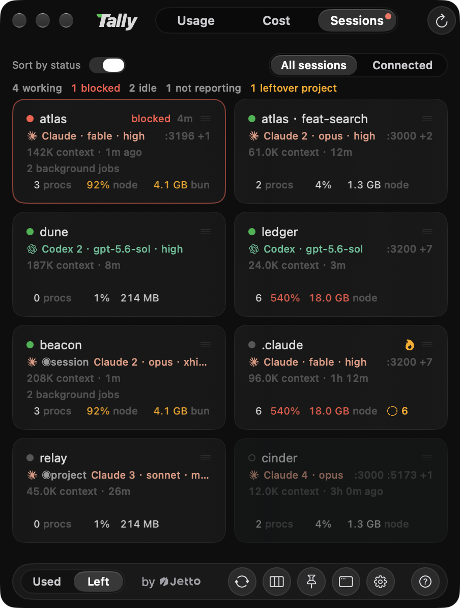
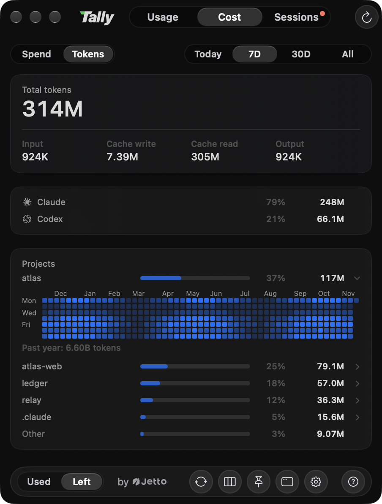
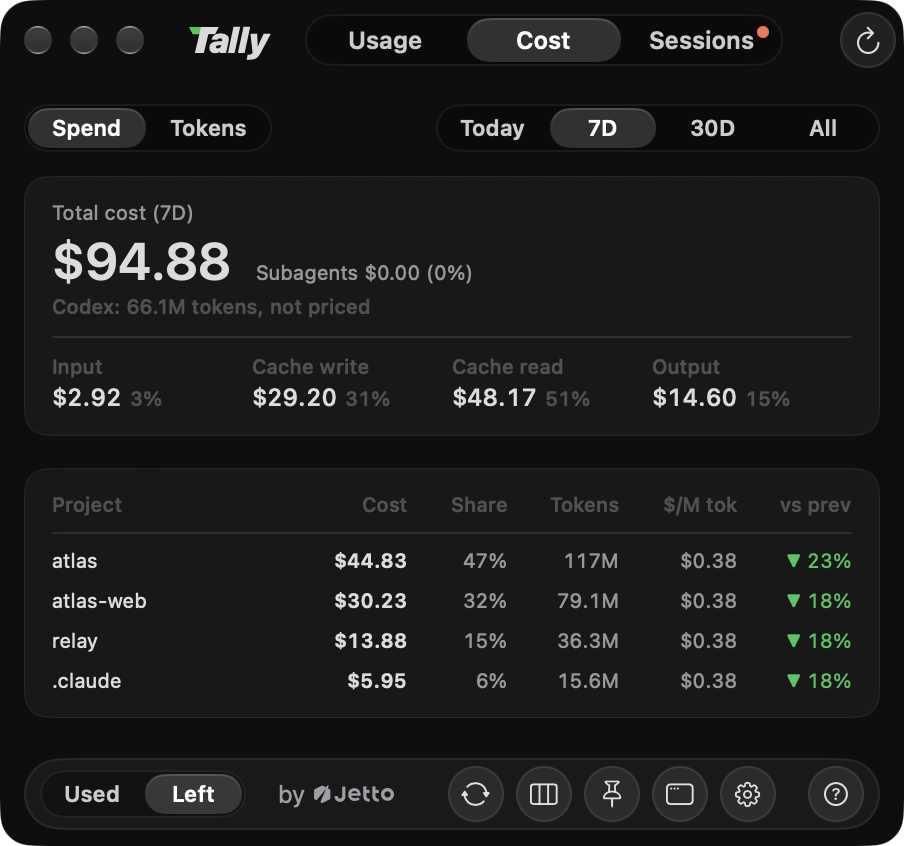
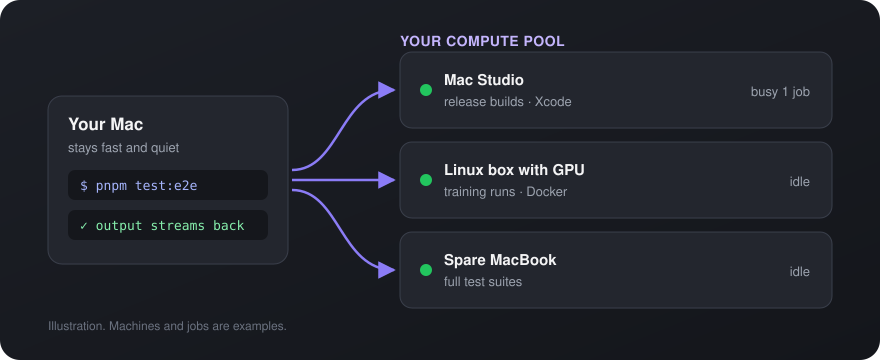

<p align="right"><b>English</b> · <a href="README.zh-TW.md">繁體中文</a> · <a href="README.zh-CN.md">简体中文</a> · <a href="README.ja.md">日本語</a> · <a href="README.ko.md">한국어</a></p>

<p align="center">
  <a href="https://github.com/jettoai/tally/releases/latest"></a>
</p>
<h1 align="center">Tally</h1>

<h3 align="center">Every Claude and Codex subscription you pay for, in one glance.</h3>

<p align="center">A free, open-source macOS menu bar app. It shows the 5-hour, weekly and top-model limits of every account side by side, and starts each new session on the account with the most room.<br>Read-only, on your own paid subscriptions.</p>

<p align="center">
  <a href="https://github.com/jettoai/tally/releases/latest/download/Tally.dmg"></a>
  <br><sub><a href="#install">Other ways to install</a> · <a href="https://github.com/jettoai/tally/releases">Release notes</a></sub>
</p>

<p align="center">
  <a href="https://github.com/jettoai/tally/releases/latest"></a>
  
  
</p>

<p align="center">
  
</p>

## See every account at once

Every Claude and Codex account gets its own row with its 5-hour, weekly and top-model windows, and each provider's accounts pool into one budget that says when it runs dry at your pace ("runs dry in about 4d 10h"). The menu bar shows the same pools without opening anything: one segment per provider (or per plan), session on top and weekly below.

<p align="center">
  
</p>

## Start every session on the account with the most room

`tally claude` (or `tally codex`) weighs remaining quota against reset time. When an account hits its cap, Tally resumes the *same conversation* on the next one, and every `/clear` is a free chance to move. You, or an AI agent, can also clear a session from outside with `tally session clear`: the empty window reopens on the account with the most room.

```sh
tally claude          # starts on the best account right now
tally codex           # same for Codex
```

## Watch every session on one board

Every conversation Tally launched becomes a card with its account, model and context size, and whether it is working, idle, or **blocked waiting on you**. A red dot in the menu bar tells you when one is asking for permission, and each card shows what that session is costing the machine (CPU, memory, ports held), read straight from the macOS kernel; Tally does not start a `ps` or `top` process to get them.

<p align="center">
  
</p>

https://github.com/user-attachments/assets/75a92cf0-4724-4ffd-bd2b-8db5e10ba8dd

<p align="center"><sub>A 30-second tour of Tally.</sub></p>

## Install

Paste this to your AI agent. It installs Tally and shows you the result:

```text
Download https://github.com/jettoai/tally/releases/latest/download/Tally.dmg,
copy Tally.app from it into /Applications and launch it. If macOS blocks the
app, stop and tell me to open it once from Finder. Then create /usr/local/bin if
it is missing and link the bundled CLI onto my PATH with
`ln -s /Applications/Tally.app/Contents/Helpers/tally /usr/local/bin/tally`,
trying it without a password first. If that needs my password, do not force it:
give me this one line to paste instead:
`sudo mkdir -p /usr/local/bin && sudo ln -s /Applications/Tally.app/Contents/Helpers/tally /usr/local/bin/tally`
After I paste it, wait about 10 seconds, run `tally` and show me the result. If
it shows no accounts, tell me to sign in to Claude or Codex first.
```

Or install it yourself:

```sh
curl -fsSLO https://github.com/jettoai/tally/releases/latest/download/Tally.dmg && open Tally.dmg
```

Or [download the DMG](https://github.com/jettoai/tally/releases/latest/download/Tally.dmg) directly, drag **Tally.app** into Applications, and launch it. It is notarized and updates itself in-app. Then **Settings → Integrations → Install all** adds the `tally` CLI, the status line signal and the Claude Code skill in one click. [More install options](#install-options).

## Pin the panel

Pin the dashboard as an always-on-top frosted-glass panel and drag its header anywhere. The account cards render as glass over the panel's backdrop.

## See where your tokens went

Tokens and list-price spend per project, read from the CLIs' own local transcripts. Nothing leaves your Mac, and `tally cost --json` hands the same figures to your scripts.

<p align="center">
  
</p>

<details>
<summary>The Spend page</summary>

The Spend page, the one the tab opens on, turns those tokens into money: each project's Claude usage priced at Anthropic's list prices, with the total broken into input, cache write, cache read and output. Codex tokens are counted but left unpriced, since Tally has no price list it trusts for them. `tally cost --json` hands the same figures to your scripts.

<p align="center">
  
</p>

</details>

## Read-only, on your own paid subscriptions

- Usage comes through the official `claude` and `codex` CLIs (`claude -p "/usage"` and `codex app-server`), so there is no session key or browser cookie to hand over.
- Tally never proxies, shares or resells access, and never logs or sends a token.
- One native Swift app with no Electron; the core that reads conversation transcripts is written in Rust.

<details>
<summary>How it works (and what it never does): every read and the few named writes</summary>

- **Usage via official CLIs.** Usage is read through the providers' **own official CLIs**
  (`claude -p "/usage"` and `codex app-server`), which authenticate with their vendors and manage
  their own credentials. Account discovery checks login attributes. One read-only exception is
  Claude login deadline metadata: Tally temporarily reads the local credential document from
  Keychain, or from `.credentials.json` when the Keychain item is absent, to extract
  `refreshTokenExpiresAt`. Only dates leave this reader. It does not log, persist, or transmit
  tokens, refresh logins, or modify credentials.
- **Read-only, with one named exception.** `claude auth login` finishes the OAuth round trip and
  stops there, so a config home Tally created and signed in for you would still meet its first
  session with the first-run wizard: a theme picker, and a request to sign in to the account that
  just signed in. So after a login Tally itself drove (adding an account, or renewing one from a
  card), it merges Claude Code's own note that the wizard is done, `hasCompletedOnboarding`, into
  that one home's state file, and a home Tally creates is seeded with the folder-trust answers you
  already gave on an existing account. A merge, never a replacement; a file it cannot parse is
  refused rather than rewritten; a home that has been through the wizard is left byte for byte.
  Never a credential, and never a scan for other homes to repair.
- **One opt-in root helper, for one purpose.** When a process such as `fseventsd` stays at full CPU, Tally
  writes an evidence file under `~/.tally/logs/process-forensics/`. Capturing `sample` and `fs_usage` of a
  root-owned process needs root, so Settings (or `tally forensics setup`) can install a helper once: the
  system's own password window runs it, Tally never sees the password, and exactly two root-owned files are
  written, `/Library/PrivilegedHelperTools/ai.jetto.tally.forensics` and `/etc/sudoers.d/tally-forensics`.
  The helper takes one process number and runs only those two read-only tools. It stays off until you set it
  up, and `tally forensics remove` (or the Remove button in Settings) takes both files away.
- **One poller, ever.** Only the menu-bar app runs the CLIs (every minute by default,
  relaxable to 2/5/15). The `tally` launcher reads a local snapshot
  (`~/.tally/snapshot.json`: percentages and paths, never tokens), so opening ten terminals
  costs zero extra reads.
- **Your own accounts only.** Multi-account means *your* paid subscriptions on *your* machine.
  Tally does not proxy, share, or resell access, and account switching just launches the
  official CLI with the config directory you already own.
- **Local first, error reports optional and off by default.** Nothing leaves your machine except
  the provider usage reads themselves, the anonymous usage ping below and, only if you turn on
  **Send crash and error reports** in Settings, crash and error reports to Sentry. Those carry the
  stack trace, the app and macOS versions, the Mac model, language and time zone, and the rough
  region Sentry infers from the connection; never your IP address, accounts, usage numbers or file
  contents. Turn it off again in the same place.
- **Anonymous usage ping, on by default.** When Tally starts and about once a day while it runs, it
  sends a random device ID, the app version and which build it is (Tally or Tally Pro) to jetto.ai
  so we can count installs and active users. It never sends your accounts, usage numbers, project
  names or file contents. Like any web request it reaches the server with your IP address and a
  standard User-Agent header. Turn it off in Settings > About (**Send anonymous usage data**) and
  nothing more is sent.
- **A small API for integrations.** Dashboards and scripts talk to Tally through the `tally` CLI;
  there is no socket or server to connect to.
  - `tally status --json` is the read side: every account's remaining windows and resets, plus
    `sessions`, one entry per supervised session with its `pid`, `project`, `state`, `model`,
    `effort` and `taskList` (the task list it writes to). The report carries `"version": 1` and is
    additive only: fields may appear in later versions, never vanish or change meaning.
  - `tally session send <text> --session <pid>` types one line into that session and presses
    Return; `tally message claude|codex <text> --session <pid>` hands a message to the session's
    own transport without pressing a key.

</details>

## Features

A one-line map of every feature; the full write-up lives in [docs/features.md](docs/features.md).

| Where | What you get |
|---|---|
| [The dashboard](docs/features.md#the-dashboard) | Account pool and forecast, usage advisor, menu bar strip, pinnable glass panel, card and list densities, token usage by project, reset times, login health, Codex reset banking |
| [The session board](docs/features.md#the-session-board) | Every conversation as a card, blocked states, the red dot, per-session CPU and memory |
| [The launch control plane](docs/features.md#the-launch-control-plane) | Smart pick, cap handoff, moves on `/clear`, early start, `tally type`, worktrees, reload, and the `tally` CLI with `tally status --json`, status line, Claude Code skill, shell shims and harness tools |
| [The chrome](docs/features.md#the-chrome) | Six app languages, native Swift with one third-party dependency |

## Coming soon: Tally Pro compute pool

Your other Macs and Linux boxes are sitting idle while this one grinds through a test suite. Tally Pro will send heavy work (full test suites, release builds, training jobs) to your own other machines automatically and stream the output back, so the Mac you are typing on stays fast.

<p align="center">
  
</p>

<p align="center"><sub>Watch this repo to hear when it ships.</sub></p>

## FAQ

<details>
<summary>How do I see usage limits for several Claude Max accounts in the macOS menu bar?</summary>

Sign each account in to Claude Code under its own config directory (for example
`CLAUDE_CONFIG_DIR=~/.claude2 claude`, then log in). Tally finds every `~/.claude*` login and
every Codex install, shows each account's 5-hour, weekly and top-model windows on its own row, and
pools each provider's accounts into one budget in the menu bar.

</details>

<details>
<summary>Is Tally a proxy or an account-sharing tool?</summary>

No. Tally does not sit between Claude Code and Anthropic, and it does not proxy, share or resell
access. It reads each account's usage through the official CLIs, and `tally claude` starts the
official CLI with the config directory of the account that has the most room. Every account is
your own paid subscription on your own Mac.

</details>

<details>
<summary>How is Tally different from ccusage or other usage trackers?</summary>

Tools like [ccusage](https://github.com/ryoppippi/ccusage) are terminal CLIs that estimate token
spend from local logs. Tally is a native menu bar app that shows the quota windows the vendors
actually enforce (5-hour, weekly, top-model) for every Claude and Codex account at once, and adds a
launcher that acts on those numbers. The
Tokens view covers the "how much did I burn, and on what" question too, per project, straight
from the local transcripts, with no dollar guessing. And the session board goes a level deeper
than ccusage and other usage meters: every running session as a card, who is blocked waiting on you, and what each
one is costing the machine, down to the process holding the memory. Read-only, on your own paid
subscriptions.

</details>

<details>
<summary>How is Tally different from CodexBar, Claude Usage Tracker or Usage4Claude?</summary>

As of October 2026 they are all native menu bar meters, and several of them now show more than one
account. What Tally adds: usage is read only through the official `claude` and `codex` CLIs, so
there is no session key or browser cookie to provide; each provider's accounts are pooled into one
budget with a forecast of when it runs dry at your pace; and `tally claude` picks the account for
each new session by remaining quota and reset time, then resumes the same conversation on the next
account if one hits its cap. CodexBar covers more providers (Cursor, Copilot, Gemini and others),
so if you use one account across many AI tools it may fit you better.

</details>

<details>
<summary>How does Tally handle Keychain access?</summary>

Usage comes through official CLIs, and account discovery probes attributes only. The Claude login
deadline reader also reads a credential document, but skips access when its preflight detects a
locked Keychain or does not establish that the reader is trusted; the deadline stays unknown.
Keychain state can change between that check and the read, so a permission prompt is still possible.
Signing in remains the official CLI's job; Tally's sign-in flow does not directly modify credentials.

</details>

<details>
<summary>What happens when every account is capped?</summary>

Nothing dramatic: the dashboard shows it, `tally claude` warns and launches the bare CLI, and
auto-handoff stays put rather than looping.

</details>

<details>
<summary>Does auto-handoff lose my conversation?</summary>

No: it resumes the same session transcript on the next account (additively; your original
transcript is never modified). An interrupted tool call may re-run once after the switch.

</details>

<details>
<summary>Will the status line integration break my custom status line?</summary>

No. Your own command keeps running exactly as before, fed the same session JSON; Tally only
appends its signal, skips the account name if you already show one, restores your original
registration byte-for-byte on removal, and falls back to running your command directly if the
tally binary ever disappears.

</details>

## Requirements

- macOS 14+
- [Claude Code](https://claude.com/claude-code) and/or Codex CLI (`~/.codex`). If this Mac has
  neither yet, the window Tally shows the first time you open it installs one for you and walks
  you through signing in.
- A second Claude account: **Settings → Accounts → Add an account**. (Advanced: it is just an
  extra config dir, so `CLAUDE_CONFIG_DIR=~/.claude2 claude` and logging in works too.)

## Install options

Download the latest notarized DMG from [Releases](https://github.com/jettoai/tally/releases/latest),
drag **Tally.app** into Applications, and launch it. Updates arrive automatically in-app.

To use the `tally` CLI, link the copy bundled inside the app onto your PATH. `/usr/local/bin` may not exist on a fresh Mac, so this needs an administrator password:

```sh
sudo mkdir -p /usr/local/bin && sudo ln -s /Applications/Tally.app/Contents/Helpers/tally /usr/local/bin/tally
```

<details>
<summary>Build from source instead</summary>

```sh
brew install xcodegen   # once
git clone https://github.com/jettoai/tally && cd tally
xcodegen generate
xcodebuild build -project Tally.xcodeproj -scheme Tally -configuration Release -destination 'platform=macOS'
xcodebuild build -project Tally.xcodeproj -scheme TallyCLI -configuration Release -destination 'platform=macOS'
```

Then move `Tally.app` from DerivedData to `/Applications`, and put the `tally` binary on your PATH:

```sh
ln -s <build-products>/tally /usr/local/bin/tally
```

</details>

Or skip the symlink: **Settings → Integrations** installs each piece
with one click and a clean removal, with an Install all switch over the set: the CLI tool, the
shell shims (bare `claude` / `codex` follow your policy), the status line signal, the session
board's notification hook, the subagent-count hooks, the quota warning hooks, and the Claude Code
skill with its `/tally` command. Every hook row keeps the same
promise: whatever you already had registered on that event keeps running, and removal takes out
only Tally's own entry. Sharing an existing account's harness has a row here too, deliberately
left out of Install all: that one moves conversations between config homes, and a press meaning
"turn everything on" may not also mean that.

How the shims differ from `tally claude`: with the shims installed and Claude's Launch account
setting on anything but Off, typing plain `claude` picks an account before it starts. `tally claude` (the
`c` and `cc` aliases below) does two more things a shim cannot. When an account hits its usage
limit, the conversation moves to another account on its own; if no other account has room yet, it
stays put and retries every 15 seconds. And `--continue` reopens, by its id, the conversation
Tally last watched in this directory, which is one run through `tally claude`; only when there is
no such record, or its conversation is gone, does it fall back to the newest conversation there,
however that one was opened.

Optional shell aliases:

```sh
alias c='tally claude'
alias cc='tally claude --continue'
```

## Localization

Tally ships in English, 繁體中文, 简体中文, 日本語, 한국어, and Türkçe, switchable live from Settings
with no relaunch. Every string lives in one Xcode String Catalog
([`Tally/Resources/Localizable.xcstrings`](Tally/Resources/Localizable.xcstrings)). To add a
language, fill in its catalog column, register its code in `AppLocale.supported` and
`project.yml`, and add its native name to the Settings language picker. The bar is "reads like the OS, not
like a translation"; corrections to existing languages are as welcome as new ones.

## Contributing

Issues and pull requests are welcome. To get building, follow "Build from source" above; two
conventions keep the project healthy:

- `project.yml` is the single source of truth; `Tally.xcodeproj` is generated by XcodeGen and
  never edited by hand.
- New user-facing strings go through the `L("…")` helper and the String Catalog, with all six
  languages filled in.

Keep each PR to one intent, and put the why in the description.

## Acknowledgments

Tally builds on a trail mapped by some excellent projects:

- [ccusage](https://github.com/ryoppippi/ccusage) pioneered turning Claude Code's local logs into
  usage insight, and showed how much developers want to see their numbers.
- [OpenUsage](https://github.com/robinebers/openusage) and
  [AIUsage](https://github.com/sylearn/AIUsage) proved the at-a-glance menu bar meter; Tally
  exists because we wanted that glance across many accounts at once.
- [Sparkle](https://sparkle-project.org) powers the in-app updates.

## License

[MIT](LICENSE) © [jetto](https://jetto.ai)

<p align="center"><sub>Free and open source · by <a href="https://jetto.ai">Jetto</a> · a macOS menu bar AI usage monitor for Claude and Codex rate limits</sub></p>
