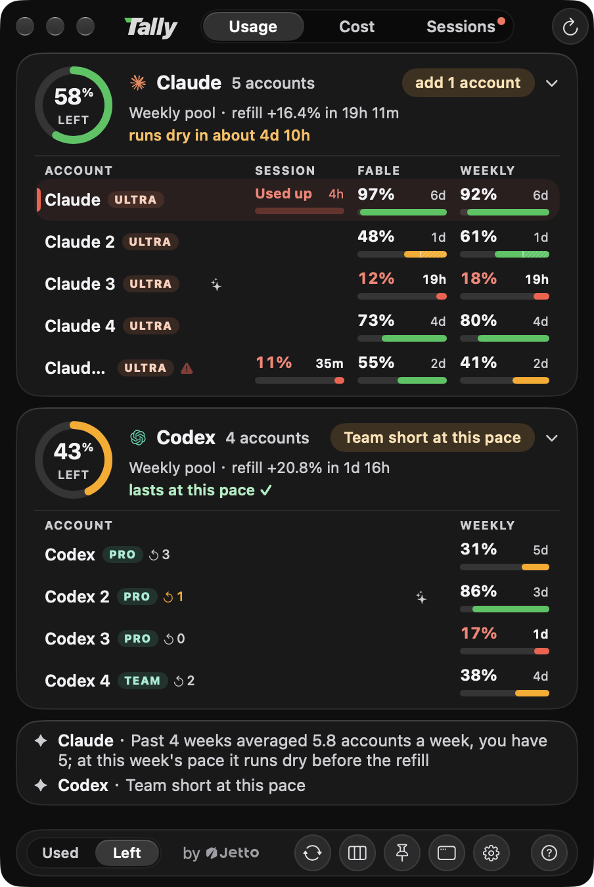
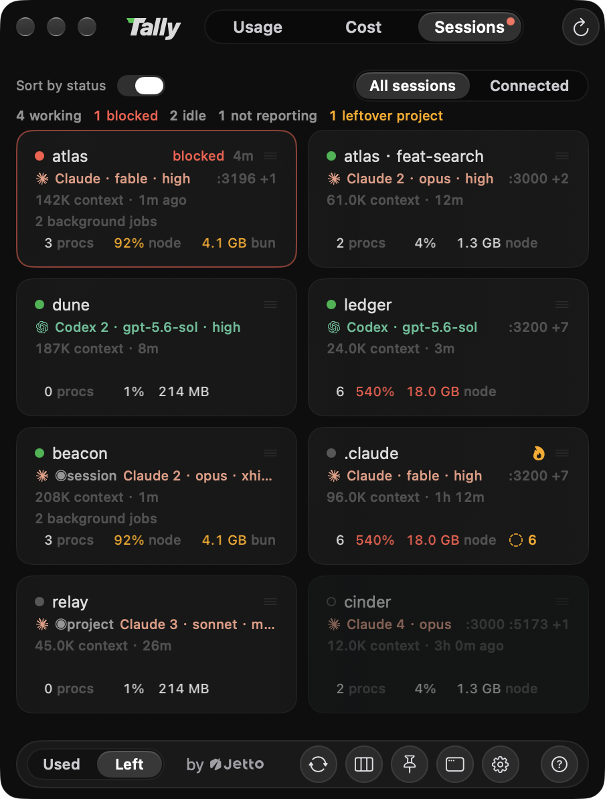
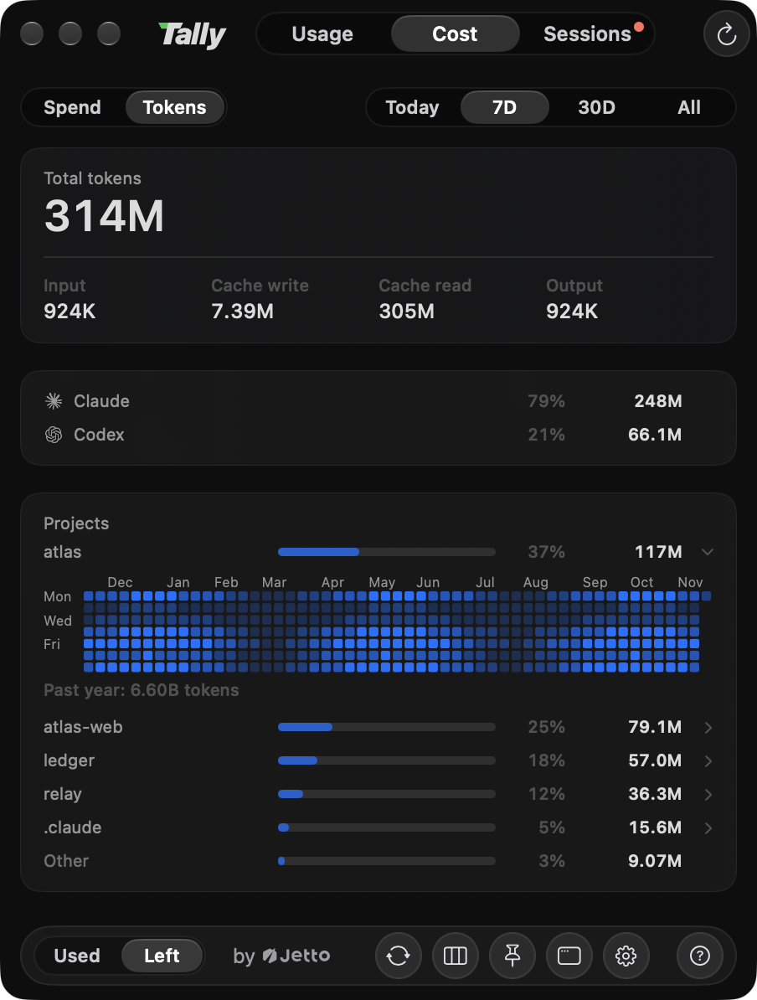
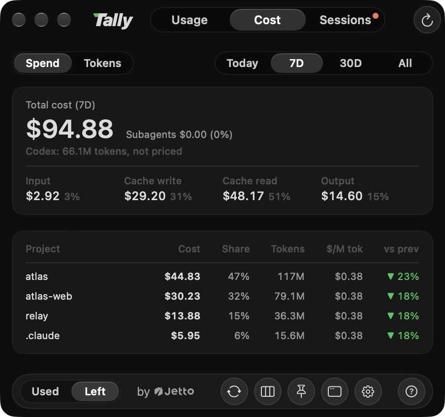
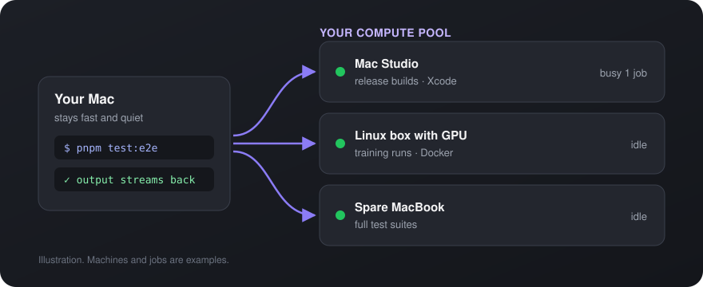

<p align="right"><a href="README.md">English</a> · <a href="README.zh-TW.md">繁體中文</a> · <b>简体中文</b> · <a href="README.ja.md">日本語</a> · <a href="README.ko.md">한국어</a></p>

<p align="center">
  <a href="https://github.com/jettoai/tally/releases/latest"></a>
</p>
<h1 align="center">Tally</h1>

<h3 align="center">你付费的每个 Claude 与 Codex 订阅，一眼看尽。</h3>

<p align="center">免费开源的 macOS 菜单栏 app。把每个账号的 5 小时、每周与旗舰模型额度上限并排显示，并让每个新会话从余量最多的账号开始。<br>只读，仅用于你自己付费的订阅。</p>

<p align="center">
  <a href="https://github.com/jettoai/tally/releases/latest/download/Tally.dmg"></a>
  <br><sub><a href="#安装">其他安装方式</a> · <a href="https://github.com/jettoai/tally/releases">版本说明</a></sub>
</p>

<p align="center">
  <a href="https://github.com/jettoai/tally/releases/latest"></a>
  
  
</p>

<p align="center">
  
</p>

## 一眼看尽每个账号

每个 Claude 与 Codex 登录各占一行，带有自己的 5 小时、每周与旗舰模型额度窗；账号池再把同一家的账号合并成一份预算，并照你的节奏预测什么时候用光（「约 4d 10h 后用光」）。菜单栏不用打开任何东西就显示同样的池：每个 provider（或每种方案）一段，会话在上、每周在下。

<p align="center">
  
</p>

## 每个新会话都从余量最多的账号开始

`tally claude`（或 `tally codex`）会对照剩余额度与重置时间来挑账号。账号撞到上限时，Tally 会在下一个账号上续跑*同一段对话*；每次 `/clear` 都是一次免费的搬家机会。你或 AI 智能体也可以从外部用 `tally session clear` 清空某个会话，新的空白窗口会直接开在余量最多的账号上。

```sh
tally claude          # 现在就从最佳账号启动
tally codex           # Codex 同样适用
```

## 所有会话在同一块看板上

Tally 启动的每一段对话都会成为一张卡片：账号、模型、context 大小，以及它在工作中、空闲，还是**卡住等你回复**。有会话在请求权限时，菜单栏的红点会告诉你；每张卡片也显示该会话占了机器多少资源（CPU、内存、占住的端口）。这些数字直接从 macOS 内核读取，不另外启动 `ps` 或 `top` 进程。

<p align="center">
  
</p>

https://github.com/user-attachments/assets/75a92cf0-4724-4ffd-bd2b-8db5e10ba8dd

<p align="center"><sub>30 秒带你看一遍 Tally。</sub></p>

## 安装

把下面这段话贴给你的 AI，它会自己装好 Tally 并跑出结果：

```text
Download https://github.com/jettoai/tally/releases/latest/download/Tally.dmg,
copy Tally.app from it into /Applications and launch it. If macOS blocks the
app, stop and tell me to open it once from Finder. Then create /usr/local/bin if
it is missing and link the bundled CLI onto my PATH with
`ln -s /Applications/Tally.app/Contents/Helpers/tally /usr/local/bin/tally`,
trying it without a password first. If that needs my password, do not force it:
give me this one line to paste instead:
`sudo mkdir -p /usr/local/bin && sudo ln -s /Applications/Tally.app/Contents/Helpers/tally /usr/local/bin/tally`
After I paste it, wait about 10 seconds, run `tally` and show me the result. If
it shows no accounts, tell me to sign in to Claude or Codex first.
```

或自己安装：

```sh
curl -fsSLO https://github.com/jettoai/tally/releases/latest/download/Tally.dmg && open Tally.dmg
```

或直接[下载 DMG](https://github.com/jettoai/tally/releases/latest/download/Tally.dmg)，把 **Tally.app** 拖进「应用程序」后启动。它已通过公证，并在应用内自动更新。接着在**设置 → 集成 → 全部安装**一键加上 `tally` CLI、status line 信号与 Claude Code skill。[更多安装方式](#安装选项)。

## 钉住面板

把仪表盘钉成始终置顶的毛玻璃面板，标题栏拖到哪都行。账号卡片会以玻璃质感呈现在面板背景之上。

## 看清 Token 花到哪里去了

每个项目的 Token 与牌价花费，数据读自 CLI 自己的本地 transcript。没有任何东西离开你的 Mac，`tally cost --json` 把同一份数字交给你的脚本。

<p align="center">
  
</p>

<details>
<summary>花费页</summary>

花费页（分页默认打开的那页）把这些 Token 换算成金额：按 Anthropic 牌价计算每个项目的 Claude 用量，总额再拆成输入、缓存写入、缓存读取与输出。Codex 的 Token 会计入，但没有换算金额，因为 Tally 没有一份可信的 Codex 价目表。运行 `tally cost --json` 就能让脚本拿到同一份数字。

<p align="center">
  
</p>

</details>

## 只读，只用于你自己付费的订阅

- 用量通过官方 `claude` 与 `codex` CLI 读取（`claude -p "/usage"` 与 `codex app-server`），所以没有 session key 或浏览器 cookie 需要交出去。
- Tally 从不代理、共享或转售访问权，也从不记录或发送任何 token。
- 单一原生 Swift app，没有 Electron；读取对话记录的核心用 Rust 编写。

<details>
<summary>工作原理（以及它绝不做的事）：每一次读取与少数几项具名写入</summary>

- **通过官方 CLI 获取用量。** 用量通过各家**官方 CLI** 读取（`claude -p "/usage"` 与
  `codex app-server`），由官方客户端向厂商验证身份并管理凭证。账号检测会检查登录属性。
  一个只读例外是 Claude 登录期限数据：Tally 会暂时读取 Keychain 中的本地凭证文件，
  如果 Keychain 项目不存在，则读取 `.credentials.json`，从中获取 `refreshTokenExpiresAt`。
  这个读取程序只会返回日期；它不会记录、持久保存或发送 token，也不会刷新登录或修改凭证。
- **只读，只有一个明确例外。** `claude auth login` 完成 OAuth 流程后就停手，所以 Tally
  帮你新建并登录的配置 home，第一次启动时仍会撞见首次运行向导：主题选择，以及要求你登录
  刚刚才登录的那个账号。所以在 Tally 自己驱动的一次登录之后（新增账号，或从卡片续签），
  它会把 Claude Code 自己记录「向导已完成」的那个字段 `hasCompletedOnboarding` 合并进
  那一个 home 的状态文件，Tally 新建的 home 也会预先带入你在既有账号上已经回答过的文件夹
  信任答案。只合并，绝不整份覆盖；解析不了的文件会直接拒写，而不是被改写；已经跑过向导
  的 home 会原封不动、逐字节保留。永不碰凭证，也永不扫描其他 home 去修补。
- **一个可选启用的 root 辅助程序，只做一件事。** 当 `fseventsd` 这类进程持续满载，Tally 会在
  `~/.tally/logs/process-forensics/` 留一份取证文件。要捕获 root 进程的 `sample` 与 `fs_usage` 需要
  root 权限，所以设置页（或 `tally forensics setup`）可以一次性安装一个辅助程序：由系统自己的密码
  窗口执行，Tally 看不到密码，只会写入两个 root 拥有的文件：
  `/Library/PrivilegedHelperTools/ai.jetto.tally.forensics` 与 `/etc/sudoers.d/tally-forensics`。
  辅助程序只接收一个进程编号，只运行那两个只读工具。你不设置就一直关闭，
  `tally forensics remove`（或设置页的「移除」按钮）会把两个文件都删掉。
- **永远只有一个轮询者。** 只有菜单栏应用会执行 CLI（默认每 1 分钟，可放宽到 2／5／15 分钟）。
  `tally` 启动器只读本机快照（`~/.tally/snapshot.json`，只有百分比和路径、绝无 token），
  开十个终端也不多读一次。
- **只碰你自己的账号。** 多账号指的是*你自己*付费、在*你自己*机器上的订阅。Tally 不代理、
  不共享、不转售访问权；切换账号只是用你本来就拥有的 config 目录启动官方 CLI。
- **本机为主，错误报告可选、默认关闭。** 除了用量读取本身、下面的匿名使用统计，以及你在设置里
  打开「发送崩溃与错误报告」后发送到 Sentry 的错误报告，没有任何东西离开你的机器。错误报告含
  错误堆栈、App 与 macOS 版本、Mac 机型、语言与时区，以及 Sentry 由连接推断的大致地区；
  绝不包含 IP、账号、用量数字或文件内容。在同一处可随时关闭。
- **匿名使用统计，默认开启。** Tally 启动时与运行期间约每天一次，把随机设备码、App 版本与版本类别
  （Tally 或 Tally Pro）发送到 jetto.ai，用于统计安装与使用人数。绝不发送你的账号、用量数字、项目名称
  或文件内容。和任何网络请求一样，服务器会看到你的 IP 地址与标准的 User-Agent 标头。在设置 > 关于
  关闭「发送匿名使用统计」，之后就不再发送任何东西。
- **面向集成的小型 API。** 仪表板与脚本通过 `tally` CLI 与 Tally 交互；没有 socket 或服务器可连。
  - `tally status --json` 是读取端：每个账号剩余的额度窗与重置时间，外加 `sessions`，
    每个受监督的会话一条，带有它的 `pid`、`project`、`state`、`model`、`effort` 与
    `taskList`（它写入的任务列表）。报告带有 `"version": 1`，并且只增不改：之后的版本可能新增
    字段，既有字段永不消失或改变含义。
  - `tally session send <text> --session <pid>` 会把一行文字输入该会话并按下 Return；
    `tally message claude|codex <text> --session <pid>` 则把消息交给该会话自己的传输通道，
    不按任何键。

</details>

## 功能

每项功能的一行索引；完整说明在 [docs/features.zh-CN.md](docs/features.zh-CN.md)。

| 在哪里 | 你会得到什么 |
|---|---|
| [仪表盘](docs/features.zh-CN.md#仪表盘) | 账号池与预测、用量顾问、菜单栏条、可钉住的毛玻璃面板、卡片与列表密度、按项目的 Token 用量、重置时间、登录状态、Codex 额度重置存量 |
| [会话看板](docs/features.zh-CN.md#会话看板) | 每段对话一张卡片、卡住状态、红点、每个会话的 CPU 与内存 |
| [启动控制平面](docs/features.zh-CN.md#启动控制平面) | 智选、撞上限接管、`/clear` 时搬家、提前开窗、`tally type`、worktree、重载，以及 `tally` CLI（含 `tally status --json`）、status line、Claude Code skill、shell shim 与 harness 工具 |
| [外观与细节](docs/features.zh-CN.md#外观与细节) | 六种 app 语言、原生 Swift、只有一个第三方依赖 |

## 即将推出：Tally Pro 算力池

这台 Mac 在跑测试套件的时候，你的其他 Mac 与 Linux 主机正闲着。Tally Pro 会自动把重活（完整测试套件、release 构建、训练任务）送到你自己的其他机器上，再把输出流式传回，让你正在打字的这台 Mac 保持流畅。

<p align="center">
  
</p>

<p align="center"><sub>Watch 这个 repo，上线时第一时间收到通知。</sub></p>

## 常见问题

<details>
<summary>怎么在 macOS 菜单栏同时看多个 Claude Max 账号的额度？</summary>

让每个账号各自登录 Claude Code，各用自己的配置目录（例如
`CLAUDE_CONFIG_DIR=~/.claude2 claude`，再登录）。Tally 会找出每一个 `~/.claude*` 登录与每一个
Codex 安装，每个账号各占一行显示 5 小时、每周与旗舰模型窗口，并把同一家的账号合成一个余量池
显示在菜单栏。

</details>

<details>
<summary>Tally 是 proxy 或账号共享工具吗？</summary>

不是。Tally 不介入 Claude Code 与 Anthropic 之间，也不代理、不共享、不转售任何访问权限。它通过官方
CLI 读取每个账号的用量，`tally claude` 则用余量最多那个账号的配置目录启动官方 CLI。每个账号
都是你自己付费订阅、跑在你自己的 Mac 上。

</details>

<details>
<summary>Tally 和 ccusage 或其他用量工具有什么不同？</summary>

[ccusage](https://github.com/ryoppippi/ccusage) 这类工具是终端 CLI，从本地 log 估算 token
花费。Tally 是原生菜单栏 app，显示厂商实际强制的额度窗口（5 小时、每周、旗舰模型），
一次覆盖每个 Claude 与 Codex 账号，还附带一个依据这些数字行动的启动器。Token 视图也把「我到底烧了多少、烧在哪」这题一并覆盖，按项目拆分，直接读
本地 transcript，不做金额猜测。而会话看板又比 ccusage 与其他用量仪表都再深一层：每一段运行中的会话都是一张
卡片，谁卡住在等你、每一段又占了机器多少资源，细到是哪个进程占着内存。只读，仅用于你自己
付费的订阅。

</details>

<details>
<summary>Tally 和 CodexBar、Claude Usage Tracker、Usage4Claude 有什么不同？</summary>

截至 2026 年 10 月，它们都是原生菜单栏仪表，其中几个现在也能显示多个账号。Tally 多做的是：
只通过官方 `claude` 与 `codex` CLI 读取用量，所以不需要提供 session key 或浏览器 cookie；
把每一家的账号合成一个余量池，并预测按你当前的速度何时用完；`tally claude` 依剩余额度与重置
时间为每个新会话选账号，某个账号撞到上限时，在下一个账号上续跑同一段对话。CodexBar 覆盖
更多服务（Cursor、Copilot、Gemini 等），如果你是用同一个账号跨多个 AI 工具，它可能更适合你。

</details>

<details>
<summary>Tally 如何访问 Keychain？</summary>

用量通过官方 CLI 获取，账号检测只检查属性。Claude 登录期限的读取程序也会读取凭证文件，
但如果预先检查发现 Keychain 已锁定，或无法确认读取程序受信任，就会跳过访问，期限保持未知。
检查与读取之间 Keychain 状态仍可能改变，因此仍有可能出现授权窗口。
登录仍交由官方 CLI 执行，Tally 的登录流程不会直接修改凭证。

</details>

<details>
<summary>所有账号都满了会怎样？</summary>

不会有戏剧性后果：仪表如实显示，`tally claude` 警告后直接裸启动官方 CLI，
自动接管则原地不动、不会空转循环。

</details>

<details>
<summary>自动接管会弄丢我的对话吗？</summary>

不会：它在下一个账号上续跑同一份会话记录（只新增、原始记录永不被修改）。
被中断的工具调用可能会在切换后重跑一次。

</details>

<details>
<summary>status line 集成会破坏我自定义的 status line 吗？</summary>

不会。你自己的命令会照原样继续运行，喂进同一份 session JSON；Tally 只是在后面加一段
信号，如果你已经显示账号名称就会跳过那部分，移除时逐字节还原成原本的注册，就算
tally 这个二进制哪天消失了，也会直接回退到运行你原本的命令。

</details>

## 要求

- macOS 14+
- [Claude Code](https://claude.com/claude-code) 与／或 Codex CLI（`~/.codex`）。如果这台 Mac
  两个都还没有，第一次打开 Tally 时出现的窗口会帮你安装其中一个，并带你完成登录。
- 第二个 Claude 账号：**设置 → 账号 → 添加账号**。（进阶：它其实就是多一个 config 目录，
  所以用 `CLAUDE_CONFIG_DIR=~/.claude2 claude` 再登录也可以。）

## 安装选项

从 [Releases](https://github.com/jettoai/tally/releases/latest) 下载最新的公证 DMG，
把 **Tally.app** 拖进「应用程序」后启动即可，之后的更新会在应用内自动送达。

要使用 `tally` CLI，把应用内置的那份链接到 PATH。全新的 Mac 上 `/usr/local/bin` 可能不存在，所以需要管理员密码：

```sh
sudo mkdir -p /usr/local/bin && sudo ln -s /Applications/Tally.app/Contents/Helpers/tally /usr/local/bin/tally
```

<details>
<summary>或从源码构建</summary>

```sh
brew install xcodegen   # 一次性
git clone https://github.com/jettoai/tally && cd tally
xcodegen generate
xcodebuild build -project Tally.xcodeproj -scheme Tally -configuration Release -destination 'platform=macOS'
xcodebuild build -project Tally.xcodeproj -scheme TallyCLI -configuration Release -destination 'platform=macOS'
```

把 `Tally.app` 从 DerivedData 移到「应用程序」，并把 `tally` 放进 PATH：

```sh
ln -s <build-products>/tally /usr/local/bin/tally
```

</details>

或者跳过符号链接：**设置 → 集成** 里每一项都是一键安装、一键干净移除，
上方还有一个「全部安装」开关管住整组：CLI 工具、shell shim（让裸的 `claude` / `codex`
也遵循你的策略）、status line 信号、会话看板的通知 hook、subagent 计数 hook、额度警示
hook，以及带着 `/tally` 命令的 Claude Code skill。每一行 hook 都给同一个承诺：你原本注册在那个事件上的东西照常运行，
移除时也只拿掉 Tally 自己那一条。把既有账号接上共享配置在这里也有一行，但刻意不纳入
「全部安装」：那一项会在 config home 之间搬动对话，而一个意思是「全部打开」的按键，
未必也代表那件事。

shim 和 `tally claude` 的区别：装了设置页的 shim，而且 Claude 那一行的“启动账号”没有选“关闭”，直接输入 `claude` 也会先帮你挑账号。`tally claude`（也就是下面的 `c` 和 `cc`）多做两件 shim 做不到的事：撞到用量上限时，对话自动接到别的账号继续，暂时没有别的账号有额度就停在原处、每 15 秒重试一次；`--continue` 按对话 id 接回 Tally 在这个目录最后看着的那段对话，也就是最近一次用 `tally claude` 跑的那段；这个目录没有这条记录、或那段对话已经不在时，才改为接回目录里最新的一段，不管它是怎么开的。

可选的 shell 快捷方式：

```sh
alias c='tally claude'
alias cc='tally claude --continue'
```

## 本地化

Tally 内置 English、繁體中文、简体中文、日本語、한국어与 Türkçe，设置页实时切换、免重启。
所有字符串集中在单一 Xcode String Catalog
（[`Tally/Resources/Localizable.xcstrings`](Tally/Resources/Localizable.xcstrings)），
新增语言就是「多填一列」的单文件 PR。标准是「读起来像操作系统原生文案、不像翻译」；
修正既有语言与新增语言一样欢迎。

## 参与贡献

欢迎 issue 与 pull request。开发环境照上方「从源码构建」，另有两条让项目保持健康的惯例：

- `project.yml` 是唯一事实来源；`Tally.xcodeproj` 由 XcodeGen 生成、永不手改。
- 新增用户可见字符串一律走 `L("…")` helper 进 String Catalog，六种语言一次填齐。

每个 PR 保持单一意图，并把「为什么」写进描述。

## 致谢

Tally 走在几个优秀项目开出的路上：

- [ccusage](https://github.com/ryoppippi/ccusage)：最早把 Claude Code 本地日志变成用量洞察，
  证明了开发者有多想看到自己的数字。
- [OpenUsage](https://github.com/robinebers/openusage) 与
  [AIUsage](https://github.com/sylearn/AIUsage)：确立了菜单栏仪表一眼看用量的形式；
  Tally 的存在，是因为我们想把这一眼同时看遍多个账号。
- [Sparkle](https://sparkle-project.org)：驱动应用内自动更新。

## 许可证

[MIT](LICENSE) © [jetto](https://jetto.ai)

<p align="center"><sub>免费开源 · 由 <a href="https://jetto.ai">Jetto</a> 打造 · 一款 macOS 菜单栏 AI 用量监控工具，盯住 Claude 与 Codex 的额度限制</sub></p>
