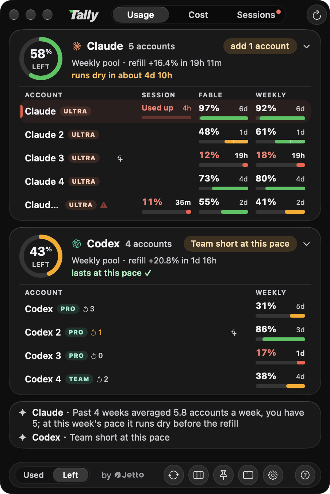
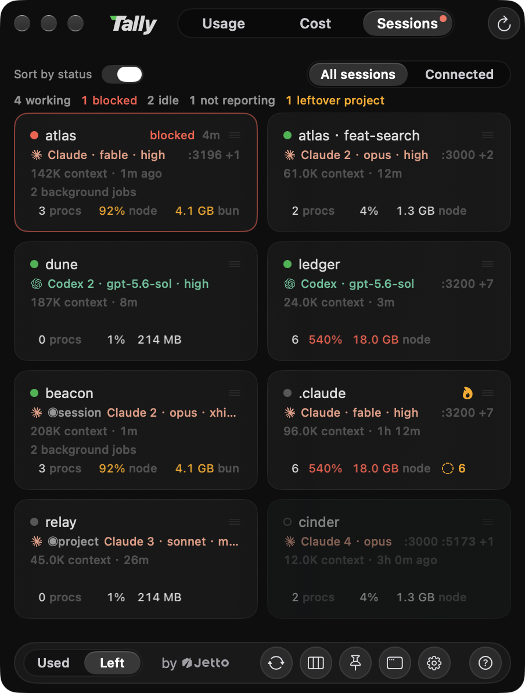
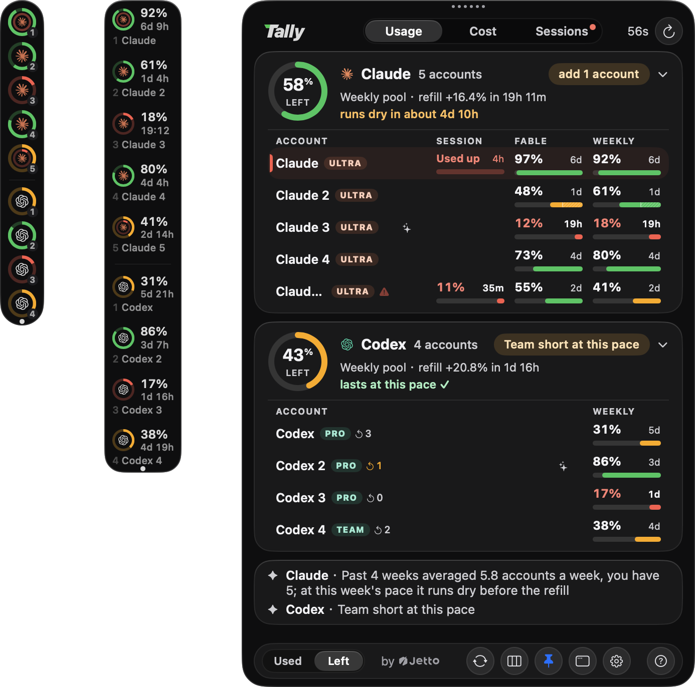
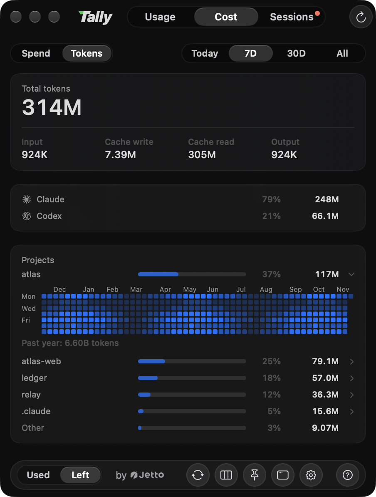
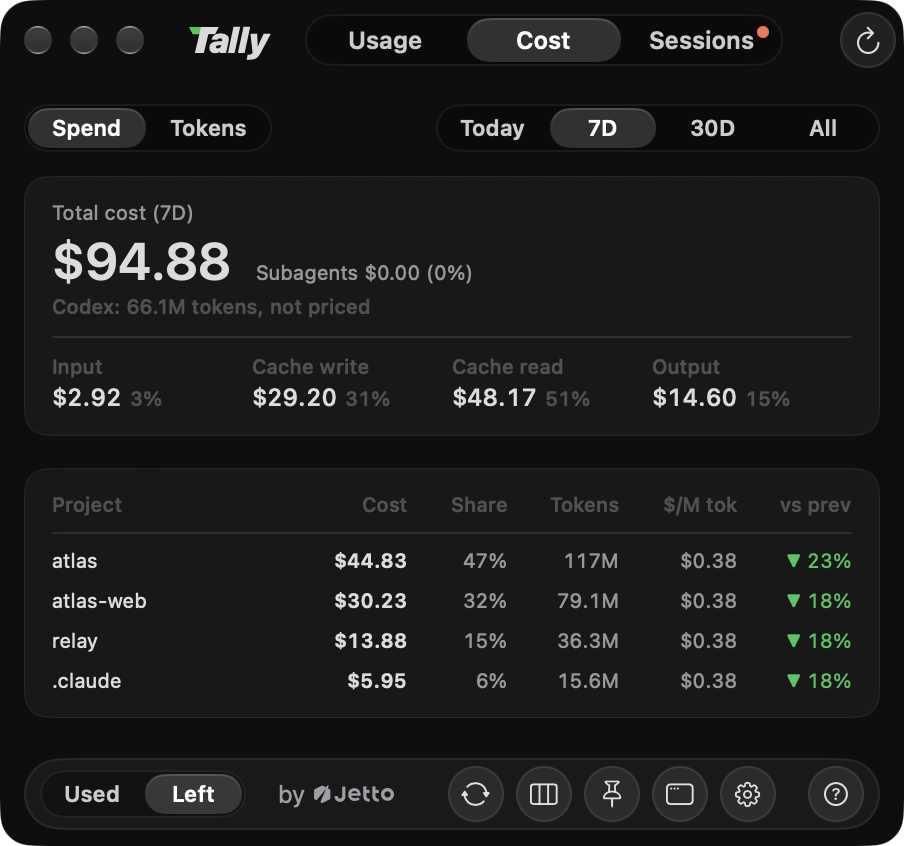
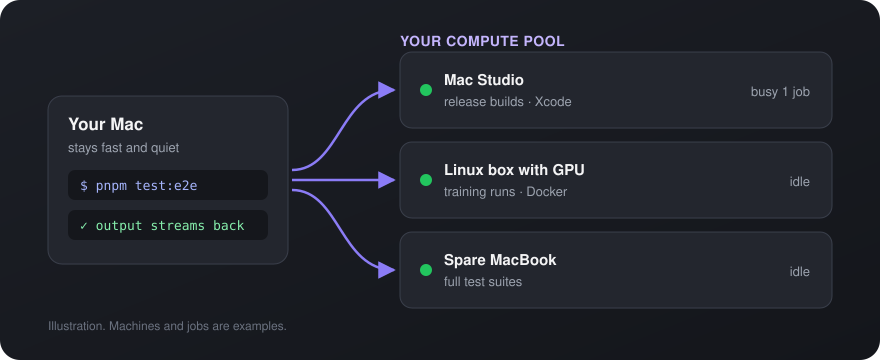

<p align="right"><a href="README.md">English</a> · <b>繁體中文</b> · <a href="README.zh-CN.md">简体中文</a> · <a href="README.ja.md">日本語</a> · <a href="README.ko.md">한국어</a></p>

<p align="center">
  <a href="https://github.com/jettoai/tally/releases/latest"></a>
</p>
<h1 align="center">Tally</h1>

<h3 align="center">你付費的每個 Claude 與 Codex 訂閱，一眼看完。</h3>

<p align="center">免費開源的 macOS 選單列 app。把每個帳號的 5 小時、每週與旗艦模型額度上限並排顯示，並讓每個新 session 從餘量最多的帳號開始。<br>唯讀，只用於你自己付費的訂閱。</p>

<p align="center">
  <a href="https://github.com/jettoai/tally/releases/latest/download/Tally.dmg"></a>
  <br><sub><a href="#安裝">其他安裝方式</a> · <a href="https://github.com/jettoai/tally/releases">版本說明</a></sub>
</p>

<p align="center">
  <a href="https://github.com/jettoai/tally/releases/latest"></a>
  
  
</p>

<p align="center">
  
</p>

## 一眼看完每個帳號

每個 Claude 與 Codex 登入各佔一行，帶著 5 小時、每週與旗艦模型額度窗；帳號池再把同一家的帳號合成一份總預算，並預測照你的節奏何時用光（「約 4d 10h 後用光」）。選單列不用打開任何東西就顯示同樣的池：每個服務（或每種方案）一個圓環，填滿的比例是每週還剩多少；在「設定」開啟後，圓環內多一圈較細的內環代表 5 小時額度。

<p align="center">
  
</p>

## 每個新 session 都從餘量最多的帳號開始

`tally claude`（或 `tally codex`）會對照剩餘額度與重置時間來挑帳號。帳號撞到上限時，Tally 會在下一個帳號上續跑*同一段對話*；每次 `/clear` 都是一次免費搬家的機會。你或 AI agent 也可以從外面用 `tally session clear` 清空某個 session，新的空白視窗會直接開在餘量最多的帳號上。

```sh
tally claude          # 現在就從最佳帳號啟動
tally codex           # Codex 同樣適用
```

## 所有 session 攤在同一塊看板上

Tally 啟動的每段對話都會變成一張卡片：帳號、模型、context 大小，以及它是工作中、閒置，還是**卡住在等你**。有 session 在要求權限時，選單列的紅點會提醒你；每張卡片也顯示那個 session 佔了機器多少資源（CPU、記憶體、佔住的 port）。這些數字直接向 macOS 核心讀取，不另外開 `ps` 或 `top` 行程。

<p align="center">
  
</p>

## 安裝

把這段話貼給你的 AI，它會自己裝好 Tally 並跑出結果：

```text
下載 https://github.com/jettoai/tally/releases/latest/download/Tally.dmg，
把裡面的 Tally.app 複製到 /Applications 並啟動。若 macOS 擋下這個 app，
先停下來告訴我從 Finder 開一次。接著若 /usr/local/bin 不存在就先建立，再用
`ln -s /Applications/Tally.app/Contents/Helpers/tally /usr/local/bin/tally`
把內附的 CLI 連到我的 PATH，先試不用密碼的做法。若需要我的密碼，不要自己硬做，
直接把下面這一行給我貼：
`sudo mkdir -p /usr/local/bin && sudo ln -s /Applications/Tally.app/Contents/Helpers/tally /usr/local/bin/tally`
我貼完後，等約 10 秒再執行 `tally`，把結果給我看。
若它顯示沒有任何帳號，告訴我先登入 Claude 或 Codex。
```

或自己安裝：

```sh
curl -fsSLO https://github.com/jettoai/tally/releases/latest/download/Tally.dmg && open Tally.dmg
```

也可以直接[下載 DMG](https://github.com/jettoai/tally/releases/latest/download/Tally.dmg)，把 **Tally.app** 拖進「應用程式」後啟動。它經過 Apple 公證，並在 app 內自動更新。接著在**設定 → 整合 → 全部安裝**一鍵加入 `tally` CLI、status line 訊號與 Claude Code skill。[更多安裝方式](#安裝選項)。

## 釘選面板

把儀表板釘成永遠置頂的毛玻璃面板，拖到哪都行。可選三種形態：單獨的圓環、帶標籤的窄條，或完整的浮動面板。在窄條上，指標移上去時會出現關閉鈕；按右鍵可選擇取消釘選、形態與方向。帳號卡片會以玻璃質感呈現在面板背景之上。

<p align="center">
  
</p>

## 看清 Token 花到哪裡

每個專案的 Token 與牌價花費，資料讀自 CLI 自己的本機 transcript。沒有任何東西離開你的 Mac，`tally cost --json` 把同一份數字交給你的腳本。

<p align="center">
  
</p>

<details>
<summary>花費頁</summary>

花費頁（分頁預設打開的那頁）把這些 Token 換算成金額：依 Anthropic 牌價計算每個專案的 Claude 用量，總額再拆成輸入、快取寫入、快取讀取與輸出。Codex 的 Token 會計入，但沒有換算金額，因為 Tally 沒有一份可信的 Codex 價目表。跑 `tally cost --json` 就能讓腳本拿到同一份數字。

<p align="center">
  
</p>

</details>

## 唯讀，只用你自己付費的訂閱

- 用量透過官方 `claude` 與 `codex` CLI 讀取（`claude -p "/usage"` 與 `codex app-server`），所以沒有 session key 或瀏覽器 cookie 需要交出去。
- Tally 從不代理、共享或轉售存取權，也從不記錄或傳送任何 token。
- 一個原生 Swift app、沒有 Electron；讀對話紀錄的核心用 Rust 寫。

<details>
<summary>運作方式（以及它絕不做的事）：每一次讀取與少數幾項具名寫入</summary>

- **透過官方 CLI 取得用量。** 用量透過各家**官方 CLI** 讀取（`claude -p "/usage"` 與
  `codex app-server`），由官方客戶端向原廠驗證身分並管理憑證。帳號偵測會檢查登入屬性。
  一個唯讀例外是 Claude 登入期限資料：Tally 會暫時讀取 Keychain 中的本機憑證文件，
  若 Keychain 項目不存在，則讀取 `.credentials.json`，從中取得 `refreshTokenExpiresAt`。
  這個讀取程序只會回傳日期；它不會記錄、持久保存或傳送 token，也不會刷新登入或修改憑證。
- **唯讀，只有一個明確例外。** `claude auth login` 完成 OAuth 流程後就停手，所以 Tally
  幫你新建並登入的設定 home，第一次啟動時仍會撞見首次執行精靈：主題選擇，以及要求你登入
  剛剛才登入的那個帳號。所以在 Tally 自己驅動的一次登入之後（新增帳號，或從卡片續簽），
  它會把 Claude Code 自己記錄「精靈已完成」的那個欄位 `hasCompletedOnboarding` 合併進
  那一個 home 的狀態檔，Tally 新建的 home 也會預先帶入你在既有帳號上已經回答過的資料夾
  信任答案。只合併，絕不整份覆寫；解析不了的檔案會直接拒寫，而不是被改寫；已經跑過精靈
  的 home 會原封不動、逐位元組保留。永不碰憑證，也永不掃描其他 home 去修補。
- **一個選擇性啟用的 root 輔助程式，只做一件事。** 當 `fseventsd` 這類行程持續滿載，Tally 會在
  `~/.tally/logs/process-forensics/` 留一份取證檔。要擷取 root 行程的 `sample` 與 `fs_usage` 需要
  root 權限，所以設定頁（或 `tally forensics setup`）可以一次性安裝一個輔助程式：由系統自己的密碼
  視窗執行，Tally 看不到密碼，只會寫入兩個 root 擁有的檔案：
  `/Library/PrivilegedHelperTools/ai.jetto.tally.forensics` 與 `/etc/sudoers.d/tally-forensics`。
  輔助程式只接收一個行程編號，只執行那兩個唯讀工具。你不設定就一直關閉，
  `tally forensics remove`（或設定頁的「移除」按鈕）會把兩個檔案都拿掉。
- **永遠只有一個輪詢者。** 只有選單列 app 會執行 CLI（預設每 1 分鐘，可放寬到 2／5／15 分鐘）。
  `tally` 啟動器只讀本機快照（`~/.tally/snapshot.json`，只有百分比和路徑、絕無 token），
  開十個終端也不多讀一次。
- **只碰你自己的帳號。** 多帳號指的是*你自己*付費、在*你自己*機器上的訂閱。Tally 不代理、
  不共享、不轉售存取權；切換帳號只是用你本來就擁有的 config 目錄啟動官方 CLI。
- **本機為主，錯誤回報可選、預設關閉。** 除了用量讀取本身、下面的匿名使用統計，以及你在設定裡
  打開「傳送當機與錯誤回報」後送到 Sentry 的錯誤回報，沒有任何東西離開你的機器。錯誤回報含
  錯誤堆疊、App 與 macOS 版本、Mac 機型、語系與時區，以及 Sentry 由連線推得的大致地區；
  絕不含 IP、帳號、用量數字或檔案內容。在同一處可隨時關閉。
- **匿名使用統計，預設開啟。** Tally 啟動時與執行期間約每天一次，把隨機裝置碼、App 版本與版本別
  （Tally 或 Tally Pro）送到 jetto.ai，用來計算安裝與使用人數。絕不送你的帳號、用量數字、專案名稱
  或檔案內容。和任何網路請求一樣，伺服器會看到你的 IP 位址與標準的 User-Agent 標頭。在設定 > 關於
  關閉「傳送匿名使用統計」，之後就不再傳送任何東西。
- **給整合用的小型 API。** 儀表板與腳本透過 `tally` CLI 與 Tally 溝通；沒有 socket 或伺服器可連。
  - `tally status --json` 是讀取端：每個帳號剩餘的額度窗與重置時間，外加 `sessions`，
    每個受監督的 session 一筆，帶有它的 `pid`、`project`、`state`、`model`、`effort` 與
    `taskList`（它寫入的任務清單）。報告帶有 `"version": 1`，而且只加不改：之後版本可能新增
    欄位，既有欄位永不消失或改變意義。
  - `tally session send <text> --session <pid>` 會把一行文字打進該 session 並按下 Return；
    `tally message claude|codex <text> --session <pid>` 則把訊息交給該 session 自己的傳輸通道，
    不按任何鍵。

</details>

## 功能

每項功能的一行索引；完整說明在 [docs/features.zh-TW.md](docs/features.zh-TW.md)。

| 在哪裡 | 你會得到什麼 |
|---|---|
| [儀表板](docs/features.zh-TW.md#儀表板) | 帳號池與預測、用量顧問、選單列 strip、可釘選的毛玻璃面板、卡片與清單密度、依專案的 Token 用量、重置時間、登入狀態、Codex 額度重置存量 |
| [session 看板](docs/features.zh-TW.md#session-看板) | 每段對話一張卡片、卡住狀態、紅點、每個 session 的 CPU 與記憶體 |
| [啟動控制平面](docs/features.zh-TW.md#啟動控制平面) | 智選、撞上限接手、`/clear` 時搬家、提早開窗、`tally type`、worktree、重載，以及 `tally` CLI（含 `tally status --json`）、status line、Claude Code skill、shell shim 與 harness 工具 |
| [介面與細節](docs/features.zh-TW.md#介面與細節) | 六種 app 語言、原生 Swift、只有一個第三方依賴 |

## 即將推出：Tally Pro 算力池

這台 Mac 埋頭跑測試套件的時候，你其他的 Mac 與 Linux 主機都閒在一旁。Tally Pro 會自動把重活（完整測試套件、release 建置、訓練工作）送到你自己的其他機器上，再把輸出串流回來，讓你正在打字的這台 Mac 保持流暢。

<p align="center">
  
</p>

<p align="center"><sub>Watch 這個 repo，上線時就會收到通知。</sub></p>

## 常見問題

<details>
<summary>怎麼在 macOS 選單列同時看多個 Claude Max 帳號的額度？</summary>

讓每個帳號各自登入 Claude Code，各用自己的設定資料夾（例如
`CLAUDE_CONFIG_DIR=~/.claude2 claude`，再登入）。Tally 會找出每一個 `~/.claude*` 登入與每一個
Codex 安裝，每個帳號各佔一列顯示 5 小時、每週與旗艦模型視窗，並把同一家的帳號合成一個餘量池
顯示在選單列。

</details>

<details>
<summary>Tally 是 proxy 或帳號共享工具嗎？</summary>

不是。Tally 不介在 Claude Code 與 Anthropic 之間，也不代理、不共享、不轉賣任何存取。它透過官方
CLI 讀取每個帳號的用量，`tally claude` 則用餘量最多那個帳號的設定資料夾啟動官方 CLI。每個帳號
都是你自己付費訂閱、跑在你自己的 Mac 上。

</details>

<details>
<summary>Tally 跟 ccusage 或其他用量工具有什麼不同？</summary>

[ccusage](https://github.com/ryoppippi/ccusage) 這類工具是終端機 CLI，從本機 log 估算 token
花費。Tally 是原生選單列 app，顯示廠商實際強制的額度視窗（5 小時、每週、旗艦模型），一次涵蓋
每個 Claude 與 Codex 帳號，還附一個依這些數字行動的啟動器。Token 視圖也把「我到底燒了多少、
燒在哪」這題一併涵蓋，依專案拆分，直接讀本機 transcript，不做金額猜測。而 session 看板又比
ccusage 與其他用量儀表再深一層：每一段執行中的 session 都是
一張卡片，誰卡住在等你、每一段又佔了機器多少資源，細到是哪個行程佔著記憶體。唯讀，
只用於你自己付費的訂閱。

</details>

<details>
<summary>Tally 跟 CodexBar、Claude Usage Tracker、Usage4Claude 有什麼不同？</summary>

截至 2026 年 10 月，它們都是原生選單列儀表，其中幾個現在也能顯示多個帳號。Tally 多做的是：
只透過官方 `claude` 與 `codex` CLI 讀取用量，所以不需要提供 session key 或瀏覽器 cookie；
把每一家的帳號合成一個餘量池，並預測以你目前的速度何時用完；`tally claude` 依剩餘額度與重置
時間替每個新 session 選帳號，某個帳號撞到上限時，在下一個帳號接續同一段對話。CodexBar 涵蓋
更多服務（Cursor、Copilot、Gemini 等），如果你是用同一個帳號跨多個 AI 工具，它可能更適合你。

</details>

<details>
<summary>Tally 如何存取 Keychain？</summary>

用量透過官方 CLI 取得，帳號偵測只檢查屬性。Claude 登入期限的讀取程序也會讀取憑證文件，
但若事前檢查發現 Keychain 已鎖定，或無法確認讀取程序受到信任，就會略過存取，期限維持未知。
檢查與讀取之間 Keychain 狀態仍可能改變，因此仍有可能出現授權視窗。
登入仍交由官方 CLI 執行，Tally 的登入流程不會直接修改憑證。

</details>

<details>
<summary>所有帳號都滿了會怎樣？</summary>

不會有戲劇性後果：儀表照實顯示，`tally claude` 警告後直接裸啟動官方 CLI，
自動接手則原地不動、不會空轉迴圈。

</details>

<details>
<summary>自動接手會弄丟我的對話嗎？</summary>

不會：它在下一個帳號上續跑同一份 session 紀錄（只新增、原始紀錄永不被修改）。
被中斷的工具呼叫可能會在切換後重跑一次。

</details>

<details>
<summary>status line 整合會弄壞我自訂的 status line 嗎？</summary>

不會。你自己的指令會照原樣繼續執行，餵進同一份 session JSON；Tally 只是在後面加一段
訊號，如果你已經顯示帳號名稱就會跳過那部分，移除時逐位元組還原成原本的註冊，就算
tally 這個 binary 哪天不見了，也會直接 fallback 回執行你原本的指令。

</details>

## 需求

- macOS 14+
- [Claude Code](https://claude.com/claude-code) 與／或 Codex CLI（`~/.codex`）。如果這台 Mac
  兩個都還沒有，第一次打開 Tally 時出現的視窗會幫你安裝其中一個，並帶你完成登入。
- 第二個 Claude 帳號：**設定 → 帳號 → 新增帳號**。（進階：它其實就是多一個 config 目錄，
  所以用 `CLAUDE_CONFIG_DIR=~/.claude2 claude` 再登入也可以。）

## 安裝選項

從 [Releases](https://github.com/jettoai/tally/releases/latest) 下載最新的公證 DMG，
把 **Tally.app** 拖進「應用程式」後啟動即可，之後的更新會在 app 內自動送達。

要使用 `tally` CLI，把 app 內建的那份連結到 PATH。全新的 Mac 上 `/usr/local/bin` 可能不存在，所以需要管理員密碼：

```sh
sudo mkdir -p /usr/local/bin && sudo ln -s /Applications/Tally.app/Contents/Helpers/tally /usr/local/bin/tally
```

<details>
<summary>或從原始碼建置</summary>

```sh
brew install xcodegen   # 一次性
git clone https://github.com/jettoai/tally && cd tally
xcodegen generate
xcodebuild build -project Tally.xcodeproj -scheme Tally -configuration Release -destination 'platform=macOS'
xcodebuild build -project Tally.xcodeproj -scheme TallyCLI -configuration Release -destination 'platform=macOS'
```

把 `Tally.app` 從 DerivedData 移到「應用程式」，並把 `tally` 放進 PATH：

```sh
ln -s <build-products>/tally /usr/local/bin/tally
```

</details>

或者跳過符號連結：**設定 → 整合** 裡每一項都是一鍵安裝、一鍵乾淨移除，
上方還有一個「全部安裝」開關管住整組：CLI 工具、shell shim（讓裸的 `claude` / `codex`
也遵循你的策略）、status line 訊號、session 看板的通知 hook、subagent 計數 hook、額度警示
hook，以及帶著 `/tally` 指令的 Claude Code skill。每一列 hook 都給同一個承諾：你原本註冊在那個事件上的東西照常執行，
移除時也只拿掉 Tally 自己那一筆。把既有帳號接上共用設定在這裡也有一列，但刻意不納入
「全部安裝」：那一項會在 config home 之間搬動對話，而一個意思是「全部打開」的按鍵，
未必也代表那件事。

shim 和 `tally claude` 的差別：裝了設定頁的 shim，而且 Claude 那列的「啟動帳號」沒有選「關閉」，直接打 `claude` 也會先幫你挑帳號。`tally claude`（也就是下面的 `c` 和 `cc`）多做兩件 shim 做不到的事：撞到用量上限時，對話自動接到別的帳號繼續，暫時沒有別的帳號有額度就停在原處、每 15 秒重試一次；`--continue` 照對話 id 接回 Tally 在這個目錄最後看著的那段對話，也就是最近一次用 `tally claude` 跑的那段；這個目錄沒有這筆紀錄、或那段對話已經不在時，才改接回目錄裡最新的一段，不管它是怎麼開的。

可選的 shell 捷徑：

```sh
alias c='tally claude'
alias cc='tally claude --continue'
```

## 在地化

Tally 內建 English、繁體中文、简体中文、日本語、한국어與 Türkçe，設定頁即時切換、免重啟。
所有字串集中在單一 Xcode String Catalog
（[`Tally/Resources/Localizable.xcstrings`](Tally/Resources/Localizable.xcstrings)），
新增語言就是「多填一欄」的單檔 PR。標準是「讀起來像作業系統原生文案、不像翻譯」；
修正既有語言與新增語言一樣歡迎。

## 參與貢獻

歡迎 issue 與 pull request。開發環境照上方「從原始碼建置」，另有兩條讓專案保持健康的慣例：

- `project.yml` 是唯一真相來源；`Tally.xcodeproj` 由 XcodeGen 產生、永不手改。
- 新增使用者可見字串一律走 `L("…")` helper 進 String Catalog，六種語言一次填齊。

每個 PR 保持單一意圖，並把「為什麼」寫進描述。

## 致謝

Tally 走在幾個優秀專案開出的路上：

- [ccusage](https://github.com/ryoppippi/ccusage)：最早把 Claude Code 本機日誌變成用量洞察，
  證明了開發者有多想看到自己的數字。
- [OpenUsage](https://github.com/robinebers/openusage) 與
  [AIUsage](https://github.com/sylearn/AIUsage)：確立了選單列儀表一眼看用量的形式；
  Tally 的存在，是因為我們想把這一眼同時看遍多個帳號。
- [Sparkle](https://sparkle-project.org)：驅動 app 內自動更新。

## 授權

[MIT](LICENSE) © [jetto](https://jetto.ai)

<p align="center"><sub>免費開源 · by <a href="https://jetto.ai">Jetto</a> · Claude 與 Codex 額度的 macOS 選單列 AI 用量監控工具</sub></p>
