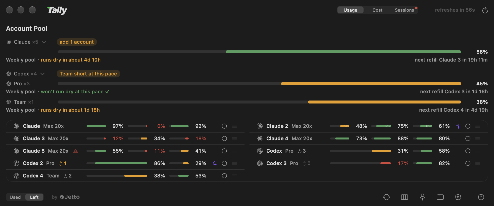
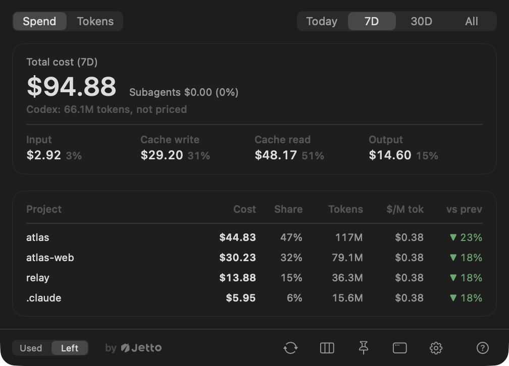

<p align="center">
  <a href="https://github.com/jettoai/tally/releases/latest"></a>
</p>
<h1 align="center">Tally</h1>

<p align="center"><b>為同時使用多個 AI 訂閱的人打造。</b></p>

<h3 align="center">你付費的每個 Claude 與 Codex 訂閱，在選單列一眼看完。<br>每個新 session 都從餘量最多的帳號開始。</h3>

<p align="center">
Tally 是免費、開源的 macOS 選單列 app，把你 Mac 上每個 Claude（Pro、Max）與 OpenAI Codex 帳號的 5 小時、每週與旗艦模型用量上限並排顯示，並讓每個新的 Claude Code 或 Codex session 從餘量最多的帳號開始。它透過官方的 <code>claude</code> 與 <code>codex</code> CLI 讀取用量：唯讀，只用於你自己付費的訂閱。
</p>

<p align="center">
  <a href="https://github.com/jettoai/tally/releases/latest/download/Tally.dmg"></a>
</p>

<p align="center">
  <a href="https://github.com/jettoai/tally/releases/latest"></a>
  
  
  
</p>

<p align="center"><a href="README.md">English</a> · <b>繁體中文</b> · <a href="README.zh-CN.md">简体中文</a> · <a href="README.ja.md">日本語</a> · <a href="README.ko.md">한국어</a></p>

<p align="center">
  
</p>

https://github.com/user-attachments/assets/75a92cf0-4724-4ffd-bd2b-8db5e10ba8dd

<p align="center"><sub>30 秒看懂 Tally。</sub></p>

<p align="center"><sub>免費開源 · by <a href="https://jetto.ai">Jetto</a> · Claude 與 Codex 額度的 macOS 選單列 AI 用量監控工具</sub></p>

## 為什麼是 Tally

如果你同時付費訂閱兩個 Claude Max 和一個 Codex 方案，你整天都在問：「哪個帳號還有餘量？」Tally 一次回答所有帳號，接著依答案採取行動。

### 1. 每個帳號，並排呈現

每個 Claude 與 Codex 登入各佔一行，帶著 5 小時、每週與旗艦模型額度窗；帳號池再把它們合成一份總預算，並預測照你的節奏何時用光（「約 4d 10h 後用光」）。選單列不用打開任何東西就顯示同樣的池：每個服務（或每種方案）一段，上面是工作階段、下面是每週，角落的小標記寫著它合計了幾個帳號、或是哪一種方案。想把帳號分開看時，到設定切換成一帳號一個標記。

<p align="center">
  
</p>

### 2. 每個 session 都落在餘量最多的帳號上

`tally claude`（或 `tally codex`）會把每個新 session 啟動在當下額度撐最久的帳號上，同時考量重置時間與剩餘百分比。帳號在對話中途撞到上限時，Tally 會在次佳帳號上續跑*同一段對話*；每次 `/clear` 都是一次免費搬家的機會；帳號快見底時，會在用它的每個 session 裡打上一行提醒。你或 AI agent 也可以從外面用 `tally session clear` 清空某個 session，新的空白視窗會直接開在餘量最多的帳號上。

```sh
tally claude          # starts on the best account right now
```

### 3. 所有執行中的 session，攤在同一塊看板上

Tally 啟動的每段對話都會變成一張卡片：帳號、模型、context 大小，以及它是工作中、閒置，還是**卡住在等你**。有 session 在要求權限時，選單列的紅點會提醒你；每張卡片也顯示那個 session 佔了機器多少資源（CPU、記憶體、佔住的 port）。這些數字直接向 macOS 核心讀取，不另外開 `ps` 或 `top` 行程。

<p align="center">
  
</p>

### 4. 看清 Token 花到哪裡

「成本」分頁的 Token 頁會統計今天、7 天、30 天或全部區間的輸入、快取與輸出 Token，依服務與專案拆分，每個專案附一整年的每日活動。資料讀自 CLI 自己的本機 transcript，永遠不離開你的 Mac。

<p align="center">
  
</p>

花費頁（分頁預設打開的那頁）把這些 Token 換算成金額：依 Anthropic 牌價計算每個專案的 Claude 用量，總額再拆成輸入、快取寫入、快取讀取與輸出。Codex 的 Token 會計入，但沒有換算金額，因為 Tally 沒有一份可信的 Codex 價目表。跑 `tally cost --json` 就能讓腳本拿到同一份數字。

<p align="center">
  
</p>

### 5. 唯讀，只用你自己付費的訂閱

用量透過各家自己的官方 CLI 讀取（`claude -p "/usage"` 與 `codex app-server`）。Tally 從不代理、共享或轉售存取權，從不記錄或傳送任何 token，而且是一個原生 Swift app、沒有 Electron，讀對話紀錄的核心用 Rust 寫。[它讀什麼，以及它會寫入的少數幾樣東西](#運作方式以及它絕不做的事)。

## 安裝

把這段話貼給你的 AI，它會自己裝好 Tally 並跑出結果：

```text
下載 https://github.com/jettoai/tally/releases/latest/download/Tally.dmg，
把裡面的 Tally.app 複製到 /Applications 並啟動。若 macOS 擋下這個 app，
先停下來告訴我從 Finder 開一次。接著若 /usr/local/bin 不存在就先建立，再用
`ln -s /Applications/Tally.app/Contents/Helpers/tally /usr/local/bin/tally`
把內附的 CLI 連到我的 PATH。等約 10 秒後執行 `tally`，把結果給我看。
若它顯示沒有任何帳號，告訴我先登入 Claude 或 Codex。
若某一步需要我的密碼，先停下來告訴我該執行哪個指令。
```

或自己安裝：

```sh
curl -fsSLO https://github.com/jettoai/tally/releases/latest/download/Tally.dmg && open Tally.dmg
```

也可以直接[下載 DMG](https://github.com/jettoai/tally/releases/latest/download/Tally.dmg)，把 **Tally.app** 拖進「應用程式」後啟動。它經過 Apple 公證，並在 app 內自動更新。接著在**設定 → 整合 → 全部安裝**一鍵加入 `tally` CLI、status line 訊號與 Claude Code skill。[更多安裝方式](#安裝選項)。

## 即將推出：Tally Pro 算力池

這台 Mac 埋頭跑測試套件的時候，你其他的 Mac 與 Linux 主機都閒在一旁。Tally Pro 會自動把重活（完整測試套件、release 建置、訓練工作）送到你自己的其他機器上，再把輸出串流回來，讓你正在打字的這台 Mac 保持流暢。

<p align="center">
  
</p>

<p align="center"><sub>Watch 這個 repo，上線時就會收到通知。</sub></p>

## 功能

### 儀表板

- **多帳號優先。** 每個 `~/.claude*` 登入與 Codex 安裝各自一張卡，N 個帳號並排呈現，
  不是單帳號 fallback。卡片可拖曳排序，順序套用到所有介面。
- **帳號池。** 每個 provider 的帳號合併成一條量表：連續 bar 代表合併後的每週預算，總量
  用帳號份數表達（「剩 2.9/5」），加上下一筆錯開回充。預測會依你近期實測的節奏估算這個
  池子還能撐多久，並把每次重置補回的額度算進去：超支時顯示「約 4d 10h 後用光」，沒超支時
  顯示「照目前速度不會用光 ✓」。
- **用量顧問。** 需要再多開一個帳號嗎？儀表下方每個 provider 各一行：每個你擁有的帳號
  對應一個實心圓點，實測節奏要求再開一個時顯示空心圓點，並標出可直接讀出的每週實際需求
  數字（「5.8 acct/wk」）。橫跨兩種方案的艦隊會依方案分開顯示（「Pro 1.7・Team 0.9」），
  因為一個 200 美元方案帳號週和一個 20 美元方案帳號週不是同一種量，合併計算只會產生一個
  對不上任何訂閱方案的數字。滑鼠懸停可看依方案拆分的明細、目前燃燒速率、斷糧時數與下一批
  回充；`tally status --json` 會用 `tierDemands` 發布同一份拆分。
- **選單列 strip。** 預設每個服務一段，把該服務的帳號合計成帳號池畫的同一個池，徽章標示
  這一段代表幾個帳號；想把帳號分開看，可切換成一帳號一個標記。兩種模式都是工作階段疊在
  每週之上，滑鼠懸停會列出帳號、完整數字，以及沒進池的帳號是誰。
- **可釘選的毛玻璃面板。** 把儀表釘成永遠置頂的毛玻璃視窗，拖曳標題列放到任何位置。帳號卡片
  本身也會在面板背景之上以玻璃質感呈現（你關掉半透明、或系統要求降低透明度時，改為不透明）。
- **卡片，或每帳號一行。** 帳號超過六個左右，卡片格線就會撐爆畫面，所以面板還有第二種
  密度：每個帳號一行，識別資訊在左側，每個額度窗都畫成一條小 bar 加數字，啟動控制縮成
  圖示。它藏起來的是文字、不是資訊，所以窗名稱、重置時間與每個控制項的作用都移進 hover
  提示（Tally 自己畫在面板的玻璃上，不等系統 tooltip）。每種密度各自記住自己的欄數，清單
  密度的「自動」固定一欄，額度條拉長填滿整列。
- **版面隨你安排，一次一張卡。** 頁尾的檢視選項卡用版面圖磚設定密度與欄數（每個圖磚直接
  畫出它產生的版面）、開關帳號池與用量顧問，把 provider 收折到自己的儀表底下，也能開啟
  「依服務分組」讓卡片各自落在所屬 provider 的區塊裡，區塊內一樣可拖曳排序。收折的
  provider 會留著標題，這也是它回來的辦法。艦隊高過螢幕時會改成捲動，而不是掉出畫面外。
- **Token 用量，依專案拆分。** 每個介面的「成本」分頁裡都有一頁 Token：今天／7 天／
  30 天／全部區間的 Token 總計，附輸入、快取與輸出分項、依 provider 的拆分，以及一張專案表，
  連 agent 與 workflow 的工作階段都會追溯回它服務的專案。點一列專案，就會展開成一整年的
  每日活動，一張依該專案自身量級分級、貢獻紀錄風格的熱力圖，每天的總計只要滑鼠懸停就能
  看到。資料讀自 CLI 自己的本機 transcript，經增量快取彙整（沒有新資料時重新整理遠低於
  一秒），而且永遠不離開你的電腦。同一分頁預設的「花費」頁依 Anthropic 牌價把這些 Token 換算成
  各專案的金額，附輸入／快取寫入／快取讀取／輸出的花費組成；`tally cost --json` 把同一份
  數字交給腳本。
- **每個窗自己的重置時間。** 點任何重置文字，全部在「2d 4h 後重置」與「07/18 20:00 重置」
  之間切換。
- **登入狀態一目了然。** 滑鼠懸停在卡片上就能看到該帳號登入的 email。已登出的帳號會顯示
  紅色標籤並發送通知；需要 `/login` 的工作階段會有獨立警示，可直接開啟該工作階段。
  若能取得 Claude 登入期限，Tally 會在到期前三天內及到期後提醒。點選更新登入後，由服務的
  官方 CLI 在背景執行登入，搭配瀏覽器授權（看得見的終端機視窗是備援方案）；
  這個登入流程不會由 Tally 直接修改憑證。
- **不用離開 app 就能新增帳號。** 設定會先備好下一個帳號的設定目錄，預設提供共用主帳號的設定
  （一套設定服務所有帳號）並附上白話的隱私說明，接著跑同一套安靜登入；瀏覽器把結果交回來時，
  新卡片就會出現。已經有的帳號也能事後加入同一套共用設定（`tally share`，或設定裡的那一列）：
  對話、inbox 與記憶筆記會併進主帳號，什麼都不刪（擋路的東西會被改名、留在原地），那一列
  也白話寫明共用的意思：從此每個帳號都讀得到每個帳號的對話。
- **Codex 額度重置存量，看得到也能兌換。** 累積的額度重置會直接顯示在卡片上（「3 枚額度重置
  可兌換」），讓你在撞牆前就知道自己還有幾條退路。點一下就能兌換一枚，兌換前會跳出確認
  視窗，指名帳號、列清楚成本，並在兌換多半會浪費時提出警告；最快到期的額度優先花。帳號的每週額度
  用完時，Tally 也能自動兌換最快到期的那一枚並通知你（設定裡的開關，預設開啟）。


### session 看板

- **每一段對話，都在同一塊看板上。** 標題列切換的第三個位置，就排在「用量」與「成本」
  旁邊：每一段受監督的 session 各一張卡片，寫明它是什麼（帳號、模型、effort、跑在哪個
  worktree）、現在正在做什麼，以及對話已經長到多大（「142k context」）。四種狀態由 session
  自己的 supervisor 發布，而不是從外面猜：工作中、卡住、閒置，以及沒有夠新的回報時誠實寫出
  的「未回報」。點一張卡片，Tally 就把那個 session 的終端機帶到最前面。我們建議搭配 Ghostty
  使用（Tally 就是圍繞它打造的）：跳轉靠 session 自己的 tty，精準落在那個分頁上；其他終端機
  目前只會把整個 app 帶到前景，更多終端機的分頁級跳轉在待開發清單上。
- **卡住就是它在等你。** 唯一需要人介入的狀態：Claude Code 跳出權限請求、提問或計畫確認
  而沒人回答時，卡片會亮起紅邊、開始計時等待，滑鼠懸停直接寫明它要什麼（「Claude needs
  your permission to use Bash」）。摘要列統計整塊看板的工作中／卡住／閒置／未回報，而且
  只有「卡住」那個數字會上色，也只有它大於零時才上色。
- **面板關著也看得到紅點。** 只要有任何 session 在等你，選單列 strip 就會長出一個小紅點，
  一個都不剩時立刻收掉；滑鼠懸停會說有幾個。
- **每段 session 佔了機器多少。** 每張卡片保留該 session 底下整棵行程樹最近十五分鐘的紀錄：
  CPU、記憶體與行程數各一條 sparkline，附目前數字與這段期間的峰值，並指名吃最兇的那個
  （「(bun)」、「(Google Chrome Helper)」），加上它派出了幾個 subagent、佔住哪些 port
  （就是你下一次 `pnpm dev` 會撞到的那些），以及寫入磁碟的速度。警示看的是「對不對得上」
  而不是「大不大」：build 到一半的 session 吃掉 300% 的核心就只是在 build，同樣的燃燒發生在
  回合結束二十秒後就是殘留，會拿到一個琥珀色註記；吃掉機器大半記憶體的 session 會拿到紅色
  註記，而記憶體要有兩個證人（行程樹自己的數字，加上核心回報的壓力值）Tally 才敢這樣說。
  任何讀數都要持續好幾秒才會變成警示，所以一次 GC 停頓永遠不會閃紅。用量儀表讀的是額度，
  看不到每個執行中的 session 佔了機器多少資源。
- **一塊你學得會的看板。** 依狀態排序只在看板打開的那一刻決定座位，之後就定在那裡（一塊
  每秒重排兩次的看板，沒有人學得會）；拖動任何一張卡，順序就變成你的。篩選可以只看已連線
  的 session、也可以全部顯示，未回報的會變暗但仍然點得動；看板還記住自己的欄數，與儀表板
  的分開算。


### 啟動控制平面

- **智選。** 新 session 一律啟動在「當下燒錢速率最高」的帳號上：用剩餘百分比除以到重置的
  時間，橫跨 5 小時、每週、旗艦模型三個額度窗計算。快要重置的額度優先燒（放著不用就蒸發）；
  得撐好幾天的額度會被留著；設有遲滯機制，避免噪音等級的差異讓你在帳號間跳來跳去。面板徽章
  標出目前的選擇，理由寫在 tooltip 裡。
- **每個 provider 三種模式。** 智選（每次啟動都由演算法決定）、手動（卡片上的圓圈可以
  釘住一個帳號；點勾勾就會釋放回智選，即時生效，連正在跑的 session 也適用）、關閉
  （純儀表板，不介入啟動）。
- **session 中途接手。** 撞到用量上限時，tally 在餘量最好的下一個帳號上續跑*同一段對話*
  （內建 10 分鐘 3 次熔斷，可用 `--no-handoff` 或 `TALLY_AUTO_HANDOFF=0` 關閉）。若伺服器
  悄悄把你的模型降級，會優先切到還能提供原本模型的手足帳號接手對話，只有在沒人能提供時，
  才會套用你設定的 fallback 配對。不緊急的切換會等到回合之間的空檔再做。
- **視窗邊界是免費的搬家機會。** 你打下 `/clear` 的那一刻，對話是空的：沒有回合會被打斷、
  沒有 context 要重載、沒有東西可以損失。所以 Tally 會在那一刻再問一次帳號的問題，改成
  一件工作問一次、而不是一次啟動問一次，並在目前這個帳號快見底時，把全新的視窗搬到餘量
  最多的帳號上。觸發依據是事實、不是猜測：Claude Code 自己的 status line 會回報新的對話
  id，所以被提示吞掉的 `/clear` 不會搬動任何東西。
- **提早開窗。** 5 小時窗要等你送出東西才開始計時，所以一天的第一次重置會落在你坐下之後
  五小時，而每一次停頓都把下一次往後推。只要某個 Claude 帳號的窗是關著的，Tally 就透過
  官方 CLI 送一則短訊息把它打開，並釘在最便宜的模型上，讓時鐘在你睡覺時也在走、重置落在
  你一天裡更早的時間。每個帳號每 5 小時最多一則，已經在工作的帳號不會被打擾，另有選用的
  安靜時段讓它整夜不出聲。它從不碰任何憑證，第一則訊息送出前會先告訴你一次，設定列則記著
  這一天誠實的帳：有幾個帳號開了窗、幾個是刻意略過的、幾個開不起來。
- **快用完的帳號會自己說出來。** 當一個帳號的瓶頸額度窗掉到 15% 以下，Tally 會在它底下
  每個 session 的輸入框打上一行，指名是哪個窗卡住、什麼時候回充、有幾個 session 在分它，
  以及哪個手足帳號還有餘量：「收個尾換帳號，或等它重置。」若所有帳號都沒有餘裕，它就誠實
  地這樣講。要回到 30% 才會重新上膛，所以在門檻上下徘徊的帳號只會講一次；而快要重置的窗
  算作滿的，因為為了一份馬上就要回充的額度把你叫停，是在跟你作對。
- **叫一個正在跑的 session 做事。** `tally type claude "<文字>" --project <專案名>` 會把一行送到
  那個位址指名的確切受監督終端機，不會使用前景視窗。`type` 後面那個字說明要找的是哪一種
  session，所以同一個 checkout 裡並存一個 Claude、一個 Codex 時，光靠 provider 就定得到址；指到
  另一種的會被拒絕，不會照打進去。`--project` 除了路徑，也接受裸專案名（啟動目錄的最後一段）；
  人已經在那個目錄裡時可以整個省略。同一個目錄裡同一種 session 有兩顆時，會列出兩個 pid 拒絕
  送出，不用猜的。`tally session send "<文字>" --session <pid>` 是同一個 send，改以
  `tally status --json` 列出的 supervisor 或 child PID 定址。Claude 保留既有的 send 與 clear 行為。
  Codex session 只有在 Tally 已取得受信任的
  原生綁定、驗證對應終端機，並觀察到原生回合完成後，才會宣告 `send`。Codex 只接受非空白的
  一般 prompt，不接受 slash command、shell mode 或單獨的 Return。它在工作中、被阻擋、狀態未知、要求權限，
  或有人可能正在打字時會排隊，15 分鐘後到期。終端機安靜卻有無法解釋的輸入時會立即拒絕：請在
  該 Codex session 輸入真正的 prompt，等它完成後再重試，單純清掉 composer 無法建立安全邊界。
  只有 Codex 發出相符的新使用者訊息才算送達確認。終端機已寫入但未確認時會標示 `unconfirmed-input`，
  不會自動重送，包含自訂 Enter 鍵對應。僅供監看的 Codex session 須先結束，再用
  `tally codex resume <UUID>` 恢復。當它只指定一個確切 UUID、沒有明確 prompt、已安裝 Tally
  status hook，且由 Tally 透過私有 TTY 啟動時，Tally 會送出一則可見的原生初始化 prompt，不需要人工
  bootstrap prompt。它會用掉一個 model turn 和訂閱額度，不會自動重試，也不保證零工具執行，因為 prompt 指令不是強制機制。呼叫端提供的
  prompt 與所有其他 resume 形式都維持原樣。啟動期間的人為輸入仍會保留為 draft-held。這條路徑仍須有受信任
  的原生綁定、確切終端機、完成的原生回合與相符 receipt，Codex 才會宣告 `send`，不會略過原生信任。
  請求上限為 200 UTF-8 bytes，已處理或拒絕的結果會記錄在本機 `~/.tally/logs/input.log`。`tally session
  clear` 仍是 Claude 專用的獨立控制，可將清空的 session 改開到較健康的帳號。
  `tally message claude "<文字>" --project <專案名>` 則是把一則原生訊息送進那段對話，全程不碰鍵盤；
  它答不了 dialog，而且兩個指令都不是收訖回執。
- **平行的工作線。** `tally claude -w <名稱>` 會在 git worktree 裡開 session，需要時建立
  `../<repo>-<名稱>`、把專案的 Claude 記憶連過去，並執行該 repo 自己的 setup 腳本；只打
  `-w` 會列出既有的工作線讓你挑。`tally worktree tree / list / root / remove` 負責照看
  它們，`remove` 會乾淨地收掉一條已合併的線：結束該線的所有 session、移除 worktree 與
  分支，除非你另外交代，否則 transcript 一律保留。
- **把一段對話，或一個 repo，釘住。** `tally account <名稱>` 會在目前回合結束時，把你執行
  它的那個 session 搬到另一個帳號、對話原封不動，並一直留在那裡，直到 `tally account
  --auto` 放開它。`tally model <模型> [effort]` 讓這一段對話終生跑在那個模型上，撐過每一次
  重啟（額度接手、重載、app 更新），這是 Claude Code 自己的 `/model` 在 supervisor 從自己
  的命令列重啟之後給不了的保證。`tally project set --model <m> [--account <n>]` 宣告這個
  repo（以及它的每一個 worktree）啟動時用什麼；app 的預設值會讓位給它，而你自己打的旗標
  又贏過它。在 Claude Code 裡面，隨附的 `/tally` 指令可以切換帳號或模型而不用喚醒模型，
  `/tally-account` ／ `/tally-model` 不帶參數則會叫出 app 自己畫的原生選擇面板：一份清單、
  點一下，答案就回到 CLI。
- **設定改一次，所有 session 重載。** `tally reload` 會讓每個受監督的 session 在下一個安靜
  時刻重新啟動，於是改過的 hook、skill 或 CLAUDE.md 不必你逐個終端機走一遍，就能送到每一個
  開著的視窗。對話會留著（重啟走的是與額度接手同一條 resume 路徑），正在串流或正在被打字
  的 session 不會被動到，而反正都要重啟的 session，也順便從快見底的帳號上搬走。
  在某個 session 裡跑 `tally reload --self`（你或它的 agent 都行），只會重啟那一個 session：
  在當前這一輪結束後，模型與帳號都不變。
- **啟動預設值，就在設定裡。** 預設權限模式、啟動模式（continue 或 new）、模型與 reasoning
  effort 綁成一組，另外還有一組獨立的 fallback 配對（fallback 模型＋自己的 effort＋額外
  旗標）。只在你沒自己打旗標時才會注入：你自己下的參數永遠優先。
- **模型改一次，所有 session 跟著換。** 把預設模型或 effort 指到別處，每個執行中的受監督
  session 都會在下一個安靜時刻跟進、接續同一段對話；不用逐個 terminal 打 `/model`。
  你自己打的模型或 effort 永遠不會被碰，`--no-follow` 可讓單一 session 退出跟隨。
- **Shell 整合。** 一鍵安裝 PATH shim，讓連裸的 `claude` / `codex` 指令都遵循你的啟動策略；
  一鍵移除，乾淨不留痕跡。
- **Status line 整合。** Claude Code 的 status line 會多一個紫色 ✦ Tally 訊號（代表這個
  session 跑在 Tally 底下）、目前使用的帳號名稱，以及這個 session 正在跑的模型與 effort；
  選擇開啟完整額度線後，整條額度線會用 app 同款色板呈現：進度條、百分比與重置倒數，涵蓋
  5 小時窗與這個帳號的每週預算，並跟隨面板的「已用量／剩餘」切換。合池後的艦隊視圖留在
  app 與 `tally status`，那裡才有空間好好呈現。
  既有自訂的 status line 會原封不動繼續執行、只是後面多接一段訊號；移除時逐位元組還原成
  原樣，就算你不解除安裝直接刪掉 Tally 也照常運作。
- **Claude Code skill。** 一鍵把一個小 skill 放進每個 Claude 帳號的 skills 資料夾，讓 agent
  session 學會從 `tally status --json` 回答額度問題、挑選帳號（也會在重度多 agent 工作開跑前
  先確認瓶頸額度窗）；移除時同樣乾淨不留痕跡。同一次安裝還會加上 `/tally` 指令，並註冊
  原生選擇面板背後的 MCP server。
- **`tally` CLI。** 啟動：`tally claude [參數…]`、`tally claude --account <名稱>`、
  `tally claude -w <名稱>`（worktree）、`tally resume`（把目前目錄最新的一段對話搬到另一個
  帳號）、`tally add <provider>`（再登入一個帳號：自動挑下一個空編號、設定目錄也幫你建好；
  主帳號那一套設定，CLAUDE.md/AGENTS.md、skills、hooks、agents、設定與對話紀錄，預設就會
  用符號連結接進來，一套設定服務所有帳號，加 `--no-share` 可退出）、`tally share`（把你
  已經有的帳號放上同一套設定）。查看：`tally status`（加上 `--json` 會輸出版本化的機器
  可讀報告：每個帳號的額度窗與重置時間、現在啟動會落在哪個帳號，以及每個受監督的 session
  正在跑什麼，可直接餵給你自己的腳本、hook 與 agent skill）、`tally worktree tree|list|root`、
  `tally best-dir <provider>`。操控：`tally account`、`tally model`、`tally project`、
  `tally type|message <claude|codex>`、`tally session send|clear`、`tally reload`。維護：`tally update`、`tally completion zsh`、
  `tally worktree remove`。全部對腳本友善。

- **Harness 工具。** 在設定 > 整合 > Harness，一次安裝或移除兩邊的
  Tally harness skill 與離線信箱提醒。之後可請任一助理適配目前專案或使用者設定的
  harness。安裝工具本身不會變更專案規則，原生 hook 信任需另行確認。
  詳見 [harness 指南](docs/harness.md)。

### 介面與細節

- **五種語言。** English、繁體中文、简体中文、日本語、한국어，app 內即時切換。
- **原生。** Swift 6 + SwiftUI + AppKit，沒有 Electron。唯一的第三方依賴是
  [Sparkle](https://sparkle-project.org)（macOS 標準更新框架），app 和 CLI 各一個 binary。

## 運作方式（以及它絕不做的事）

- **透過官方 CLI 取得用量。** 用量透過各家**官方 CLI** 讀取（`claude -p "/usage"` 與
  `codex app-server`），由官方客戶端向原廠驗證身分並管理憑證。帳號偵測會檢查登入屬性。
  一個唯讀例外是 Claude 登入期限資料：Tally 會暫時讀取 Keychain 中的本機憑證文件，
  若 Keychain 項目不存在，則讀取 `.credentials.json`，從中取得 `refreshTokenExpiresAt`。
  這個讀取程序只會回傳日期；它不會記錄、持久保存或傳送 token，也不會刷新登入或修改憑證。
- **唯讀，只有一個明確例外。** `claude auth login` 完成 OAuth 流程後就停手，所以 Tally
  幫你新建並登入的設定 home，第一次啟動時仍會撞見首次執行精靈：主題選擇，以及要求你登入
  剛剛才登入的那個帳號。所以在 Tally 自己驅動的一次登入之後（新增帳號，或從卡片續簽），
  它會把 Claude Code 自己記錄「精靈已完成」的那個欄位 `hasCompletedOnboarding` 合併進
  那一個 home 的狀態檔，Tally 新建的 home 也會預先帶入你在既有帳號上已經回答過的資料夾
  信任答案。只合併，絕不整份覆寫；解析不了的檔案會直接拒寫，而不是被改寫；已經跑過精靈
  的 home 會原封不動、逐位元組保留。永不碰憑證，也永不掃描其他 home 去修補。
- **永遠只有一個輪詢者。** 只有選單列 app 會執行 CLI（預設每 1 分鐘，可放寬到 2／5／15 分鐘）。
  `tally` 啟動器只讀本機快照（`~/.tally/snapshot.json`，只有百分比和路徑、絕無 token），
  開十個終端也不多讀一次。
- **只碰你自己的帳號。** 多帳號指的是*你自己*付費、在*你自己*機器上的訂閱。Tally 不代理、
  不共享、不轉售存取權；切換帳號只是用你本來就擁有的 config 目錄啟動官方 CLI。
- **本機為主，錯誤回報可選、預設關閉。** 除了用量讀取本身、下面的匿名使用統計，以及你在設定裡
  打開「傳送當機與錯誤回報」後送到 Sentry 的錯誤回報，沒有任何東西離開你的機器。錯誤回報含
  錯誤堆疊、App 與 macOS 版本、Mac 機型、語系與時區，以及 Sentry 由連線推得的大致地區；
  絕不含 IP、帳號、用量數字或檔案內容。在同一處可隨時關閉。
- **匿名使用統計，預設開啟。** Tally 啟動時與執行期間約每天一次，把隨機裝置碼、App 版本與版本別
  （Tally 或 Tally Pro）送到 jetto.ai，用來計算安裝與使用人數。絕不送你的帳號、用量數字、專案名稱
  或檔案內容。和任何網路請求一樣，伺服器會看到你的 IP 位址與標準的 User-Agent 標頭。在設定 > 關於
  關閉「傳送匿名使用統計」，之後就不再傳送任何東西。
- **給整合用的小型 API。** 儀表板與腳本透過 `tally` CLI 與 Tally 溝通；沒有 socket 或伺服器可連。
  - `tally status --json` 是讀取端：每個帳號剩餘的額度窗與重置時間，外加 `sessions`，
    每個受監督的 session 一筆，帶有它的 `pid`、`project`、`state`、`model`、`effort` 與
    `taskList`（它寫入的任務清單）。報告帶有 `"version": 1`，而且只加不改：之後版本可能新增
    欄位，既有欄位永不消失或改變意義。
  - `tally session send <text> --session <pid>` 會把一行文字打進該 session 並按下 Return；
    `tally message claude|codex <text> --session <pid>` 則把訊息交給該 session 自己的傳輸通道，
    不按任何鍵。

## 需求

- macOS 14+
- 已登入的 [Claude Code](https://claude.com/claude-code)，額外帳號就是多一個 config 目錄
  （`CLAUDE_CONFIG_DIR=~/.claude2 claude` 登入即可），與／或
- 已登入的 Codex CLI（`~/.codex`）

## 安裝選項

從 [Releases](https://github.com/jettoai/tally/releases/latest) 下載最新的公證 DMG，
把 **Tally.app** 拖進「應用程式」後啟動即可，之後的更新會在 app 內自動送達。

要使用 `tally` CLI，把 app 內建的那份連結到 PATH：

```sh
ln -s /Applications/Tally.app/Contents/Helpers/tally /usr/local/bin/tally
```

<details>
<summary>或從原始碼建置</summary>

```sh
brew install xcodegen   # 一次性
git clone https://github.com/jettoai/tally && cd tally
xcodegen generate
xcodebuild build -project Tally.xcodeproj -scheme Tally -configuration Release -destination 'platform=macOS'
xcodebuild build -project Tally.xcodeproj -scheme TallyCLI -configuration Release -destination 'platform=macOS'
```

把 `Tally.app` 從 DerivedData 移到「應用程式」，並把 `tally` 放進 PATH：

```sh
ln -s <build-products>/tally /usr/local/bin/tally
```

</details>

或者跳過符號連結：**設定 → 整合** 裡每一項都是一鍵安裝、一鍵乾淨移除，
上方還有一個「全部安裝」開關管住整組：CLI 工具、shell shim（讓裸的 `claude` / `codex`
也遵循你的策略）、status line 訊號、session 看板的通知 hook、subagent 計數 hook、額度警示
hook，以及帶著 `/tally` 指令的 Claude Code skill。每一列 hook 都給同一個承諾：你原本註冊在那個事件上的東西照常執行，
移除時也只拿掉 Tally 自己那一筆。把既有帳號接上共用設定在這裡也有一列，但刻意不納入
「全部安裝」：那一項會在 config home 之間搬動對話，而一個意思是「全部打開」的按鍵，
未必也代表那件事。

shim 和 `tally claude` 的差別：裝了設定頁的 shim，而且 Claude 那列的「啟動帳號」沒有選「關閉」，直接打 `claude` 也會先幫你挑帳號。`tally claude`（也就是下面的 `c` 和 `cc`）多做兩件 shim 做不到的事：撞到用量上限時，對話自動接到別的帳號繼續，暫時沒有別的帳號有額度就停在原處、每 15 秒重試一次；`--continue` 照對話 id 接回 Tally 在這個目錄最後看著的那段對話，也就是最近一次用 `tally claude` 跑的那段；這個目錄沒有這筆紀錄、或那段對話已經不在時，才改接回目錄裡最新的一段，不管它是怎麼開的。

可選的 shell 捷徑：

```sh
alias c='tally claude'
alias cc='tally claude --continue'
```

## 在地化

Tally 內建 English、繁體中文、简体中文、日本語、한국어，設定頁即時切換、免重啟。
所有字串集中在單一 Xcode String Catalog
（[`Tally/Resources/Localizable.xcstrings`](Tally/Resources/Localizable.xcstrings)），
新增語言就是「多填一欄」的單檔 PR。標準是「讀起來像作業系統原生文案、不像翻譯」；
修正既有語言與新增語言一樣歡迎。

## 參與貢獻

歡迎 issue 與 pull request。開發環境照上方「從原始碼建置」，另有兩條讓專案保持健康的慣例：

- `project.yml` 是唯一真相來源；`Tally.xcodeproj` 由 XcodeGen 產生、永不手改。
- 新增使用者可見字串一律走 `L("…")` helper 進 String Catalog，五種語言一次填齊。

每個 PR 保持單一意圖，並把「為什麼」寫進描述。

## 常見問題

**怎麼在 macOS 選單列同時看多個 Claude Max 帳號的額度？**
讓每個帳號各自登入 Claude Code，各用自己的設定資料夾（例如
`CLAUDE_CONFIG_DIR=~/.claude2 claude`，再登入）。Tally 會找出每一個 `~/.claude*` 登入與每一個
Codex 安裝，每個帳號各佔一列顯示 5 小時、每週與旗艦模型視窗，並把同一家的帳號合成一個餘量池
顯示在選單列。

**Tally 是 proxy 或帳號共享工具嗎？**
不是。Tally 不介在 Claude Code 與 Anthropic 之間，也不代理、不共享、不轉賣任何存取。它透過官方
CLI 讀取每個帳號的用量，`tally claude` 則用餘量最多那個帳號的設定資料夾啟動官方 CLI。每個帳號
都是你自己付費訂閱、跑在你自己的 Mac 上。

**Tally 跟 ccusage 或其他用量工具有什麼不同？**
[ccusage](https://github.com/ryoppippi/ccusage) 這類工具是終端機 CLI，從本機 log 估算 token
花費。Tally 是原生選單列 app，顯示廠商實際強制的額度視窗（5 小時、每週、旗艦模型），一次涵蓋
每個 Claude 與 Codex 帳號，還附一個依這些數字行動的啟動器。Token 視圖也把「我到底燒了多少、
燒在哪」這題一併涵蓋，依專案拆分，直接讀本機 transcript，不做金額猜測。而 session 看板又比
ccusage 與其他用量儀表再深一層：每一段執行中的 session 都是
一張卡片，誰卡住在等你、每一段又佔了機器多少資源，細到是哪個行程佔著記憶體。唯讀，
只用於你自己付費的訂閱。

**Tally 跟 CodexBar、Claude Usage Tracker、Usage4Claude 有什麼不同？**
截至 2026 年 10 月，它們都是原生選單列儀表，其中幾個現在也能顯示多個帳號。Tally 多做的是：
只透過官方 `claude` 與 `codex` CLI 讀取用量，所以不需要提供 session key 或瀏覽器 cookie；
把每一家的帳號合成一個餘量池，並預測以你目前的速度何時用完；`tally claude` 依剩餘額度與重置
時間替每個新 session 選帳號，某個帳號撞到上限時，在下一個帳號接續同一段對話。CodexBar 涵蓋
更多服務（Cursor、Copilot、Gemini 等），如果你是用同一個帳號跨多個 AI 工具，它可能更適合你。

**Tally 如何存取 Keychain？**
用量透過官方 CLI 取得，帳號偵測只檢查屬性。Claude 登入期限的讀取程序也會讀取憑證文件，
但若事前檢查發現 Keychain 已鎖定，或無法確認讀取程序受到信任，就會略過存取，期限維持未知。
檢查與讀取之間 Keychain 狀態仍可能改變，因此仍有可能出現授權視窗。
登入仍交由官方 CLI 執行，Tally 的登入流程不會直接修改憑證。

**所有帳號都滿了會怎樣？**
不會有戲劇性後果：儀表照實顯示，`tally claude` 警告後直接裸啟動官方 CLI，
自動接手則原地不動、不會空轉迴圈。

**自動接手會弄丟我的對話嗎？**
不會：它在下一個帳號上續跑同一份 session 紀錄（只新增、原始紀錄永不被修改）。
被中斷的工具呼叫可能會在切換後重跑一次。

**status line 整合會弄壞我自訂的 status line 嗎？**
不會。你自己的指令會照原樣繼續執行，餵進同一份 session JSON；Tally 只是在後面加一段
訊號，如果你已經顯示帳號名稱就會跳過那部分，移除時逐位元組還原成原本的註冊，就算
tally 這個 binary 哪天不見了，也會直接 fallback 回執行你原本的指令。

## 致謝

Tally 走在幾個優秀專案開出的路上：

- [ccusage](https://github.com/ryoppippi/ccusage)：最早把 Claude Code 本機日誌變成用量洞察，
  證明了開發者有多想看到自己的數字。
- [OpenUsage](https://github.com/robinebers/openusage) 與
  [AIUsage](https://github.com/sylearn/AIUsage)：確立了選單列儀表一眼看用量的形式；
  Tally 的存在，是因為我們想把這一眼同時看遍多個帳號。
- [Sparkle](https://sparkle-project.org)：驅動 app 內自動更新。

## 授權

[MIT](LICENSE) © [jetto](https://jetto.ai)
